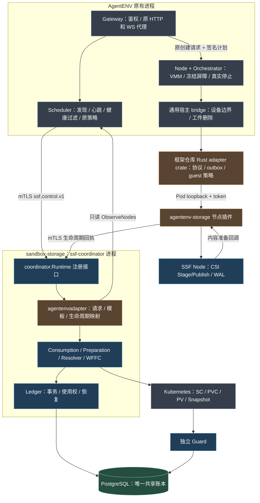
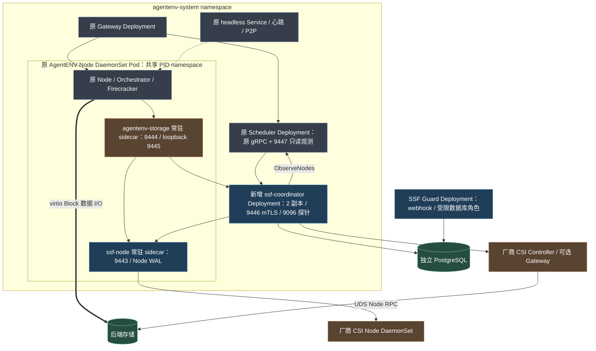
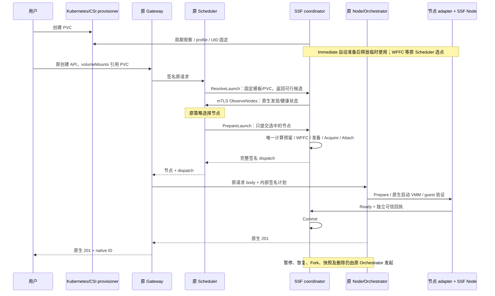

# Kubernetes 原生卷管理与 Substrate 模式沙箱消费设计

SSF 使用 Kubernetes StorageClass、PVC、PV 与原生 CSI 配套组件作为唯一卷管理体系；沙箱消费参考 Substrate 的直接调用设计与实现。公共消费协调模块由 `sandbox-storage` 的独立 `ssf-coordinator` 承载，原项目保留计算调度与生命周期入口；Node Agent 调用 CSI Node，项目 Runtime Adapter 接入 VMM/guest。CSI 协议不变，业务数据不经过消费协调模块。

2026-10-21 设计修订：运行时 adapter 分为“供卷定制准备”和“沙箱内部挂载”，延续 [21：卷管理与两部分 Adapter](21-ssf-volume-provisioning-and-runtime-adapter-design.md) 的数据语义。用户通过 Kubernetes 创建 PVC，再调用原沙箱接口直接引用；不以原项目卷登记或手工初始化为前提。本轮将公共执行边界从原 Scheduler 移至独立服务，保留原 Gateway/Scheduler/Orchestrator 和生命周期；最新实现、构建和验证状态见 [26](26-independent-coordinator-implementation.md)，[22](22-volume-preparation-implementation.md) 为此前自动准备实施记录。

## 1 目标和范围

首期支持静态/动态供卷、Immediate/WFFC、文件/块卷、普通 VM/microVM、创建销毁、pause/resume，保持 Cube Reference/Share 与 AgentENV Capture/Clone 等语义。Linux 为节点环境；管理面要求 Kubernetes API，计算节点可使用 Pod 内项目进程或经认证的宿主服务，不要求沙箱本身成为 Pod。

供卷、管理快照/克隆、Controller 扩容与后端回收通过原生资源实现。SSF 增加卷内容准备编排、独立消费者的选点桥、使用授权、直接 Attach/挂载、引用保护与恢复；不实现第二套后端供卷 Provider。项目 Volume API 是可选 Kubernetes facade，不是沙箱使用 PVC 的必经入口。

正常挂载不通过创建消费者 Pod、Holder Pod 或 Binding CRD 等待调谐，不依赖 kubelet Volume Manager。WFFC 首次供卷/绑定仍等待原生完成；后台恢复与 GC 保留。rootfs、内存镜像、P2P 缓存暂不重写，热插拔/迁移和跨后端原子事务不属首期保证。

## 2 架构与公共模块

### 2.1 关键模块与代码归属

当前 AgentENV 采用独立公共协调服务。Consumption、Preparation、Ledger 及 `ssf-coordinator` 入口全部属于 `sandbox-storage`；原项目只保留轻量客户端和必要宿主 hook。共享账本数据位于 PostgreSQL，Guard 是独立 Pod。



[可编辑图源](figures/ssf-independent-modules.mmd)

### 2.2 完整部署视图



[可编辑图源](figures/ssf-independent-deployment.mmd)。该部署保留原 Gateway/Scheduler/Node，不新增公开沙箱控制面。其他运行时可以实现同一注册接口；独立服务与内嵌消费模块不得同时拥有执行权。数据库使用原生 PVC 或外部数据库，不依赖沙箱卷启动。

### 2.3 完整模块调用视图



[可编辑图源](figures/ssf-independent-calls.mmd)。标准 CSI Controller 不调用 Node Service，实际 I/O 不经过协调服务或 PostgreSQL。计算策略由原 Scheduler 执行，服务只持久预留选中的节点。

### 2.4 组件职责

| 组件 | 部署归属 | 职责 |
| --- | --- | --- |
| API Server / PV Controller | 原有控制面进程及内部模块 | 卷资源、绑定与生命周期权威 |
| external-provisioner / Controller Driver | 原 CSI Controller Pod | 唯一动态 Create/DeleteVolume、clone 供卷 |
| snapshot / resizer 组件 | 按需启用的官方组件 | 后端快照与 Controller 扩容 |
| PVC/PV Resolver | 公共库；AgentENV 在 `ssf-coordinator` 内运行 | 解析真实资源、身份/绑定/能力/拓扑/凭证引用、保护校验 |
| VolumePreparation Coordinator | 公共库；AgentENV 在 `ssf-coordinator` 内运行 | 周期 List/Reconcile 受管 PVC、执行 adapter 内容准备、维护准备权/证据、自动就绪；不另调 CreateVolume |
| Consumption Coordinator | 公共库；AgentENV 在 `ssf-coordinator` 内运行 | 同步 step runner、使用授权、writer/node pin、Attach、排空与恢复 |
| DelayedBinding | Coordinator 内公共模块 | WFFC 联合选点、计算 lease、动态桥/静态绑定、结果确认 |
| Controller Registry/SessionManager | Coordinator 内公共模块 | 端点、身份、能力、revision、长连接；仅消费 RPC |
| Admission Guard | 默认独立新增 Deployment | 校验使用/删除/迁移许可、阻止冲突消费者与破坏性更新 |
| Controller Gateway | 可选新增容器，同 CSI Controller Pod | 认证、operation/owner；副作用仅Attach/Detach，允许必要只读探测/能力查询；本地UDS |
| SSF Node Agent | 新增 DaemonSet 或认证宿主服务 | 同步 Prepare/Release、Node RPC、WAL、引用和恢复 |
| CSI Node Driver | 原有或定制 Driver DaemonSet | 标准 Identity/Node、实际设备与文件系统操作 |
| Integration / Runtime Adapter | 框架仓库的 adapter，控制服务/节点插件及宿主 bridge | 两部分：运行时卷规格/内容准备、VMM/guest 接入；复用通用 API/生命周期桥 |
| Use Ledger / Node WAL | 共享事务库 / 节点持久路径 | 消费操作/引用权威，不是第二套 PV/PVC 生命周期库 |

### 2.5 Node Agent 内部结构

| 公共模块 | 作用 |
| --- | --- |
| Node Registry / SessionManager | UDS、身份/能力、NodeGetInfo、初始化 singleflight、版本化长连接 |
| Prepare/Release Executor | 请求主动推进，同卷依赖串行、多卷有界并行 |
| Stage/Publish Manager | holder 集合、共享 stage、逐 Binding target、末次释放 |
| StateStore/WAL | intent/outcome、幂等请求、pin、node boot |
| RuntimeBinding Registry | 实例、设备/挂载身份、就绪和停止使用回执 |
| Recovery/GC | 核对实际 mount/device/runtime、恢复未知操作及释放，不删除后端卷 |

### 2.6 两个扩展方向

后端差异由标准 CSI Driver/facade 表达，由原生资源管理卷；沙箱差异由项目 Integration/Runtime Adapter 表达。Substrate Plugin 是调用适配器，不是厂商 Driver。非标准分层盘 checkpoint 协同单独扩展，不开放第二套卷 Create/Delete。

Runtime plugin 必须适配项目原有生命周期，不得通过另建 sandbox API、自带调度器、改写默认行为或取消原模块来完成接入。公共契约包括身份/能力、PlacementProvider、Endpoint/证据及可选 checkpoint；项目只实现语义映射和宿主 hook。暂停的逻辑使用持有与一次运行的节点 Binding 分离；恢复和 fork 的存储步骤必须进入原生内部启动路径，而不仅是用户创建入口。

运行时 adapter 内部再分为两个职责：`VolumePreparation` 在 Kubernetes 供卷链中声明并满足运行时卷规格，`RuntimeMount` 将满足规格的 Endpoint 接入沙箱。两部分可以共用 adapter 部署，不代表必须另建两类服务。公共框架统一负责准备和消费的 CSI/互斥/恢复，详见 [21](21-ssf-volume-provisioning-and-runtime-adapter-design.md)。

### 2.7 节点与 Driver 注册

Node Agent 预先验证 UDS、GetPluginInfo、Probe、NodeGetCapabilities 和 NodeGetInfo，登记真实 CSI node_id、topology/最大卷数、宿主 nodeUID/boot、Driver 实例及 revision。CSI node_id、K8S Node 名、Pod 名与 SSF nodeUID 分开。

原生拓扑供卷还需正确的 Node/CSINode/标签，优先复用 registrar/kubelet 注册；注册不代表 kubelet 接管沙箱挂载。没有原生拓扑注册不开放相关 WFFC，SSF Registry 不可替代。

Controller/Node 按 role/revision 管理连接，变化后先验证再接受新操作。能力查询失败关闭相关新准入；合法空 optional 集合只表示不支持这些 RPC。Mount/Block/访问模式依明确组合和适用的 ValidateVolumeCapabilities 校验。Node 恢复 WAL/实际资源后开放 Prepare。[实现规则](07-substrate-inspired-implementation.md#4-driver-会话与参数)

### 2.8 单一管理入口与公共消费核心

Resolver 解释原生资源，不直接 Create/Delete。WaitingConsumer 可以只有 PVC UID，没有 PV/handle，不能进入 Node。首期只消费CSI类型PV；非CSI本地PV须通过认证CSI Driver/facade接入，不能绕过原生管理。Bound 后由 PV.spec.csi 解析 Driver、volumeHandle、volumeAttributes、fsType、SecretRef，结合 mountOptions、volumeMode、accessModes、nodeAffinity 与消费声明生成 ResolvedVolume。

volumeUID 是稳定使用索引，PVC/PV 是管理权威。不建立自有 StorageClass，不独立改变容量/绑定/后端存在性；API 不可达或供卷超时不切换直接建卷。跨项目同一物理资源只有一个规范身份及使用权威。

## 3 能力和语义

### 3.1 能力交集

实际可用能力是 `后端能力 ∩ runtime 能力 ∩ 租户策略 ∩ 部署环境能力`。准入同时验证：

| 类别 | 能力示例 |
| --- | --- |
| 接入 | FileTree、BlockDevice、guest 文件系统、冷启动接入、恢复时重绑定 |
| 访问 | 单沙箱写、多沙箱只读、共享文件读写、后端是否可被外部写入 |
| 生命周期 | Create/Delete、Import、Snapshot、Clone、Expand |
| 供卷与拓扑 | Immediate/WFFC、静态绑定/动态供卷、节点或可用区约束、容量观测与重选能力 |
| 分层存储 | lazy materialize、seal/restack、独立 durable layer pin |
| 恢复 | 外部引用恢复、独立版本恢复、跨节点可用、节点限制 |
| 安全 | backend fencing、readonly 强制、UID/GID、加密和凭证作用域 |

CSI capabilities 是输入之一；SSF 的 RuntimeCapabilities 和经过验证的 driver manifest 补足 VM 与数据语义。不能从“支持 Snapshot”推导出“支持跨卷与内存原子 checkpoint”。

### 3.2 内置语义 profile

| profile | 接入 | 访问 | sandbox snapshot | sandbox fork | 典型映射 |
| --- | --- | --- | --- | --- | --- |
| `agentenv-layered-v1` | BlockDevice | ExclusiveSandbox 或 SharedReadOnly | Capture 独立版本 | 可写 Clone，只读 Share | 保持当前 AgentENV |
| `cube-external-v1` | FileTree | 按后端共享策略，挂载可 readonly | Reference | Share 原卷 | 保持 Cube Plugin Volume |
| `local-directory-v1` | FileTree | 按管理员策略 | Reference | 显式 Share 或 Reject | 原 Host Mount，保留节点亲和 |

`snapshotPolicy = Capture | Reference | Reject`，`forkPolicy = Clone | Share | Reject`。对没有独立 snapshot/clone 的后端，不能把 AgentENV profile 自动降为 Reference/Share。

pause 不一定释放同一类资源：停止 VM 后可以按 profile 保留 writer reservation，或者在数据发布完成后释放。恢复持有同一个逻辑卷不代表能忽略原节点未上传的数据。

## 4 数据模型

### 4.1 全局对象

| 对象 | 必需字段及含义 |
| --- | --- |
| DriverInstance | 稳定实例 ID、标准 driver name、vendor version、按 role 的 endpoint、config/credential revision、经验证能力与 readiness |
| BackendAuthority | 管理员登记的后端命名域、存储集群或账号标识、资源映射和唯一生命周期权威 |
| Node | 宿主稳定 nodeUID、boot/incarnation、runtime ID 映射、`driverInstance -> CSI node_id`、拓扑 |
| ConsumptionPolicy | 引用原生 StorageClass UID，附加消费 profile/访问/预热策略；不复制原生供卷参数和配额权威 |
| ResolvedVolume / Volume 索引 | 不可复用 volumeUID、租户、driverInstance/backendAuthority、真实 handle、generation/profile、观测容量/topology、PVC/PV UID/版本、操作 owner、保护与 durability；只是消费视图 |
| VolumeRequest | 稳定 volumeUID、PVC UID、bindingMode、需求和约束；WFFC 未供卷时 PV UID/backendHandle 暂缺，绑定后填充真实映射 |
| PlacementOperation | request/attempt、候选节点、项目计算 lease、待绑定 PVC/PV 集合、选点版本、供卷进度和恢复义务 |
| NodeAttachment | volumeUID、nodeUID、driverInstance、CSI node_id、attachmentMode、publish_context、pin、状态、generation |
| WriterReservation | volumeUID、sandboxInstanceUID 或 node delegation、epoch、有效期、fencing 方式 |
| SnapshotReference | 原生 Snapshot/Content UID/handle 映射或明确 legacy 版本引用、独立 pin、来源与 durability |
| CheckpointManifest | runtime checkpoint ID、绑定槽位、卷版本或外部引用、profile、访问模式、可恢复节点约束 |
| Operation | 请求 key/摘要、operationVersion、step 状态与参数摘要、已完成结果、未决 RPC、重试时间和补偿义务 |

`backendHandle` 是 CSI driver 返回的值，不能假设等于 SSF volumeUID，也不能假设在不同 driver 间唯一。卷目录对 `(driverInstance, backendHandle)` 建唯一映射，禁止以两个别名绕过锁和访问约束。显示名可重新使用，UID 不复用。

多个 driver 实例若指向相同物理存储，还需归属同一 BackendAuthority，并按实际资源 identity 去重和协调。CSI handle 不是跨产品的全局资源标识；无法自动识别的 NFS 别名、bucket/prefix 或不同 driver 映射，需要管理员在导入时登记和核验，不能声称任意别名都能自动识别。

NodeAttachment 也承担全局 node pin，即使 driver 不需要实际 ControllerPublish，节点在 publish 前也要持有该权威记录。Delete 必须等待所有 node pin 被显式释放。这样本地 Binding 不需要每次同步全局引用计数，也不会在共享挂载期间被控制面误删。

`durability` 区分 `RemoteSync` 和 `NodeLocalUntilCommit` 等已验证后端策略。后者在层发布前可能只保存在当前节点，节点永久损坏会丢失尚未发布的修改；“沙箱删除后保留”不等于“任意节点故障零数据损失”。返回的 fsync 保证、RPO 和可跨节点恢复的提交点必须由 driver 声明并实测。

sourceRef 固定 clusterUID、PVC/PV UID/版本与 volumeMode。provisioningOwner=Kubernetes、attachmentOwner=SSF Direct、nodePublishOwner=SSF Node、reclaimOwner=Kubernetes。SSF 批准消费排空和回收许可，后端 Delete 仍由原生组件执行；Snapshot/Clone/Expand 管理也走原生资源。CatalogReady 前完成保护登记，详见[K8S 集成](05-kubernetes-integration.md)。

### 4.2 节点对象

| 对象 | 必需字段及含义 |
| --- | --- |
| StageRecord | volumeUID、driverInstance、generation、node boot、stagePath、mount namespace、实际设备/挂载标识、参数/凭证域摘要、session revision、holder/pin 集合 |
| Binding | bindingUID、tenantUID、runtimeInstance、sandboxUID、sandboxInstanceUID、mountUID、volumeUID、guestPath、readonly、epoch、targetPath、runtime token、状态 |
| DriverObservation | driver 进程 incarnation、能力、socket 状态、实际 mount/设备观测 |
| LocalOperation | WAL intent、完成标记、CSI 请求摘要、资源 ownership 和待恢复步骤 |

重复请求键至少包含 `(tenantUID, runtimeInstance, sandboxInstanceUID, mountUID, generation)`。同一 sandbox 的 pause/resume 可拥有新的运行实例 UID；旧实例 Release 必须携带原 Binding UID 与 epoch，不得删除新实例的资源。

不同挂载参数不通过“换一个缓存 key”强行重复 stage 同一卷。Node 检查现有 stage 的文件系统、权限组、凭证域和后端参数是否兼容；不能兼容则拒绝或先完成受控卸载。readonly publish 和不可变数据版本分别记录。

同一 NodeAttachment 的 ControllerPublish 权限也需兼容：最初按 readonly 接入后若新增 writer，不能仅将某个 guest mount 改为 rw。需要按 driver 能力安全升级或排空并重新 attach。具有共享写能力的卷可预先用允许的节点权限接入，再对各 Binding 强制 readonly；租户权限仍按每次挂载核对。

### 4.3 元数据存储

生产首选 PostgreSQL 等支持事务与条件更新的共享数据库，或有等价线性化语义的 KV 实现。首期选定一种，避免同时实现多套一致性模型。单机开发可以使用 SQLite；节点日志可使用 SQLite WAL 或 bbolt，并在副作用前持久化 intent。

远端业务数据可使用 S3、NFS、Ceph、云盘或既有 repository，但对象存储不是默认的 writer lock 服务。缓存和异步 watch 只能加速读取，不能独立批准新写者或确认卷可删除。

独立协调服务的 Coordinator 多副本共享同一消费账本，按后端卷事务抢占和 operation outbox，只有获权执行者 Attach/Detach；Node 不直接远端 Attach。回收先设置共享屏障并排空，再授权原生资源变更，避免一方回收另一方仍 Publish。worker 失联且 RPC 结果未知时，不仅凭数据库锁过期并发发送互相矛盾的操作。

## 5 对外接口

### 5.1 项目 API 与公共消费接口

| 接口 | 处理与结果 |
| --- | --- |
| 项目 CreateVolume | 可选原生 API facade：创建 PVC，管理员静态导入创建 PV/PVC；WFFC 返回 WaitingConsumer，不直接 CSI Create |
| 项目 DeleteVolume | 先 DrainVolume；Retain 保留数据，授权 Delete 后由原生流程回收 |
| 项目 Snapshot/Clone/Expand | 转为 VolumeSnapshot、新 PVC dataSource、PVC 容量更新；另协调 runtime |
| ResolveVolumes | 从授权 PVCRef/已登记 volumeUID 解析需求、真实绑定、能力与消费策略 |
| PlanVolumes / ReservePlacement | 联合计算/存储选点、计算 lease、PVC/PV 预留及 attempt |
| EnsureVolumesBound | WFFC 桥接或等待原生供卷/绑定，确认真实 Bound；不直接建卷 |
| AcquireBindings | 对 CatalogReady 卷事务批准 writer、Binding 和 node pin |
| EnsureAttachment / BuildNodePlan | 直接完成/复用 Attach、持久 publish_context、生成受约束计划 |
| DrainVolume / InspectOperation | 关闭新使用、排空、恢复未知结果，生成绑定原生 UID 的许可及查询进度 |

上述为公共库逻辑契约，在独立服务内执行。原 Scheduler 通过版本化 mTLS `ssf.control.v1` 的 `ResolveLaunch`、`PrepareLaunch` 和 `InspectOperation` 调用；节点插件通过 `InvokeLifecycle` 直接调用服务。服务只持久预留原策略选中的节点，不自行改选。正常 CreateSandbox 请求主动推进，不依赖写 CRD 后等待消费者调谐。下列 protobuf 块是逻辑设计示意；实际 HTTP 线类型位于 `sdk/go/control`，公共 Node 协议位于 `api/ssf/v1/node.proto`。

创建请求示意：

```protobuf
message SandboxVolume {
  oneof source {
    PVCRef pvc = 1;
    string volume_uid = 2; // 已登记到真实 PVC/PV 的稳定使用索引
  }
  string mount_uid = 3;
  string guest_path = 4;
  bool readonly = 5;
  string profile = 6;
}
message PVCRef {
  string namespace = 1;
  string name = 2;
  string expected_uid = 3;
}
```

调用方只提交卷引用与 guest 意图，不指定任意 handle/socket/host target/context。首次解析后持久固定 PVC UID，同名重建不改变旧请求的目标。计算 Plan 不等于预留；WFFC 原生 Bound/CatalogReady 且 lease 有效后才能批准最终 Binding。

多个卷的使用预留可在账本事务内完成；K8S、计算预留与后端通过持久步骤协调，不宣称跨服务原子事务。

### 5.2 节点和 Runtime Adapter 的接口草案

以下是 SSF 自有的沙箱接入接口，**不是 CSI driver RPC**。字段为设计草案，不表示已有生成客户端。

```protobuf
syntax = "proto3";
package sandbox.storage.v1alpha1;

service RuntimeStorageNode {
  rpc PrepareVolumes(PrepareVolumesRequest) returns (PrepareVolumesResponse);
  rpc MarkRuntimeReady(MarkRuntimeReadyRequest) returns (OperationStatus);
  rpc ReleaseVolumes(ReleaseVolumesRequest) returns (OperationStatus);
  rpc InspectOperation(InspectOperationRequest) returns (OperationStatus);
}

message PrepareVolumesRequest {
  string request_id = 1;
  string sandbox_instance_uid = 2;
  string placement_ticket = 3; // 已签名授权，含租户、节点、卷与 epoch
  string runtime_profile = 4;
  repeated MountIntent mounts = 5;
  bytes signed_node_plan = 6; // 完整序列化计划随创建RPC下发，节点无需按ID远程查询
}
message MountIntent {
  string mount_uid = 1;
  string volume_uid = 2;
  uint64 generation = 3;
  string guest_path = 4;
  bool readonly = 5;
}
message PrepareVolumesResponse {
  string operation_id = 1;
  repeated RuntimeEndpoint endpoints = 2;
}
message RuntimeEndpoint {
  string binding_uid = 1;
  uint64 epoch = 2;
  string mount_uid = 3;
  string guest_path = 4;
  bool readonly = 5;
  oneof source {
    FileTree file_tree = 6;
    BlockDevice block_device = 7;
  }
  string volume_uid = 8;
  uint64 volume_generation = 9;
  string node_uid = 10;
  string node_boot_id = 11;
  string capability_revision = 12;
}
message FileTree {
  string managed_path = 1;
  string visibility_domain = 2; // 已登记的节点挂载可见域，不是任意 nsenter 目标
  string mount_identity = 3;
}
message BlockDevice {
  string managed_target = 1;
  uint32 major = 2;
  uint32 minor = 3;
  string filesystem = 4;
  string device_identity = 5;
  uint64 size_bytes = 6;
}
message BindingRef {
  string binding_uid = 1;
  uint64 epoch = 2;
}
message MarkRuntimeReadyRequest {
  string request_id = 1;
  string sandbox_instance_uid = 2;
  repeated BindingRef bindings = 3;
  string runtime_attachment_token = 4;
}
message ReleaseVolumesRequest {
  string request_id = 1;
  string sandbox_instance_uid = 2;
  repeated BindingRef bindings = 3;
  string runtime_detachment_token = 4;
}
message InspectOperationRequest { string operation_id = 1; }
message OperationStatus {
  string operation_id = 1;
  string state = 2;
  string reason = 3;
  uint64 retry_after_ms = 4;
}
```

NodeVolumePlan 随现有创建 RPC 下发，含 plan UID/revision、operation、sandbox instance、nodeUID/boot、Binding/epoch、PVC/PV UID、真实 handle、VolumeCapability、volume_context、当前 attachment 的 publish_context、用途受限 SecretRef 和授权票据。计划没有明文 Secret；可信执行层按用途解析凭证。Node 校验计划/票据一致、attachment 已完成及参数版本有效；计划失效返回同一 operation 恢复，Node 不自行 Attach。

厂商 CSI Node 通过宿主 UDS 调用；AgentENV 宿主到 NodePlugin 使用独立 Pod loopback HTTP 和部署 token，跨进程控制服务及公共 Node RPC 使用 mTLS URI SAN 身份校验。票据还关联 source UID、管理权版本和消费 generation；普通 Node Prepare 不反复 Get PVC。票据含租户、具体节点、volume UID、generation、readonly、profile、reservation epoch、过期时间和请求摘要，不接受 caller 自填 tenant 就取得权限。

供卷/绑定策略属于控制面，Node API 统一只接受 CatalogReady 的最终票据。WFFC 由 EnsureVolumesBound 完成后再调用 PrepareVolumes，Node 不自行改变 selected-node，也不与 provisioner 竞争建卷。

`PrepareVolumes` 仅在所有必要卷达到 host prepared 后返回成功。发生部分失败返回 operation ID，补偿进度可查询；不得返回“全部成功”而让 VM 部分启动。状态未知的重复调用复用 operation。`MarkRuntimeReady` 只是确认 runtime 接入，不代表数据已持久化。

公共 Node API 使用 gRPC 错误协议。`ssf.control.v1` 使用结构化 `code`/`message`；Scheduler 薄客户端映射回原 gRPC/Gateway 错误类别。launch ID 固定操作身份；未知结果通过同一请求的 `InspectOperation` 恢复。只有明确未形成预留的容量拒绝才允许原策略重选；认证失败、能力不匹配和未知 Attach 不能盲目启动新实例。错误处理不修改 CSI 自身协议。

endpoint 只发给可信 runtime adapter，SDK 用户只看到卷 UID 和沙箱路径。不要把宿主路径或凭证透出到沙箱用户 API。

endpoint 是带 Binding、卷代际、节点 boot 和能力版本的短期接入结果，不能脱离有效 Binding 作为永久路径保存。恢复清单保存稳定卷身份及 guest 槽位映射；目标节点重新 Prepare 后得到新路径/设备身份。CSI volume_context、publish_context 和 secrets 由公共执行层传递，不要求项目 runtime 重新拼装。

### 5.3 Runtime Adapter 最小契约

| 操作 | 必须保证 |
| --- | --- |
| ValidateCapabilities | 真实报告 FileTree/BlockDevice、guest FS、设备槽位和恢复限制 |
| DescribeVolumeProfile / PlanVolumePreparation〔设计新增〕 | 声明供卷定制与内容来源；同规格 PVC 不因创建入口不同受到不同限制 |
| PrepareVolume / InspectVolumePreparation / ReleasePreparation〔设计新增〕 | 在公共独占准备权下构建/校验内容、持久证据并释放临时资源；无 VMM 时不伪造 RuntimeStopped |
| AttachPrepared | 在 VM 启动或恢复前配置文件 share/drive；设备身份和 readonly 匹配 |
| WaitGuestReady | 确认 guest 内目标已可用，再允许用户命令运行 |
| Quiesce/Flush/Freeze/Thaw | 配合所需 checkpoint 等级，错误时保留 thaw/隔离义务 |
| DetachAndConfirm | 证明 guest、VMM、virtiofsd 等已停止使用对应资源 |
| InspectBindings | 重启后按 runtime 实例和 Binding 重建实际引用 |

token 是受认证适配器产生的关联证据，Node 还需检查 runtime 进程实例及其实际观测，不能把任意字符串当作“设备已安全释放”的证明。首期不支持在线热卸载时，只在 VMM 停止后释放；目录和设备路径一直 pin 到这一步。

Project Integration 另提供稳定租户/沙箱实例身份、现有 API 与 volumeUID 映射、Reserve/Renew/Commit/ReleasePlacement、恢复 manifest 映射和失败回调。计算 lease 在 VM 启动前校验并 Commit 为该实例的实际占用，可合并到项目原有创建事务；提交结果未知先恢复，过期预留不得继续启动。CSI、WFFC 桥接和通用引用不在各项目重复实现；接入能力对照见[项目契约](04-integration-and-validation.md#4-新沙箱项目接入清单)。

## 6 节点目录与挂载可见性

```text
/var/lib/ssf/
  node-state/                     持久 WAL 与记录
  staging/<driver-hash>/<volume-uid>/
  targets/<binding-uid>/           每个 Binding 独立 publish target
  checkpoint-pins/                 待提交或已提交版本的 pin
/run/ssf/
  node.sock
  drivers/<instance-id>/csi.sock
```

CSI 使用 driver 进程可见的绝对路径。部署时约定 Node、driver、runtime 的路径映射和 mount namespace：优先由受控宿主挂载域承载，容器通过明确的 mount propagation 观察到挂载。只共享一个普通目录而没有传播配置，无法保证另一个容器看见新 mount。

`FileTree.visibility_domain` 对应部署时登记的路径映射。BlockDevice 还需要设备 cgroup、`/dev` 可见性及 VMM/jailer 路径映射。major/minor、设备身份和 Node incarnation 用于防止重启后同名 `/dev/ublkbN` 指向另一设备。

SSF 使用自己的 staging/target 根，不读取 kubelet Pod 内部路径推断使用权。Block target 使用受管文件/设备发布路径，不沿用文件卷 MkdirAll 目标逻辑。Driver、Node Agent、runtime 的路径映射、传播与设备权限均需实测，默认不通过 Pod 导出挂载。

## 7 原生双绑定模式与直接消费时序

### 7.1 卷的提前管理

静态预绑定或 Immediate 经原生供卷/绑定；Resolver 核验 UID、权限、能力、拓扑和保护后达到 CatalogReady。需要运行时内容准备的 profile 随即由公共协调器自动准备到 VolumeReady：必要时临时选准备节点、Attach/Publish、调用 adapter，验证并释放临时资源，不固定未来的沙箱 Worker。无需内容构建的 profile 执行校验即可。WFFC 可提前创建 Pending PVC 并登记 WaitingConsumer，首次沙箱选点及原生 Bound 后再自动准备。详见 [21 第 6 节](21-ssf-volume-provisioning-and-runtime-adapter-design.md#6-供卷与准备时序)。

### 7.2 WFFC 首次消费前置阶段

| 顺序 | 执行与完成条件 |
| --- | --- |
| A | 项目调度器和 DelayedBinding 对全部卷及计算需求联合选点 |
| B | 获得计算 lease，账本预留 PVC/候选 PV，固定 attempt |
| C | 动态受控 selected-node 桥交给唯一 provisioner；静态受控预绑定现存 PV |
| D | 原生完成真实 Bound，校验 PV 身份、模式、容量、nodeAffinity 和保护 |
| E | 复核计算 lease；失效则按已经生成卷的真实拓扑重选，不重建成功卷 |

动态/静态 WFFC 均为首期正式能力；已有 Bound 的 WFFC 卷跳过本阶段。Pending 卷不能交给 Node。[桥接与失败规则](05-kubernetes-integration.md)

### 7.3 已绑定卷的默认创建路径

| 顺序 | 执行方 | 操作 |
| --- | --- | --- |
| 1 | 项目控制面 | CreateSandbox 携带 PVC/volumeUID；解析后选择/确认计算与存储共同可行节点 |
| 2 | 公共准备协调器 | 校验/等待准备完成；首次准备使用独立计划和临时 Attach/Publish；取得内容及释放/交接证据 |
| 3 | 独立服务内的 Consumption Coordinator | 事务 AcquireBindings 或从准备操作原子接续，固定 writer、node pin、operation 与计算预留，此时满足 VolumeReady |
| 4 | 同一 Coordinator | EnsureAttachment，按真实 CSI node_id 和参数复用或直接 ControllerPublish，持久结果 |
| 5 | 项目控制面 | BuildNodePlan，含准备 revision；随现有创建 RPC 下发，可与不依赖卷的网络/镜像准备并行 |
| 6 | Node Agent | 校验计划/票据/boot/实例，写 WAL；按能力 Stage，每 Binding Publish |
| 7 | Node Agent | 观测真实 mount/设备，持久 Prepared，返回 FileTree/BlockDevice |
| 8 | Runtime Adapter | 消费 VolumeReady 证明，配置共享目录/虚拟磁盘，启动或恢复 VM，确认 GuestReady |
| 9 | runtime / Node / Coordinator | 提交幂等 Ready 回执，项目 API 返回用户可用 |

Controller Gateway 只转换已授权消费调用到本地UDS；允许身份/探测/能力及适用的ValidateVolumeCapabilities只读查询，有副作用RPC仅Attach/Detach。无需 Attach 的 Driver 跳过 RPC但仍有 node pin。运行 Attach 在步骤 4 确认完成，默认 Node Prepare 不回调控制面。Controller Service 不调用 Node Service。

### 7.4 文件卷与块卷

文件链路参考 Substrate：CSI host target → 受控 bind/shared tree → 支持的 virtiofs 等 transport → guest 挂载 → 任务。一个沙箱内可合并兼容 share，不能跨租户共享无隔离 export。Cube 优先沿用已有文件接入。

块链路为 CSI Block target → runtime drive/jailer/槽位 → guest 设备与文件系统。AgentENV 增加 ManagedBlock，不能把设备路径交给要求 OverlayBD image config 的旧构造函数。纯 VM 无须套容器，但需自己的 guest 接入与就绪。raw block 不在 host 先挂文件系统，已有卷恢复禁止自动格式化。

### 7.5 释放、暂停和删除分开

释放：确认 guest/VMM 停止使用 → 移除本实例 share/drive 引用 → NodeUnpublish → 释放 Binding holder → 无 holder/热 pin 后 NodeUnstage → 满足全局条件由唯一 Coordinator ControllerUnpublish并释放 node pin。busy/未知结果保留 ReleasePending。

pause/resume 依 profile 保留或重建使用关系，停止/删除沙箱不删除 PVC。删除卷另走 DrainVolume 与 Kubernetes 回收，不能复制 Substrate DeleteActor→DeleteVolume 的耦合。

### 7.6 同步执行与失败恢复

正常请求和后台恢复共用 ensure-step handler。重试复用 operation；超时/取消只结束等待，不抹掉副作用。多卷部分失败不报告 Ready，保留已成功资源 pin，确认 runtime 没有使用后才补偿。

WFFC 首次供卷/绑定真实计时，不因重试换 PVC。VM 已启动但 Ready 回执丢失先 Inspect，不直接卸载。共享 stage 不省略新 Binding 的 Publish/guest 接入。

## 8 状态机和不变量

### 8.1 三个独立生命周期

```text
Volume 前置阶段（按模式选择）
  Immediate: Discovered -> WaitingBound
  WFFC:      Discovered -> WaitingConsumer -> Selecting -> ProvisioningOrBinding
             确定失败并允许重选时，更新 attempt 后返回 Selecting
两条路径均进入: Bound -> Protecting -> CatalogReady
回收: CatalogReady -> Draining -> Retained（保留数据）或 ReclaimPending -> Deleted（原生确认）
回收失败与重试: ReclaimPending -> ReclaimFailed -> ReclaimPending

NodeAttachment
Attaching -> Attached -> Staging -> Staged -> Draining -> Detached
                异常结果 -> Unknown -> 观测和重试后确定状态

Binding
Reserved -> Preparing -> Prepared -> RuntimeReady
                  |          |           |
                  +----------+-----------+-> Releasing -> Released
                  结果未知或释放失败 -> Recovering / ReleasePending
```

Provisioned、Bound、CatalogReady 不代表 NodePrepared 或 GuestReady。数据版本另有 `LocalDirty -> Publishing -> Durable` 或 `PublishFailed`，不能用 CatalogReady 覆盖这一状态。底层不使用 Stage 时，Attachment 可从 Attached 直接进入可 publish 状态；没有 Controller attach 能力时不伪造 attach RPC。

### 8.2 必须始终成立的不变量

1. 同一后端资源的每类有副作用操作只有一个权威；固定四阶段 owner，并共用使用/删除屏障。
2. 同一 exclusive 卷至多有一个获准的写入 sandbox instance；实际旧写入者未隔离前不得授予新写者。
3. 有 Prepared、RuntimeReady、Recovering 或 ReleasePending 的 Binding 时，底层 stage、attachment 和数据版本保持 pin。
4. 目标 publish 逐 Binding 建立；不能仅因共享 stage 已存在就省略一个标准 driver 必需的 NodePublish。
5. VM 或 guest 仍可能使用资源时，不执行对应 Unpublish/设备销毁；还有任一 Binding 时，不 Unstage/ControllerUnpublish。
6. DrainVolume 在使用账本事务中禁止新 reservation；Guard 只批准已排空资源的回收变更。backend Delete 仅由原生回收方执行，不能凭一次零引用观测直接删除。
7. checkpoint 提交必须 pin 独立版本或明确标记外部 Reference，不能依靠节点临时路径恢复。
8. 节点重启后的 driver、mount、设备与实际 runtime 观测必须重新核对；旧缓存不直接变成可用资源。

### 8.3 持久日志与重试

每个外部副作用采用 `持久 intent -> 执行 -> 持久 outcome`。进程在执行成功而 outcome 未落盘时崩溃，会留下可重试 intent。重启使用相同 CSI 参数和确定性 target 重试幂等操作，再结合 mountinfo、设备和 runtime 状态核对。

RPC 超时意味着结果未知。原生供卷未知结果保留同一 PVC/attempt，等待唯一 provisioner 恢复，不另建 claim 或直接建卷；publish 超时不立即删除可能已被 runtime 使用的资源。不同请求 ID、相同 Binding 的重试仍由持久记录合并。

标记 Prepared 后 runtime 未回应，Node 先查询该 runtime 实例。只有证明没有接入或已经停止，才补偿；通信超时本身不等于无人使用。一个实例的迟到消息不能改变另一实例的新 Binding。

step 记录 `NotStarted/Running/Succeeded/Unknown/Compensating/ReleasePending` 及参数摘要和结果；同一请求 key 配不同参数被拒绝。调用方取消只结束等待，已发生副作用继续由 operation 接管，不能因 ctx 取消抹去记录。执行租约防止正常重复推进，但不代表已经发出的旧 RPC 被撤销；结果未知时禁止并发相反操作，也不承诺端到端 exactly-once。

### 8.4 引用集合与 GC

权威依据是 Attachment/Binding/pin 集合，引用计数是派生缓存。首次进入和最后离开通过条件事务及本地单卷锁处理。恢复时集合与 mount 观测对账；不接受客户端传入的 `refCount=0` 作为卸载授权。

释放顺序为 runtime 停止使用、删除其 runtime bind/share、NodeUnpublish、清除 Binding、末次 pin 后 NodeUnstage、ControllerUnpublish。为重用而暂留 stage 可以配置 TTL，但节点 pin 在 TTL 内仍存在；删除和 drain 必须先收回它。

driver 消失、mount busy 或卸载失败时保留 ReleasePending 和资源 pin，退避重试并告警。不能使用 lazy unmount 作为写入已停止或数据已 flush 的证据。

默认只复用仍被有效 Binding 持有的兼容 stage/attachment。末次释放后的热保留是显式策略：保留 WAL、node pin、容量占用和可撤回授权，dirty/未发布数据不进入通用空闲池。删除、drain 或凭证/权限不兼容时先收回热资源；不能套用 Substrate 每次 Unpublish 后立即 Unstage 的方式管理跨沙箱共享引用。

## 9 writer reservation 与故障隔离

### 9.1 正常写入者切换

元数据用 CAS/事务批准 writer，并生成单调 epoch。epoch 用于拒绝迟到控制请求；它本身不会撤销已经打开的块设备或文件描述符。

正常切换必须完成：旧沙箱停止、driver flush/发布义务完成、旧 Binding/attachment 安全释放、必要的后端 detach，之后才批准新 writer。后端能验证 fencing token 时，每次受保护的写入链路也必须验证；只在 Node 接入时检查一次不等于数据面 fencing。

### 9.2 失联和网络分区

reservation TTL 到期只表示需要恢复处理，不能自动证明旧 VM 已停止 I/O。自动跨节点转移要求后端排他锁、可靠的 attach 隔离、节点电源隔离或其他已验证的 fencing。没有这种能力时，保持卷不可重新写入，直到旧实例被确认停止或执行人工隔离。

对象存储上的独立 COW upper 可以防止物理块盘双写，但两个节点同时发布同一个逻辑卷 head 仍会产生版本冲突；head 提交也必须做 epoch/CAS 校验。旧 writer 的层可以保留作恢复材料，不能覆盖新 head。

### 9.3 控制面短暂不可用

已有沙箱的数据面继续运行。新 exclusive 绑定必须获得有效 reservation；MVP 不允许仅凭过期缓存批准。已经 Stage 且有不可撤销 node pin 的只读卷，可以在有效授权与本地 WAL 范围内建立新只读 Binding，具体授权有效期仍需校验。

后续可引入独占卷的 node delegation，让同节点沙箱轮换在本地完成。delegation 要求严格的到期自停或后端 fencing，不能把它作为首期无成本优化。

## 10 原生管理操作与沙箱 checkpoint

### 10.1 管理与一致性分开

| 操作 | 原生管理路径 | 沙箱侧额外职责 |
| --- | --- | --- |
| Snapshot | VolumeSnapshot/Content、snapshot-controller、external-snapshotter、Driver | quiesce/flush/freeze、内存时刻、版本 pin、manifest |
| Clone/从快照恢复 | 新 PVC dataSource，经唯一 provisioner 供卷并绑定 | 新 PVC UID/volumeUID、WFFC 选点、独立孩子写策略和补偿 |
| Expand | PVC 容量变更、native resizer 的 ControllerExpand | Node Agent NodeExpand、runtime 设备刷新、guest FS 与状态协调 |
| Delete/Retain | PVC/PV 生命周期及授权 reclaim 策略 | 建使用屏障、排空、授权原生回收；不直接 backend Delete |

原生对象是上述管理声明的权威。首期关闭任意用户扩容；启用前验证节点/guest 阶段和 native resizer 状态协议，不手写完成容量状态。kubelet 不会替独立 VM 完成 NodeExpand。

### 10.2 Reference、Capture 和联合恢复

Reference 保存原卷 UID，恢复读取当时外部数据，不回滚。CrashConsistent 需要稳定快照/I/O 屏障；ApplicationConsistent 还需应用与 guest 冻结。单卷 CSI 快照不保证多卷/内存原子一致，其他共享写者也需纳入策略。

Capture：预留 checkpoint ID/pin → runtime quiesce/flush/freeze并按需暂停 → 创建原生 VolumeSnapshot并等待所需稳定屏障 → 捕获内存/设备 → 按可验证屏障恢复执行/thaw → 全部版本、内存和元数据达到声明 durability 后原子发布 manifest。冻结窗口取决于真实 Driver 能力，不提前宣称成功。失败不发布半成品，持久保存解冻/清理义务。

### 10.3 分层后端兼容

AgentENV 原 seal/restack、上传和 upper 生命周期先保留唯一权威，以显式 legacy 版本引用接入 manifest，不伪装原生 VolumeSnapshot。正式新卷与可开放的管理能力逐步由 CSI Driver 接入原生 API；不以直接 CSI CRUD 绕过。

CSI 无法表达的活跃盘协同使用独立 CheckpointExtension，只处理冻结/版本提交等，不提供第二套卷 Create/Delete。扩展明确设备身份、槽位、durability 和重启恢复；本地 image.json、/dev 路径不是全局版本标识。

### 10.4 fork、清理与 pin

Clone 每个孩子有独立 PVC/volumeUID/writable upper；Share 重新获得原卷合规 Binding。标准克隆走原生 PVC，legacy Capture/Clone 兼容期保留原语义并明确迁移状态。

Checkpoint 记录原生 Snapshot/Content UID、handle 与独立 pin，采用受控 Retain/删除许可，源 PVC 删除不破坏已发布 checkpoint。Reference 重验原 UID/权限/存在性，同名新卷不能替代。孤儿快照/子卷也通过原生资源清理，不经 Gateway 直接 DeleteSnapshot/DeleteVolume。

## 11 性能路径

### 11.1 延迟模型

```text
T_admission = T_authorize + T_joint_placement + T_reserve
T_volume_prepare = T_node_orchestration + T_controller_attach_if_needed
                 + T_stage_if_needed + T_publish

T_start_preprovisioned ≈ T_admission
                      + max(T_volume_prepare, T_vmm_prepare, T_network_prepare)
                      + T_runtime_connect + T_guest_ready
T_start_wffc ≈ T_authorize + T_joint_plan_and_placement_lease
             + T_provision_or_static_bind + T_catalog_ready
             + T_revalidate_and_acquire
             + max(T_volume_prepare, T_vmm_prepare, T_network_prepare)
             + T_runtime_connect + T_guest_ready
```

WFFC 首次消费单独计算选点预留、供卷或静态绑定、原生 API/watch 等待和最终准入，不重复叠加提前供卷公式中的准入阶段。已 Bound 的 WFFC 卷使用已就绪卷模型。并行项需用真实调用图确认；建卷不能因公式中有 max 就被假定从启动时间消失。用户开始执行命令时必须已具备承诺的挂载和访问属性。

### 11.2 首期优化

| 优化 | 作用 | 必须保留的约束 |
| --- | --- | --- |
| 静态 PV 或提前 Immediate PVC | 建卷与声明绑定不进入 VM 启动路径 | CatalogReady 后才准入，格式化责任单独约定 |
| WFFC 联合选点与事件驱动等待 | 满足节点相关供卷，减少错误选点和反复建卷 | 正式支持动态供卷与静态绑定；计算 lease、真实拓扑和唯一供卷方不能省略 |
| 常驻 driver 与 UDS 长连接 | 减少 fork/握手和连接开销 | binary 只作为兼容模式，独立统计 |
| Driver 会话提前就绪 | 将首次配置读取、身份/能力查询移到节点 admission 前 | 初始化 singleflight，配置 revision 与凭证变化需复核，失败不全开能力 |
| 单卷 singleflight | 避免并发首次 stage 风暴 | 同卷操作串行、不同卷有界并行 |
| 已使用节点的 stage 复用 | 摊销重复节点挂载与 attachment | 不为提前供卷强制固定 Worker，保留 node pin |
| 可选卷池和 prepared snapshot | 摊销特定空卷/clone 准备 | 显式节点亲和、清洁、唯一分配和租户隔离 |
| 不可变层缓存 | 降低重复拉取 | 按内容哈希与版本，GC 遵守 pin |
| 挂载计划随创建 RPC 下发 | 避免重复查询业务控制面 | 票据有效性和 generation 校验 |
| 一次 Prepare 批量处理多卷 | 降低跨语言/进程调用 | 内部按真实依赖执行与回滚 |

会话 Ready、卷 CatalogReady、节点 Staged 和某个 Binding Prepared 是四种缓存状态，分别计时。健康长连接不能证明挂载仍存在；stage 命中也不能省略新 Binding 的 publish 与 guest ready。已确认的 attachment 可以按其有效 pin、参数和 Driver profile 复用，未知或权限不兼容时同步 EnsureAttachment，不直接重用过期 publish_context。

正常创建由项目请求直接推进，不先创建沙箱 Pod/VolumeAttachment；首次 attach 由独立服务内的消费协调模块同步确保。已就绪卷不等待供卷协调，WFFC 首次供卷/绑定仍等待原生组件，耗时全部计入。后台修复负责恢复和 GC。exclusive 路径保留权威 reservation，不从端到端测量中删除。默认创建 RPC 前完成 EnsureAttachment，NodePrepare 不回调发起 Attach；全局使用授权和必要的远端 Attach 仍计时，不能声称所有启动只有一次本地调用。

SSF Node Agent 不代理读写，但新增 FUSE/virtiofs 或设备包装会影响数据面。需要同时测启动增量和 I/O，不能仅验证 RPC 很快。

## 12 安全与多租户

宿主路径由 Node 生成，caller 不可指定任意 target。FileTree 使用受管根、真实路径与 mount 身份校验，访问 subPath 时使用基于 dirfd 的安全解析，防止符号链接和 TOCTOU 越界。仅字符串前缀检查不足以建立新的多租户边界。

只读在实际 publish、runtime share/drive 和 guest 层按能力执行并验证。块设备只读配置不能仅依赖 guest mount flag；用户可获得 guest root 时尤其需要 host/VMM 约束。共享文件读写必须声明权限、锁、rename 和缓存语义；S3/FUSE 不能默认宣称完整 POSIX。

driver Node 可能需要 CAP_SYS_ADMIN、`/dev` 和 mount 权限，应按信任级别隔离。公共 SDK 不允许动态提交 driver 二进制、socket 或 mount 参数。driver 安装是管理员操作，manifest 需列明后端凭证、宿主能力和网络访问要求。

凭证以 SecretRef 或外部凭证服务管理，Node 按用途取短期凭证。`volume_context` 和 `publish_context` 保存非机密上下文；持久保存的敏感内容加密且日志脱敏。Cube legacy `private_data` 作为不可信 opaque 字段保留，不作为统一 Secret 通道。权限组变更避免对大共享目录启动时递归 chown，并记录实际完成的权限行为。

## 13 可观测性和运维

指标分开记录 admission、reservation、attach、stage、publish、runtime attach、guest ready 和 release。统计 warm/cold、driver、endpoint 类型、失败阶段、singleflight 等待、预热命中率、未知结果、ReleasePending 和未发布 checkpoint 数量。

trace 通过 request/operation/binding ID 关联；volumeUID、sandboxUID 等高基数字段进入 trace 或结构化日志，避免默认作 Prometheus label。凭证、private_data 和票据不进入日志。

节点 drain 先关闭新准入，再迁移或停止已有 Binding，完成 dirty 数据的发布，最后释放 stage 和云端 attachment。滚动升级先处理 Node/driver 的兼容能力和设备存活方式，不能把 kill driver 当作无损升级。

## 14 首期实现边界

本节记录 2026-10-19 公共框架首期边界。随后已实施 AgentENV 原生接入，见 [18](18-native-integration-implementation-status.md)；2026-10-21 新增两部分 adapter/自动准备目标见 [21](21-ssf-volume-provisioning-and-runtime-adapter-design.md)，软件增量见 [22](22-volume-preparation-implementation.md)。下文“暂不开发 adapter”等属于首期历史范围，不覆盖后续已授权工作。

本次交付原生 PVC/PV facade与Resolver、Immediate/WFFC（动态/静态）、计算 lease 契约、消费授权与排空保护、直接 Attach、Node Agent/WAL、FileTree/BlockDevice、公共 Runtime 契约和验证适配器、Driver 会话与持久恢复。按 2026-10-19 用户指令，两个项目 Runtime Adapter 暂不开发，三个参考项目源码不修改。原生供卷和回收是唯一入口，没有 Direct 供卷 Provider。Guard/保护未就绪时不开放生产新准入。

实际协议以 [SSF protobuf](../sandbox-storage/api/ssf/v1/node.proto) 为准：`ssf.v1.RuntimeStorageNode`，Prepare 接受 operation ID 与完整签名计划；挂载意图集中在签名计划中，避免多份参数不一致。增加 NodeExpand 和取消尚未到达节点的计划所需字段。上文协议块保留为设计演进草案，不用于生成客户端。

本次具体选择 PostgreSQL 消费账本、bbolt 节点 WAL、Ed25519 签名、服务间 mTLS URI SAN allowlist。Node 服务默认使用 mTLS gRPC；UDS 用于访问厂商 CSI。Runtime 实际状态通过受信 HTTPS verifier 验证，项目负责真实 VMM/guest 观测。节点按 operation/物理卷加锁；同一控制流程复用数据库会话，避免嵌套锁耗尽连接池。后续扩展与实际验证边界见 [覆盖矩阵](11-implementation-coverage.md)。

首期曾将控制面消费模块嵌入项目进程。本轮 AgentENV 已改为独立 `ssf-coordinator`，Node Agent、Guard 及条件 Gateway 的职责不变；旧内嵌路径移除，不与新服务同时运行。代码参考与必要修改的历史依据见 [Substrate 实现设计](07-substrate-inspired-implementation.md)。

首期保持既有项目 checkpoint 语义及明确的 legacy 兼容边界；后续将可标准化的 snapshot/clone 等逐步纳入原生 CSI 管理。VA/Holder Pod Bridge、完整 CSI Frontend、node delegation、在线热插拔/迁移均需独立验证，不作为默认路径成立条件。[实施与验收](04-integration-and-validation.md)。

当前独立服务协议、联合构建、剩余必要侵入点及实际验证状态见 [26](26-independent-coordinator-implementation.md)。本轮不新增 OverlayBD CSI Driver，不裁剪原生功能。
