# Substrate 沙箱存储完整实现分析

本文分析当前目录的 `substrate` 源码，覆盖外部 CSI 卷、节点发布、gVisor/microVM 接入、其他卷类型、快照、清理、部署与性能路径。**Substrate 已实现绕过每 Actor 的 Kubernetes 卷协调，直接调用 CSI 的消费者路径；但它没有复用 PV/PVC 生命周期，当前公开 microVM 工作负载仍是 VM 内容器。**

## 1 分析基线与主要结论

| 项目 | 本次基线 |
| --- | --- |
| 本地目录 | `sandboxVolume/substrate`，未使用工作区其他同名副本 |
| upstream | `agent-substrate/substrate` |
| HEAD | `6edd1fccfc9d8a0c0c21db31cb1125336edce442` |
| describe | `v0.5.0-16-g6edd1fccf`，不是恰好位于 v0.5.0 tag |
| 提交时间 | 2026-10-15 06:15:33 UTC |
| 分析日期 | 2026-10-15 |
| 验证范围 | 源码、安装清单、协议、已有测试的静态分析；未运行 Linux/K8S/CSI 实机测试 |

主要结论：

1. **CSI 的调用者是 Substrate 自己。** `ateapi` 调 CSI Controller，`atelet` 调 CSI Node。`internal/volume/csi` 是消费者适配器，不是一个为所有后端重新实现的 CSI Driver Server。
2. **K8S 管基础设施，Substrate 管 Actor。** WorkerPool 创建常驻 Worker Pod，Actor 调度到已有 Worker；microVM 是 Worker 中启动的 Cloud Hypervisor 进程及其 guest，不为每次激活新建业务 Pod。
3. **外部卷不创建 PV/PVC/VolumeAttachment。** StorageClass 提供 Driver 名与参数，真实 handle 保存在 PostgreSQL 中的 Actor 状态。
4. **外部卷当前是每 Actor 独立创建、随 Actor 删除的文件系统卷。** CSI capability 固定为 `Mount + SINGLE_NODE_WRITER`；不能据此宣称支持 raw block、可配置多写模式或独立于 Actor 的用户卷管理。
5. **microVM 已有独立的运行时接入层。** CSI 在宿主发布目录，worker 将其递归 bind 到一个 virtiofs 共享树，kata-agent 再把 guest 中的目录挂到容器路径。CSI Driver 不负责理解容器路径或 Cloud Hypervisor 配置。
6. **没有找到公开的纯 VM Actor 模式。** API 要求容器，冷启动和内存恢复也检查容器非空；底层有 VM 创建代码，不等于提供任意 OS/根盘启动与纯 VM 卷接入 API。
7. **外部卷不随 Actor 快照回滚。** 当前没有 CSI snapshot/clone 调用链；这与 durable-dir、rootfs upper、内存快照的捕获逻辑不同。
8. **没有实现 K8S WFFC。** 创建后端卷发生在 Resume 的 Worker 选点之前，未使用 StorageClass 的绑定模式或 CSI 创建拓扑约束。

以下每节给出具体代码证据；潜在缺口单独标为静态推论，不把已有测试文件视为本次实测结果。

## 2 整体架构与三类视图

### 2.1 关键模块



[Mermaid 源码](figures/substrate-storage-key-modules.mmd) · [PNG](figures/substrate-storage-key-modules.png)

蓝色为公共框架/基础设施，棕色为存储 Driver 或运行时实现，绿色为后端，灰色虚线框为可选集成。实线为控制调用/资源交付，虚线为声明和状态协调，粗线为实际 I/O。图中不引入本设计的 SSF 模块名称，以免将建议方案误认为 Substrate 现有代码。

### 2.2 完整部署视图


[Mermaid 源码](figures/substrate-storage-deployment.mmd) · [PNG](figures/substrate-storage-deployment.png)

部署图以安装器的 NFS 路径为例。Hostpath 测试 Driver 是另一种形态：Driver 为 StatefulSet，历史名称为 `csi-hostpath-socat` 的独立代理 StatefulSet 实际运行 Envoy，通过共享宿主 socket 并以 Pod 亲和与 Driver 同节点部署；不能将它误画为 NFS 的同 Pod socat sidecar。

### 2.3 完整调用与资源交付



[Mermaid 源码](figures/substrate-storage-module-calls.mmd) · [PNG](figures/substrate-storage-module-calls.png)

两类 CSI Service 分别由 `ateapi` 与 `atelet` 调用，CSI Controller 不直接调用 CSI Node。快照对象存储链路与 CSI 卷数据链路分开。

## 3 对象与组件：哪些属于 Kubernetes

| 对象/组件 | 实际归属 | 存储职责 |
| --- | --- | --- |
| WorkerPool、SandboxConfig | Substrate 的 K8S CRD | 维护 Worker 基础设施与可用运行时资产 |
| Worker Pod | 原生 K8S Pod | 常驻运行 `ateworker-gvisor` 或 `ateworker-microvm`，承载 Actor |
| StorageClass | 原生 K8S 对象 | 供当前代码读取 provisioner 与 parameters |
| CSIDriverConfig | Substrate 的集群级 CRD | Controller 网络 endpoint、Node socket、可选 TLS |
| ActorTemplate、Actor、Worker assignment | Substrate API/数据库资源 | 保存容器、卷声明、实际 handle、生命周期和调度状态 |
| `ateapi` | 控制面 Deployment 中的进程 | ActorWorkflow、Worker 调度、控制面卷插件注册与 CSI Controller 调用 |
| `atelet` | 每节点 DaemonSet 中的进程 | 接收 Run/Restore/Checkpoint/Terminate，调用 CSI Node、准备目录及镜像资产 |
| `ateworker-*` | Worker Pod 中的运行时进程 | 消费 atelet 已准备的目录，创建/恢复具体沙箱 |
| CSI Controller/Node Driver | 外部 Driver 进程 | 实际后端卷与宿主文件系统操作 |
| objectstore-plugin | ateapi/atelet 的独立插件容器 | 快照对象的上传、下载、复制、清理及运行时资产获取，不执行 CSI 卷 I/O |

ActorTemplate 的 YAML 是 Substrate API 的 protojson 形状，通过 `kubectl ate create actor-template` 提交；不是一个交给 kubelet 创建业务容器的 PodSpec。Actor 创建后默认记录为 SUSPENDED。证据：[Actor 创建](../substrate/cmd/ateapi/internal/controlapi/actor.go)、[公共 API 协议](../substrate/pkg/proto/ateapipb/ateapi.proto)、[数据库 Actor 实现](../substrate/cmd/ateapi/internal/store/atepg/actor.go)。

Actor 多于 Worker、一个 Worker 可有多个 Actor assignment；数据库对 Worker 的容量和 Actor assignment 做准入。这里的计算分配不同于 PVC/PV 绑定。证据：[Worker 调度](../substrate/cmd/ateapi/internal/scheduling/scheduling.go)、[assignment 事务](../substrate/cmd/ateapi/internal/store/atepg/worker_assignment.go)。

## 4 存储不是只有 CSI：四类卷与三类状态数据

### 4.1 对外声明的卷

| 类型 | 来源与使用 | 快照/恢复行为 | 是否 CSI |
| --- | --- | --- | --- |
| `externalVolumeTemplate` | 每 Actor 动态建卷，容量和 StorageClass 由模板指定 | 重连同一后端卷；内容不由 Actor snapshot 捕获/回滚 | 是 |
| `durableDir` | 沙箱可写持久目录 | 由运行时捕获内容，随快照恢复 | 否 |
| `image` | 按 digest 固定的 OCI 镜像内容，只读挂载 | 从相同镜像重新准备 | 否 |
| `systemInfo` | Actor 元数据、信任包等平台投影，只读 | 每次 Run/Restore 重新生成，排除出业务数据快照 | 否 |

协议把四种来源设为互斥成员；VolumeMount 只有 `name` 与 `mount_path`，没有通用用户 raw block 设备声明或外部卷 readonly 选项。证据：[Volume/ExternalVolumeTemplate/VolumeMount](../substrate/pkg/proto/ateapipb/ateapi.proto)、[控制面 WorkloadSpec 转换](../substrate/cmd/ateapi/internal/controlapi/workload_spec.go)。

同一个 Actor 的多个容器可以挂同一个外部卷，也可挂到多个路径：宿主卷只发布一次，容器层有多个 bind。它不等于不同 Actor 可引用同一受管卷；当前外部卷 API 没有独立 import/share 对象。

### 4.2 rootfs、内存和对象存储

- **OCI 镜像及容器 rootfs**：atelet 缓存解包后的镜像层；worker 在自己的 mount namespace 中组装 overlay。microVM 每个容器另有宿主 writable upper，再经 virtiofs 提供给 guest。
- **guest 启动镜像**：SandboxConfig 解析出的 kernel/image 是运行时资产；microVM 的 `PmemConfig` 指向 guest 启动 image。这不是把外部 CSI 卷当作用户 VM 根盘。
- **快照文件**：由运行时生成，交给 atelet 的 objectstore-plugin 上传；PostgreSQL 保存快照元数据/引用，业务数据不放数据库。

microVM 的 durable-dir 是宿主目录，暂停后按卷归档为 tar。gVisor 则以 mount-hint 把 durable-dir 声明成沙箱共享 tmpfs，并通过 runsc 的文件系统 checkpoint 保存。不能因为两者 API 名称相同，就认为实现都是远端持久盘。证据：[gVisor 卷提示](../substrate/internal/ocispec/gvisor.go)、[microVM durable-dir](../substrate/cmd/ateworker-microvm/durable.go)、[镜像缓存实际挂载](../substrate/internal/imagecache/bundle_linux.go)、[microVM rootfs upper](../substrate/cmd/ateworker-microvm/rootfsupper.go)。

## 5 外部卷模型与 CSI 适配器

### 5.1 从模板到实际卷

```yaml
# ActorTemplate 的相关字段示意；不是完整部署清单。
containers:
- name: app
  image: registry.example/app@sha256:...
  volumeMounts:
  - name: data
    mountPath: /workspace
volumes:
- name: data
  externalVolumeTemplate:
    capacity: 10Gi
    storageClassName: csi-nfs-sc
```

映射关系为：

```text
template volume.name = data
 -> StorageClass.provisioner = nfs.csi.k8s.io
 -> CSIDriverConfig 的对象名 = nfs.csi.k8s.io
 -> CreateVolume.name = substrate-<actorUID>-data
 -> Driver 返回 storageVolumeID / volumeContext
 -> Actor.status.external_volumes[] 持久保存实际结果
```

`CreateVolume.name` 与返回的 `volume_id` 是两个身份，不保证相等。初始 Actor 记录只含卷名和从 StorageClass 读取的 Driver 类型；成功供卷后才填 handle/context。证据：[initialExternalVolumes/createActorVolumes/actorVolumeID](../substrate/cmd/ateapi/internal/controlapi/volumes.go)、[ExternalVolume 协议](../substrate/pkg/proto/ateapipb/ateapi.proto)。

### 5.2 公共卷接口

[internal/volume/plugin.go](../substrate/internal/volume/plugin.go) 定义两组接口：

| 接口 | 调用方 | 映射 |
| --- | --- | --- |
| DriverName | 控制面/初始化校验 | GetPluginInfo |
| CreateVolume / DeleteVolume | ateapi | CSI CreateVolume / DeleteVolume |
| AttachVolume / DetachVolume | ateapi | ControllerPublishVolume / ControllerUnpublishVolume |
| MountVolume / UnmountVolume | atelet | NodeStage + NodePublish / NodeUnpublish + NodeUnstage |

Create 请求仅含 name、capacity、parameters；Attach 请求仅含 volumeID 和 node；Mount 请求包含 volumeID、targetPath、volumeContext、publishContext。接口本身尚未表达 snapshot、clone、expand、拓扑、secret、raw block、readonly、共享模式或管理权交接。

### 5.3 固定的 CSI 请求语义

[getStandardCapabilities](../substrate/internal/volume/csi/plugin.go) 固定返回一个 `VolumeCapability`：

```text
AccessType = Mount(MountVolume{})
AccessMode = SINGLE_NODE_WRITER
ControllerPublish.readonly = false
NodePublish.readonly = false
```

因此当前是可写文件系统卷消费路径。后端可以由云块盘承载，但 Driver 需要在宿主形成文件系统；当前没有 `CSI Block target -> virtio-blk -> guest 自己管理文件系统` 的实现。NFS 本身能共享，不代表框架已经开放可配置的 RWX 或跨 Actor 共享语义。

## 6 Driver 发现、连接与能力协商

### 6.1 CSIDriverConfig 的实际用途

`NewCSIPlugin` 先按 Driver 名读取配置，再选择 endpoint、建立 gRPC client、校验 GetPluginInfo 返回的 name，并查询相应 capabilities。

| 场景 | endpoint 与配置来源 |
| --- | --- |
| ateapi 控制面 | `controllerEndpoint`；使用 CSIDriverConfig informer/lister |
| atelet 节点面 | `nodeSocketOverride`，否则 `unix:///var/lib/kubelet/plugins/<driverName>/csi.sock`；首次通过 K8S API 直接 Get 配置 |
| 后续相同 Driver | 两侧均按 Driver 名缓存 Plugin/Client，复用 gRPC 连接 |

这属于按需发现加缓存，不是每次操作重新发现；现有缓存未显示配置版本驱动的自动替换逻辑，修改 endpoint 后不能仅凭“动态发现”一词推断已连接实例会立即热切换。证据：[ateapi GetPlugin](../substrate/cmd/ateapi/internal/controlapi/service.go)、[atelet getPlugin](../substrate/cmd/atelet/volumes.go)、[directCSIDriverConfigGetter](../substrate/cmd/atelet/main.go)、[CSI 初始化](../substrate/internal/volume/csi/plugin.go)。

一个文档与代码差异：通用 `NewCSIClient` 能解析 unix/tcp/dns；但当前 CRD 的 `controllerEndpoint` 校验正则只允许 tcp/dns。项目说明中 Controller 支持 unix 的说法不能直接视为可通过该 CRD 部署。证据：[client 解析](../substrate/internal/volume/csi/client.go)、[CRD 类型与校验](../substrate/pkg/api/v1alpha1/csidriverconfig_types.go)。

### 6.2 能力失败时的兼容行为

- 成功取得 capability 集合时，按集合决定是否调用 attach/stage。
- 查询失败或集合为空时，当前实现假定所有对应 RPC 都支持，再尝试执行。
- attach/detach 或 stage/unstage 返回 `Unimplemented` 时，关闭该缓存能力并跳过；必需的 NodePublish 没有同样的成功跳过。

这能适配无需 attach/stage 的 Driver，但不是严格的 fail-closed 能力准入。调用点和降级由 [Plugin](../substrate/internal/volume/csi/plugin.go) 实现，[能力测试](../substrate/internal/volume/csi/plugin_test.go) 覆盖空集合、查询失败及 Unimplemented 后禁用的行为。

### 6.3 网络与身份

Controller 可经 TCP/DNS 访问原生网络 endpoint 或代理到 Driver UDS；Node 仍用本机 UDS。启用 TLS 时只支持 Pod Identity 模式，要求 serverName，使用 TLS 1.3、动态客户端证书和动态 CA 验证。实现虽然设置 `InsecureSkipVerify`，但在 VerifyConnection 中重新验证证书链、DNS/SAN 和 serverAuth，不能据此误判为完全不验服务端证书。

TLS/mTLS 认证与 CSI backend secrets 是两件事：前者已有实现，当前卷请求构造尚未设置后者。证据：[resolveTLSConfig](../substrate/internal/volume/csi/plugin.go)、[TLS 测试](../substrate/internal/volume/csi/tls_test.go)。

## 7 从创建 Actor 到首次启动的完整链路

### 7.1 CreateActor 只登记卷需求

`ServiceImpl.CreateActor` 校验模板与 preview，构建初始 ExternalVolumes，并把 Actor 以 SUSPENDED 写入数据库。它不在这段调用中执行 CSI CreateVolume。

ExternalVolumes 是 preview：服务端启用 `--preview=ExternalVolumes`，创建相关模板/Actor 的客户端也需 opt-in。已有资源的清理并不因关闭创建 gate 就被普遍跳过；但 Resume 的 `ensureVolumesAttached` 仍检查服务端 gate，关闭 gate 后恢复已有外部卷 Actor 会报错。证据：[CreateActor](../substrate/cmd/ateapi/internal/controlapi/actor.go)、[ensureVolumesAttached](../substrate/cmd/ateapi/internal/controlapi/workflow_resume.go)、[项目卷说明](../substrate/docs/csi-volumes.md)。

### 7.2 Resume 的控制面顺序

`ActorWorkflow.ResumeActor` 的实际顺序：

```text
读 Actor；已 RUNNING 则返回
 -> 获取 Actor 分布式 lease，重读状态
 -> ensureVolumesCreated
 -> ensureWorkerAssigned
 -> ensureVolumesAttached
 -> ensureAteletRestored（有快照则 Restore，否则 Run）
 -> finalizeRunning
```

**首次真实建卷位于激活路径，而且先于 Worker 选点。** 以后激活时 handle 已存在则跳过建卷；attachment 仍按本次节点重新确保。这里没有“先 apply PVC，原生 provisioner 已提前建好卷”的链路。

CreateVolumes 逐卷处理，已存在 handle 的卷跳过；多卷部分失败时返回已知全部进度，调用方尝试写回 Actor，即使本次工作流失败也保留已成功卷。确定性 CreateVolume 名称用于重试幂等。证据：[ResumeActor/ensureVolumesCreated](../substrate/cmd/ateapi/internal/controlapi/workflow_resume.go)、[createActorVolumes](../substrate/cmd/ateapi/internal/controlapi/volumes.go)。

### 7.3 选点与 attach

调度器过滤 sandbox class、运行时兼容性、Actor/Template Worker selector、节点限制及计算/Actor slot 容量，再从候选中采样并选择较低负载 Worker。已有 node-local snapshot 可限制节点。当前约束中没有外部卷 topology/capacity 输入。

attach 遍历实际挂载的外部卷，调用 `ControllerPublishVolume`，收集返回的 publishContext，随本次 atelet WorkloadSpec 传递。publishContext 不作为全局、永远有效的卷描述存储；它属于当前节点 attachment，重试时重新获得。

一个重要兼容限制：调用直接把 `Worker.node_name` 作为 CSI `NodeId`，没有在此路径获取 Driver `NodeGetInfo.node_id` 的映射。使用 Node 名作为 nodeID 的示例 Driver 可以工作；nodeID 格式不同的云盘 Driver 需要适配，不能仅换 StorageClass 就保证支持。证据：[ensureVolumesAttached/schedulingConstraints](../substrate/cmd/ateapi/internal/controlapi/workflow_resume.go)、[Scheduler](../substrate/cmd/ateapi/internal/scheduling/scheduling.go)、[AttachVolume](../substrate/internal/volume/csi/plugin.go)。

### 7.4 atelet 的节点准备

atelet Run：校验请求和资产、重置本 Actor 目录、Mount 外部卷、准备投影/OCI bundle，然后经 Worker UDS 调用 RunWorkload。Restore 同样在调用 runtime 恢复之前 Mount 外部卷，随后解析快照、准备资产和 bundle。

每个外部卷的节点链路为：

```text
atelet.mountExternalVolumes
 -> 创建 /var/lib/ate/actors/<actorUID>/volumes/<volumeName>
 -> Node Plugin.MountVolume
 -> 若支持：NodeStageVolume 到 /var/lib/ate/staging/<storageVolumeID>
 -> NodePublishVolume 到上面的 Actor 卷目录
 -> 将 ActorDirs 和按容器划分的挂载声明传给 worker
```

volumeContext 来自供卷结果，publishContext 来自本次 attach，均传入 NodeStage/NodePublish。CSI target 没有 guest 容器路径，容器路径由后续运行时转换。

atelet 对卷逐个准备；中途失败直接返回，未见在同一函数内逆序撤销此前成功卷的完整补偿。不能把顺序调用本身视为跨卷原子准备。证据：[atelet Run/Restore/buildWorkerWorkloadSpec](../substrate/cmd/atelet/main.go)、[mountExternalVolumes](../substrate/cmd/atelet/volumes.go)、[Stage/Publish 实现](../substrate/internal/volume/csi/plugin.go)。

## 8 挂入 gVisor 与 microVM 的具体实现

### 8.1 gVisor

公共 `ocispec.Build` 为外部卷添加普通可写 bind：

```text
Source      = ActorDirs.volumes_dir/<volumeName>
Destination = container.volumeMount.mountPath
Type        = bind
Options     = bind,rw
```

`ShapeGVisor` 添加 sandbox/container 的 runsc 注解及资源配置，worker 驱动 runsc 创建沙箱和容器。外部 CSI 文件系统通过宿主 bind/gofer 路径消费；durable-dir 另有 tmpfs/checkpoint mount-hint，不能混为 CSI Driver 的内部逻辑。证据：[公共 OCI spec](../substrate/internal/ocispec/ocispec.go)、[gVisor shaping](../substrate/internal/ocispec/gvisor.go)、[runsc 调用](../substrate/cmd/ateworker-gvisor/runsc.go)。

### 8.2 microVM：宿主 CSI 目录到 guest，再到容器

`stageMergedRootfs` 在启动 virtiofsd 前准备容器 rootfs、durable-dir、CSI、system-info 和 image 卷。CSI 部分不是再调用一次 Driver，而是 `stageCsiVolumes -> kata.BindIntoShare`。

```text
宿主已发布目录
 /var/lib/ate/actors/<actorUID>/volumes/data
       |
       | 递归 bind 整个 volumes 根到共享树 csi/
       v
 /run/kata-containers/shared/sandboxes/<actorUID>/shared/csi/data
       |
       | 一个 virtiofsd，kataShared tag，Cloud Hypervisor virtio-fs device
       v
 guest: /run/kata-containers/shared/containers/csi/data
       |
       | ShapeMicroVM 改写 OCI bind source；kata-agent CreateContainer
       v
 容器: /workspace
```

具体责任：

1. `BindIntoShare` 使用 `MS_BIND | MS_REC`，保留 CSI 子挂载；递归添加 nosuid/nodev。
2. 单个 virtiofsd 服务完整共享树，配置 `--announce-submounts` 与 `--migration-mode find-paths`；不是每个 CSI 卷一个 virtiofsd。
3. Cloud Hypervisor 的 fs config 连接这个 vhost-user socket，使用 `kataShared` tag。
4. kata-agent 的 CreateSandbox 把共享文件系统挂到 guest 固定路径。
5. `ShapeMicroVM` 将公共 OCI spec 中的宿主 source 改写为 guest shared 路径，并将 bind 调整成 rbind。
6. `StartRootfsContainer` 通过 agent 的 CreateContainer/StartContainer 在该 VM 中启动业务容器，容器 rootfs 和数据卷各有自己的 bind。

证据：[csi.go](../substrate/cmd/ateworker-microvm/csi.go)、[stageMergedRootfs/buildFsConfigs/startActorContainers](../substrate/cmd/ateworker-microvm/run.go)、[共享树与 agent 接入](../substrate/cmd/ateworker-microvm/internal/kata/overlay_linux.go)、[ShapeMicroVM](../substrate/internal/ocispec/microvm.go)。

这里已有与当前 SSF 设计相近的职责分离：存储调用在公共卷层，虚机接入在 runtime。它证明文件目录型 CSI 产物可以接入 VM 内容器，但不证明 raw block 直通或纯 VM 模式已经实现。

### 8.3 实际业务 I/O

以 NFS 文件卷为例：

```text
业务容器读写 -> guest bind -> guest virtiofs
 -> virtiofsd -> 宿主 CSI publish 的 NFS 文件系统 -> NFS 服务端
```

ateapi/atelet 不逐 I/O 转发，CSI RPC 也不是数据面代理。virtiofsd 与实际宿主文件系统是数据面的一部分，其缓存、权限和错误会影响业务行为。

## 9 纯 VM 支持的核实结果

| 问题 | 当前代码能证明什么 |
| --- | --- |
| 是否真的创建独立 VM/guest 内核 | 是，worker 直接启动 Cloud Hypervisor 并配置 kernel/image/vCPU/内存/virtiofs |
| 一个 Actor 是否只能有一个容器 | 否，coldBootActor 按容器列表组装多个 rootfs，同一 Actor 的容器共享一个 VM |
| 是否必须经 containerd/Kata shim 创建这个 VM | 否，这条路径直接管理 VMM，使用 kata-agent 客户端；没有依赖 containerd shim 才能调用的启动链 |
| 是否可以没有容器，仅作为用户 VM 启动 | 当前公开 Actor 路径不支持：API 要求 containers；coldBootActor 与内存恢复都拒绝空列表 |
| 管理员能否配置 guest kernel/image | 可以配置运行时资产，但仍进入现有 Actor 容器执行协议 |
| 是否已支持 CSI raw block 挂成 guest 虚拟数据盘 | 没有找到：CSI 固定 Mount，当前外部卷经 virtiofs 交付 |
| 能否后续扩展为纯 VM | 从组件分层看可行；需新增工作负载/guest 就绪契约，以及纯 VM 的文件挂载或块设备 adapter，属于后续建设 |

证据非常直接：公共协议的 ActorTemplate `containers` 为必需；[coldBootActor](../substrate/cmd/ateworker-microvm/run.go) 与 [restoreMemoryFidelity](../substrate/cmd/ateworker-microvm/restore.go) 均在列表为空时返回 `actor spec has no containers`；[StartRootfsContainer](../substrate/cmd/ateworker-microvm/internal/kata/overlay_linux.go) 调 agent 创建和启动容器。

因此应描述为“**以 microVM 为隔离边界、guest 内容器为工作负载**”。内部 CH 客户端能构造 VM、guest 内运行 kata-agent 或 systemd，均不单独构成纯 VM 产品入口。

## 10 pause、suspend、restore、revert 与快照

### 10.1 捕获范围

| 内容 | microVM 实现 | gVisor 实现 | 外部 CSI 卷是否随其捕获 |
| --- | --- | --- | --- |
| VOLUMES fidelity | durable-dir tar，恢复时冷启动 | durable-dir 文件系统 checkpoint | 否 |
| ROOTFS fidelity | durable-dir + 每容器 rootfs upper tar | 当前不提供同样 fidelity | 否 |
| MEMORY fidelity | 上述数据 + CH 内存/设备状态 | runsc 沙箱 checkpoint，durable 数据单独文件集 | 否 |
| 镜像只读层 | 从固定镜像重新构建 | 从镜像/cache 重新准备 | 不涉及 CSI snapshot |
| system-info | 再生成 | 再生成 | 不捕获 |

microVM checkpoint 在 CH Pause 后，并行生成内存、durable-dir 与 rootfs upper 文件；结果由 atelet 收集并上传/留本地。实现没有遍历 CSI 卷来调用 CreateSnapshot，也未把整个 CSI 外部目录归档进快照。

当前还有一个值得注意的边界：microVM 的 VOLUMES 前置检查允许“只有 CSI 卷、没有 durable-dir”，但代码紧邻 TODO 明示 CSI snapshots 被忽略；因此该请求通过不代表生成了外部卷数据快照。gVisor 的 VOLUMES 路径则要求存在 durable-dir checkpoint target。证据：[microVM CheckpointWorkload](../substrate/cmd/ateworker-microvm/checkpoint.go)、[gVisor CheckpointWorkload](../substrate/cmd/ateworker-gvisor/main.go)、[durable snapshot 文件集](../substrate/cmd/ateworker-gvisor/durable.go)。

### 10.2 pause 与 suspend 的释放流程

```text
控制面记录 SUSPENDING/快照信息
 -> atelet.Checkpoint
 -> worker 生成快照并终止运行时
 -> atelet 将快照留本地（pause）或上传（suspend）
 -> atelet NodeUnpublish，必要时 NodeUnstage
 -> ateapi ControllerUnpublish
 -> 释放 Worker assignment，提交 SUSPENDED 状态
```

pause 也会 detach；代码中仅把“pause 可暂留 attachment”列为优化 TODO。pause 的 node-local snapshot 保留节点 locality，后续恢复须回可用的原节点；持久上传完成的 suspend 才有跨节点恢复材料，外部卷是否在目标节点可用仍取决于后端。

证据：[PauseActor](../substrate/cmd/ateapi/internal/controlapi/workflow_pause.go)、[SuspendActor](../substrate/cmd/ateapi/internal/controlapi/workflow_suspend.go)、[atelet Checkpoint](../substrate/cmd/atelet/main.go)。

### 10.3 恢复与回滚

恢复时先重新 attach/publish 同一个外部 handle，再重建共享树并恢复 VM/容器。microVM 内存恢复会重新启动 virtiofsd，按 find-paths 重建共享目录；rootfs upper 来自 snapshot，CSI 目录来自当前重新挂载的后端。

因此 revert 会回滚 durable-dir、适用的 rootfs/内存，**外部 CSI 卷保持当前内容**。这是代码和测试共同表达的语义，不是根据“外部存储”一词猜测：[combinedvolumes 的 ExternalVolumeNotReverted 用例](../substrate/internal/e2e/suites/combinedvolumes/combinedvolumes_test.go) 明确检查快照之后写入的外部文件在 revert 后仍存在。

显式设置 sourceTag、从历史 Tag 克隆含外部卷的模板时，[CreateActor](../substrate/cmd/ateapi/internal/controlapi/actor.go) 明确拒绝，TODO 指向未来 CSI snapshot 支持。不能宣称当前已提供“同一内存快照 + 外部卷 clone”的完整 fork。

此外，暂停 guest 不等于对所有后端执行了应用 quiesce/fsync/一致性快照。当前不能从 MEMORY fidelity 推导出外部卷与 guest 内存处于同一个可回滚提交点。

## 11 销毁、失败与恢复的真实实现

### 11.1 正常删除

控制面先以版本前提将 Actor 标记 DELETING，然后尝试：

```text
atelet.Terminate
 -> worker.TerminateWorkload：停止 VM/容器、virtiofsd，清理运行时共享 bind
 -> atelet.Unmount 外部卷：NodeUnpublish -> NodeUnstage
ateapi.DetachVolumes：ControllerUnpublish
 -> 释放 Worker assignment
 -> DeleteVolume 删除后端卷
 -> 清理 Actor 所有的对象存储快照
 -> 删除 Actor 数据库记录
```

模板丢失时，删除流程可退回使用 Actor.status 中保存的卷信息，避免只能靠模板找到 handle。清理失败则返回聚合错误并保留 DELETING Actor，便于重试。证据：[DeleteActor workflow](../substrate/cmd/ateapi/internal/controlapi/workflow_delete.go)、[deleteActorVolumes/detachActorVolumes](../substrate/cmd/ateapi/internal/controlapi/volumes.go)、[atelet Terminate](../substrate/cmd/atelet/main.go)。

删除是 Actor 所有权驱动的，未读取 StorageClass.reclaimPolicy 来决定 Retain/Delete；这里没有 PV 回收控制器或 PVC protection 替 Actor 引用提供保护。

### 11.2 已有的恢复手段

| 机制 | 已实现的作用 | 不能推导出的保证 |
| --- | --- | --- |
| Actor 分布式 lease | 串行化一个 Actor 的控制面生命周期，失租约取消 workflow context | 不自动撤销旧 VM 已打开的设备/文件写入权限 |
| Actor 版本/UID precondition | 防止并发写覆盖错误的 Actor 状态 | 不构成 backend attach/delete 事务 |
| PostgreSQL Worker assignment 事务 | 防止 Actor 重复分配和计算容量超卖 | 未建成可独立复用的卷 writer reservation 服务 |
| 确定性 CreateVolume 名称 | 相同请求重试依赖 CSI 幂等 | 返回丢失时仍需恢复实际 handle |
| 持久化部分建卷结果 | 重试跳过已知成功卷 | backend 成功、DB 落盘失败之间仍有窗口 |
| 重执行 attach/detach | 依赖 CSI 幂等恢复，重新获取 publishContext | 未持久化通用 attachment operation 状态机 |
| worker 的 Actor 锁与运行时观测 | 串行运行时生命周期、清理残留 CH/virtiofsd | 不等于 atelet 所有准备步骤都已完全幂等 |

证据：[Actor lease](../substrate/cmd/ateapi/internal/controlapi/workflow.go)、[PostgreSQL lease 实现](../substrate/cmd/ateapi/internal/store/atepg/lease.go)、[Worker assignment](../substrate/cmd/ateapi/internal/store/atepg/worker_assignment.go)。当前 lease 默认 TTL 为 30 秒并续租，不能仅凭 TTL 到期推断旧 guest 已停写。

### 11.3 需要复核的实现边界

以下为读代码发现的边界或风险，未做集群故障复现：

| 代码观察 | 静态推论与适用边界 |
| --- | --- |
| DeleteActor 采用 best-effort；Terminate 失败后仍尝试 detach；后续也仍调用 DeleteVolume | 保留 DELETING 记录有助重试，但不是严格的“确认停止使用后才执行所有破坏性操作”；安全性仍依赖 Driver 拒绝在用删除等行为，应做故障注入 |
| 未获得真实 handle 的删除会以 CreateVolume 请求名作为 volumeID | CSI 不要求两者相等；这不是通用的未知结果回收办法 |
| atelet mountExternalVolumes 前若干卷成功、后续失败时直接返回 | 同一函数没有完整逆序补偿；重试/显式删除需要回收已成功 target |
| Run/Restore 在节点重新 reset 目录、挂载、调用 worker | 控制面注释仍将 atelet Run/Restore 的完整可重入性列为 seam/TODO；不把 workflow ensure 风格等同于端到端 exactly-once |
| NodeUnpublish 后直接 NodeUnstage；没有跨 Actor stage holder 集合 | 当前每 Actor 独立卷模型较简单；若扩展为跨沙箱共享受管卷，需要补 stage/publish 引用与末次卸载规则 |
| stagingPath 直接拼接 storageVolumeID，未按 Driver/稳定内部 UID 分目录 | 特殊 handle 格式、不同 Driver ID 冲突与受管路径约束需要额外核验 |
| capabilities 查询失败/为空时先假定全部支持 | 兼容性便利不能代替生产能力认证，尤其是 attach 能力与后端安全语义 |

主要证据：[删除工作流的实际顺序](../substrate/cmd/ateapi/internal/controlapi/workflow_delete.go)、[handle fallback](../substrate/cmd/ateapi/internal/controlapi/volumes.go)、[节点挂载循环](../substrate/cmd/atelet/volumes.go)、[CSI stage/unmount](../substrate/internal/volume/csi/plugin.go)。

目录清理已有专门防护：atelet 重置 CSI target 时只 `os.Remove`，不递归 `RemoveAll` 进入仍然挂载的卷；microVM cleanup 先读取 mountinfo、按深度卸载，未能确认卸载时保留目录，以免经活跃 bind 删除源数据。它是防误删实现，不能代替 guest 已停止 I/O 的证明。证据：[resetActorDirs/removeActorDirs](../substrate/cmd/atelet/main.go)、[CleanupSandboxState](../substrate/cmd/ateworker-microvm/internal/kata/cleanup_linux.go)。

## 12 部署、挂载传播与安装器的实际差异

### 12.1 共享路径与 namespace

```text
/var/lib/ate/
  staging/<storageVolumeID>/             CSI stage
  actors/<actorUID>/
    volumes/<name>/                       CSI publish
    durable-dir/<name>/                   durable-dir 宿主目录
    bundles/<container>/                  OCI bundle
    checkpoint-state/、restore-state/     快照工作目录
    local-checkpoint/<snapshot>/          pause 的本地快照
    snapshot-state.json                   节点快照状态
  image-cache/                            节点镜像缓存
  workers/<podUID>/worker.sock            worker 本机 RPC
```

路径依据：[nodepath](../substrate/internal/nodepath/nodepath.go)、[ateletpath](../substrate/cmd/atelet/internal/ateletpath/ateletpath.go)。microVM 的共享树和 VMM socket 另位于 `/run/kata-containers/...`，不等同于 CSI publish target。

安装器给 NFS Node Driver 增加 `/var/lib/ate` 的 Bidirectional 传播，使 Driver 容器创建的挂载传到宿主；WorkerPool 生成的 Worker Pod 将同一路径设为 HostToContainer，消费宿主挂载。atelet 可以访问共享路径和 Driver socket，但不自己执行 CSI mount 系统调用。

当前 atelet 默认 manifest 的 ate-base volumeMount 没有显式 mountPropagation，而 Worker 有 HostToContainer；因此要区分“atelet 能准备同名目录并发 RPC”与“atelet 自己能观察到 Driver 新建的 mount”。实际业务消费发生在 Worker，应按真实 namespace 验证，不能仅凭相同路径推断所有容器都看到同一 mount。证据：[NFS 安装补丁](../substrate/cmd/ate-setup/internal/steps/csi.go)、[WorkerPod 生成](../substrate/cmd/atecontroller/internal/controllers/workerpool_apply.go)、[atelet manifest](../substrate/manifests/ate-install/atelet.yaml)。

### 12.2 NFS 与 Hostpath 两条示例部署

| 内容 | NFS 安装路径 | Hostpath 测试路径 |
| --- | --- | --- |
| Controller/Driver | NFS Controller Deployment | hostpath plugin StatefulSet |
| 网络代理 | 安装器补 socat 容器，TCP 转本 Pod UDS | 独立 `csi-hostpath-socat` StatefulSet，实际为 Envoy |
| 当前安装器 TLS | 生成的 CSIDriverConfig 不启用 TLS | 配置 Pod Identity mTLS，Envoy 限定 ateapi SPIFFE SAN |
| Node 部署 | NFS Node DaemonSet，安装器补 ate-base 传播 | 测试 plugin 固定到 Kind 节点，挂宿主 socket/目录 |
| 原生 CSI sidecar | 清单仍可含 provisioner/resizer/snapshotter/registrar | 测试清单包含原生 sidecar |
| 对 Actor 卷的实际调用方 | ateapi/atelet 直接调用 | ateapi/atelet 直接调用 |

保留 sidecar 不代表 Actor 卷由它们供给：Actor 没有 PVC/PV，native provisioner 没有对应声明需要调谐。也不能因装了 snapshotter 就宣称 Actor 的 CSI snapshot 已实现。

项目部署文档提供 Envoy mTLS 的推荐示例，但当前 NFS 安装器实际仍是 plaintext socat；Hostpath 的名称/代码注释含 socat，实际测试 manifest 已换为 Envoy。应以选定部署 profile 的清单与补丁为准。证据：[安装步骤](../substrate/cmd/ate-setup/internal/steps/csi.go)、[NFS Controller](../substrate/hack/third_party/csi-driver-nfs/deploy/csi-nfs-controller.yaml)、[Hostpath Envoy 清单](../substrate/hack/third_party/csi-driver-host-path/deploy/csi-hostpath-testing.yaml)、[推荐部署说明](../substrate/docs/csi-deployment.md)。

## 13 与 K8S CSI、Immediate 和 WFFC 的准确关系

### 13.1 复用到哪一层

| 能力 | 当前实现 |
| --- | --- |
| CSI 标准客户端/Driver | 复用，适配器发送标准管理 RPC |
| K8S StorageClass | 读取 Driver 与 parameters，非完整执行其生命周期语义 |
| PV/PVC/VolumeAttachment | Actor 卷路径不创建、不依赖 |
| native external-provisioner/attacher | 不是 Actor 卷的调用方 |
| kubelet CSI Node 路径 | 被 atelet 的直接调用替代；kubelet 仍运行平台 Pod 和注册基础设施 |
| guest 文件卷接入 | 运行时实现，microVM 使用 virtiofs + kata-agent |
| native snapshots/expansion | 当前 Actor 卷适配接口未覆盖 |

### 13.2 StorageClass 实际使用字段

| 字段/能力 | 当前 Actor 卷代码的行为 |
| --- | --- |
| `provisioner` | 用作卷类型、查找 CSIDriverConfig、校验 Driver identity |
| `parameters` | 传入 CSI CreateVolume |
| `volumeBindingMode` | 未用来选择 Immediate/WFFC 流程 |
| `allowedTopologies` | 未生成相应 CSI CreateVolume accessibility requirements |
| `mountOptions` | 未从 StorageClass 传入所构造的 Mount capability |
| `reclaimPolicy` | Actor 删除直接执行 DeleteVolume，不通过 PV reclaim |
| `allowVolumeExpansion` | 没有对应 Actor 卷扩容流程 |
| CSI secret 参数处理 | 未实现 native provisioner 的 secret reference 解析/传入链路 |

证据来自 [createActorVolumes](../substrate/cmd/ateapi/internal/controlapi/volumes.go) 及 [CSI 请求构造](../substrate/internal/volume/csi/plugin.go)，不是根据示例 YAML 推断。

### 13.3 为什么不能称为已支持 WFFC

本版本顺序是 `CreateVolume -> AssignWorker -> AttachVolume`。Create 请求不携带选择节点的 topology requirements，返回适配结果也只保留 handle/context，没有将 CSI accessible_topology 接入调度约束。

所以在 StorageClass 写 `WaitForFirstConsumer` 不会让该 Actor 链路自动延迟到选点之后；同理，示例写 `Immediate` 也没有触发原生 PVC 的 Immediate 协调，只是建卷时机与“先建卷后选计算”相近。节点/zone 相关后端需要新增联合选点与供卷流程，不能只改一项 StorageClass。

当前目录 SSF 方案已正式要求 Immediate/WFFC 两条路径、静态 PV 与原生 PVC 复用；Substrate 是直接 CSI 消费的代码参考，不能完整替代该集成层。

## 14 性能设计：真实减少了哪些路径

已具备的机制：

- 常驻 Worker Pod，将基础设施 Pod 创建与 kube-scheduler 排程移出每次 Actor 激活路径。
- ateapi 请求内主动推进 workflow，直接网络调用 Controller，不为每 Actor 建 PVC/VolumeAttachment 等待 native sidecar。
- atelet 直接经 UDS 调用 Node，成功后立即调用 Worker。
- 两侧缓存 Driver client，复用长连接；已记录 handle 时跳过重新供卷。
- microVM 用一个 virtiofsd 承载所有 rootfs/文件卷，减少进程、设备和恢复配置数量。
- 镜像层在节点复用；microVM snapshot 的独立内容并行捕获，本地 pause 与持久 suspend 分开。

但首次创建外部卷、attach、stage、publish 都仍可能位于激活关键路径；create/attach/mount 的卷循环当前主要是顺序执行。pause 也释放挂载/attachment，未建立通用的热 stage 池和持久 holder 复用协议。

可以按代码建立如下分解，属于分析模型，不是实测性能：

```text
T_first_activation ≈ T_actor_lease_and_state
                   + Σ T_create_if_missing
                   + T_worker_assignment
                   + Σ T_controller_attach_if_needed
                   + T_atelet_prepare_and_mount
                   + T_runtime_boot_or_restore_and_ready

T_atelet_prepare_and_mount 包含配置冷查、Stage/Publish、资产及 OCI 准备；
具体并行关系须按调用图测量，不把各项 p99 简单相加。
```

已有 workflow step span 区分 CreateVolumes、AssignWorker、AttachVolumes、CallAteletRestore；atelet Restore 的分项包含 volume_mount、manifest、download、OCI 和 worker。适合作为后续埋点参考，但 README 的恢复性能数字不能直接当成“本版本、带 CSI、首次冷卷、任意后端”的结论。证据：[workflow stepSpan](../substrate/cmd/ateapi/internal/controlapi/workflow.go)、[Restore 分项](../substrate/cmd/atelet/main.go)、[microVM phase 记录](../substrate/cmd/ateworker-microvm/checkpoint.go)。

## 15 已有测试覆盖与本次验证边界

| 测试/示例 | 代码表达的验证意图 | 证据边界 |
| --- | --- | --- |
| CSI Plugin 单测 | Create/Delete、context 传递、attach/stage 能力跳过与 Unimplemented | mock Driver，不等同于所有真实 CSI 后端认证 |
| TLS 单测 | endpoint、Pod Identity、CA/证书相关行为 | 不证明当前每种安装 profile 均启用 TLS |
| atelet volumes 单测 | mount/unmount、目录清理、配置 getter | 不完整覆盖真实多 namespace 传播 |
| microVM csi 单测 | 检测容器是否声明 CSI mount | 不是纯 VM/raw block/virtiofs E2E |
| ExternalVolumeLifecycle/删除用例 | 外部卷随 Actor 激活、挂载与删除 | 依赖 preview 与实际集群 Driver |
| combinedvolumes | 多类卷及同卷多个挂载，外部卷 revert 后保留当前数据 | Driver/gate 不具备时可省略外部卷子场景 |
| ExternalVolume_NodeMigration | 删除原 Worker Pod 后恢复外部卷 Actor | 明确跳过 microVM；换 Worker Pod 也未强制证明换了物理节点 |
| microVM counter CSI 示例 | 模板经 hostpath 外部卷消费文件目录 | 示例存在不代表本次成功运行 |

证据：[CSI 单测](../substrate/internal/volume/csi/plugin_test.go)、[atelet 卷单测](../substrate/cmd/atelet/volumes_test.go)、[microVM CSI 单测](../substrate/cmd/ateworker-microvm/csi_test.go)、[生命周期 E2E](../substrate/internal/e2e/suites/demo/demo_test.go)、[混合卷 E2E](../substrate/internal/e2e/suites/combinedvolumes/combinedvolumes_test.go)、[microVM 示例](../substrate/demos/counter/counter-microvm-csi-test-template.yaml)。

本次仅输出分析与图形，未修改 Substrate 源码、未部署 Driver、未运行上述测试。因此对纯 VM 的结论依据公开 API 与启动实现，对性能和故障风险不提供未经实测的成功保证。

## 16 对当前沙箱存储框架的参考价值

| 可参考的现有实现 | 当前 SSF 仍需补齐的能力 |
| --- | --- |
| ateapi/atelet 分别调用 Controller/Node | 标准 PV/PVC 供卷集成与四阶段管理权、删除屏障 |
| 公共 VolumePlugin 与 CSI adapter | 类型化 FileTree/BlockDevice、可配置访问能力与稳定内部 UID |
| CSIDriverConfig + 网络代理 + UDS | 受控 endpoint、Driver/nodeID/拓扑注册、凭证解析与配置代际 |
| mount 目录交给运行时 | Cube/AgentENV/普通 VM 的独立 Runtime Adapter |
| microVM 的 virtiofs 共享树 | 纯 VM guest readiness、raw block/VMM 设备交付路径 |
| Actor lease、版本更新与部分进度保存 | 卷粒度 reservation、WAL/operation、node pin、fencing 与共享引用 |
| 常驻 Worker 和同步推进 | Immediate 提前供卷、WFFC 消费时选点供卷、热 stage 的正确复用 |
| 本地/远端快照与 runtime 协同 | CSI 数据 snapshot/clone、Reference/Capture 契约和内存一致性边界 |

Substrate 最有价值的是可追踪到代码的 **“独立调度器 + 节点常驻服务 + CSI 直接调用 + Runtime 文件接入”**。对于当前项目，它验证了绕过 kubelet 消费者路径的可实现性；PV/PVC、WFFC、通用块设备及纯 VM 接入仍需按当前框架设计实现，不能从 Substrate 的 K8S 部署方式自动继承。

本报告是对 Substrate 的独立源码分析，未据此替换 [SSF 整体设计](03-framework-design.md)，也未修改 [K8S CSI 架构参考](assets/K8S-CSI架构分析.md)。
