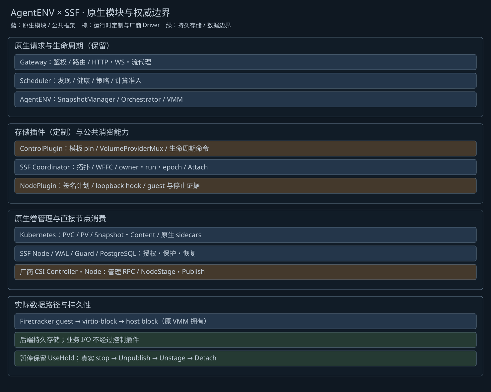

# AgentENV 原生 SSF 插件软件实现

> 2026-10-21 独立化更新：本页保留此前设计/阶段记录。当前 AgentENV 的消费与准备协调、账本事务在 `sandbox-storage` 的独立 `ssf-coordinator` 中执行；Scheduler 为轻量客户端，standalone 同样独立。以 [03](03-framework-design.md)、[23](23-current-implementation-architecture.md)、[26](26-independent-coordinator-implementation.md) 和 [13 部署](13-agentenvadapter-installation-and-deployment.md) 为准。旧内嵌宿主、`go.ssf.mod`、`-tags ssf`、原仓库 SSF overlay 不再适用。本次保留 Block/ext4 和全部原生功能，未新增 OverlayBD CSI Driver。

> 2026-10-21 自动卷准备增量：实现、部署、验证结果及未完成边界统一见 [22](22-volume-preparation-implementation.md)；直接 PVC 两步场景见 [20](20-kubernetes-pvc-agentenv-mount-validation.md)。本文件原生命周期说明继续适用，旧未启用 profile 的卷策略不代表新 profile 规则。

更新：2026-10-20。设计依据为 [16](16-agentenvadapter-native-integration-design.md)、[17](17-agentenvadapter-refactoring-and-validation.md)。代码、工具已实现；验证结果及实际运行边界见 [18](18-native-integration-implementation-status.md)。

## 架构与调用链

原 Gateway → 原 Scheduler → 原 AgentENV 节点 → 原 Orchestrator → Firecracker/guest 保持不变。Scheduler 通过接口注入 ControlPlugin，节点通过可关闭的通用 StorageProvider 调用 NodePlugin。SSF 公共 Coordinator、CSI 客户端、Node Agent、WAL 和 PostgreSQL 账本负责消费协调。Kubernetes 原生 PVC/PV、StorageClass、Snapshot/Content 及 CSI sidecars 负责管理资源；不创建 HolderPod，不由 adapter 直接 CreateVolume。

客户继续调用原沙箱 API，创建成功返回原生 ID 与 `201`；复用原 `volumeMounts`，没有必填 SSF 字段。Gateway 剥离客户私有存储 header，签名原始 body 和请求关联；Scheduler 执行原健康过滤、发现与策略并持久预留计算。普通创建、恢复、Fork、模板 builder/recorder 共用准入。节点以独立 loopback token 接收内部计划，经 mTLS 调用 SSF Node；原 Orchestrator 始终拥有 VMM。

## 源码导航与侵入点

| 层 | 实现与必要性 |
| --- | --- |
| Gateway | `AgentENV/services/gateway/internal/storage.go`：完整签名上下文与 header 边界；不替代路由、代理、鉴权 |
| Scheduler | `internal/storage_plugin.go`、`cmd/storage_ssf.go`：插件接口、持久计算准入与原调度结合；`go.ssf.mod` 隔离依赖 |
| ControlPlugin | `SSF/adapter/agentenvadapter/native_control.go`、`native_admission.go`、`native_commands.go`：owner/run、调度、生命周期指令 |
| VolumeProviderMux | 原 `api/impls/volume_provider.rs` + `native_volumes.go`：legacy 默认、SSF 卷、UID 固定导入、离线扩容，无失败回退 |
| 通用原生 hook | `AgentENV/src/sandbox/storage/`：设备、guest 证明、冻结、请求关联、outbox、清理；不含 K8s 客户端、CSI 或共享账本 |
| 原生生命周期 | `orchestrator/service.rs`、`sandbox/firecracker/`：PreparedExternalDrives、真实 stop、联合捕获、子实例准备扩展 |
| 原生模板仓库 | `snapshot/manager.rs` 与 repository：只读投影、不可变 pin、发布/删除 outbox、仓库身份；继续使用原 SnapshotManager/P2P |
| 公共框架 | `consume/`、`ledger/`、`kubernetes/`、`node/`、`guard/`：统一拓扑、持有、epoch、可信 Ready、CheckpointSet、回收许可和 WAL |

这些修改补齐原项目缺失的存储生命周期扩展点；未把调度或 VMM 管理迁出原模块。外部盘与 legacy/attachedDrives 统一检查路径、数量、槽位和只读约束。禁用 provider 时不需要插件；custom extension 独立保留。补丁路径、哈希及精确重放见 [补丁说明](../sandbox-storage/adapter/agentenvadapter/patches/README.md)。

## 生命周期与数据语义

创建先计算预留与绑定，再 Attach，随原请求发送完整 NodeVolumePlan；节点 Prepare/初始化/guest UUID、容量和 RO 验证后提交。Commit 只接受可信节点 Ready。相同 owner/run 幂等，相同 owner 不允许两个 writer；未派发、已派发未知和撤销 tombstone 分开处理。节点重启通过 WAL/outbox 恢复，不以租约到期或 HTTP 404 证明 VMM 停止。

暂停保留逻辑 UseHold，释放本 run 挂载与 attachment；恢复创建新 run，确认旧 VMM 停止后原子接续 epoch，保留原 ID、自动暂停/恢复策略。快照将 native 内存/rootfs、legacy 和 CSI 纳入同一冻结屏障；发布前持久记录 Snapshot/Content UID 和 CheckpointSet，失败执行 thaw、补偿与引用回收。快照不停止源沙箱。

Fork 固定父节点，每个 child 使用新 owner/run 和计算预留。RW 卷从同一捕获点克隆独立 PVC，RO 按原语义共享；保留原子实例 ID 和部分成功结果。子 VM 启动失败但停止未知时仍保留 handle、Killing 元数据与原生停止重试，不让错误结果丢失运行所有权。

模板别名固定不可变版本。省略 `volumeMounts` 继承；`[]` 清空可见挂载；显式数组替换。恢复内存仍可能持有旧文件描述符，因此所有旧磁盘保持原 virtio 槽位并克隆到独立保留卷，guest 将冻结挂载迁至 `/.agentenv-storage-retained/`，再安装新挂载并 thaw。保留目录不出现在公共卷映射；原生保留路径不能由客户使用。旧 FD 指向旧克隆，不可把冻结内存加载到无关的新盘。

删除先持久清理任务；确认 PID/starttime/boot/namespace/设备 FD 的真实停止证据后，依次 Unpublish、最后引用 Unstage、Detach。普通成功沙箱的用户卷保留。失败且从未 Ready 的内部卷、私有保留卷、compute 临时克隆与无引用捕获可自动回收；共享 RO/模板/暂停引用阻止提前回收。未知发布结果、尚未出现的异步 Snapshot/Content 保留 tombstone 等待后续确认，不以超时强删。

## 卷规格与扩容

本次完整规格为 Block/ext4；不新增 FileTree、跨节点内存迁移或 legacy OverlayBD CSI 化。支持动态/静态供给 × Immediate/WFFC，统一公共拓扑匹配。导入 PVC 固定 UID，不执行初始化；新卷仅在可信初始授权和全零设备验证后 mkfs。重试初始化只有前次操作已 Released 才接续。

原 Volume API 新增可选 `provider`、`storage`、能力状态及 `POST /volumes/{volumeID}/expand`。活动 writer/暂停 hold 时返回 `202`，记录扩容意图但不阻止同 owner 恢复；空闲后公共维护屏障排除 Acquire、hold、attachment 与回收，再经 PVC 原生 Controller 扩容。下一次启动先 NodeExpand，校验设备与 ext4 UUID，执行 e2fsck/resize2fs，再启动 VMM。禁止缩容，readonly 不提供扩容。

内部协议为 `ssf.runtime.v2`、`agentenv.storage.v2`，hook version `3`，完整能力 profile `agentenv-capture-clone-v1`。此 profile 表达已实现的 hook 集合，不等于厂商 CSI 或真实环境验收证书。数据库迁移幂等，协议与 OpenAPI 有重生成比对工具。
