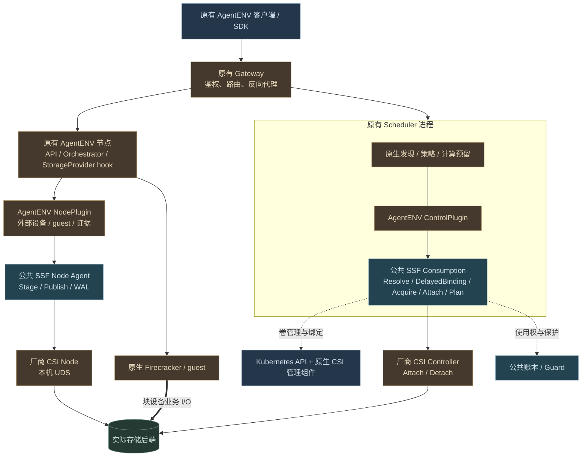
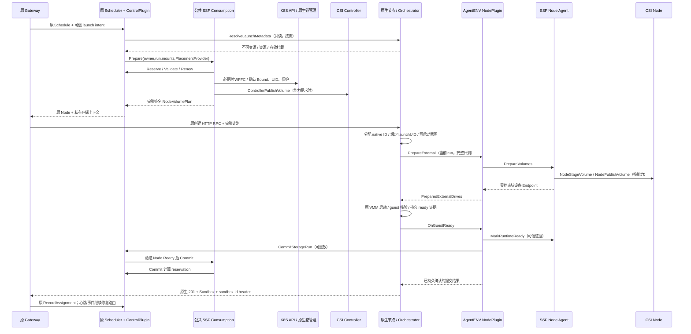
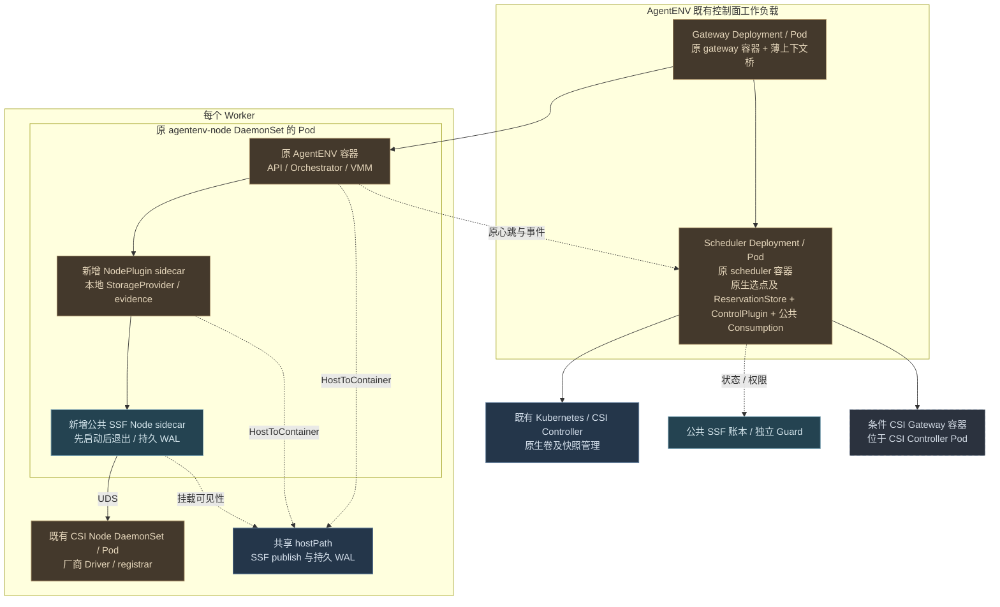

# AgentENV 原生架构内的 SSF 插件接入设计

> 2026-10-21 独立化更新：本页保留此前设计/阶段记录。当前 AgentENV 的消费与准备协调、账本事务在 `sandbox-storage` 的独立 `ssf-coordinator` 中执行；Scheduler 为轻量客户端，standalone 同样独立。以 [03](03-framework-design.md)、[23](23-current-implementation-architecture.md)、[26](26-independent-coordinator-implementation.md) 和 [13 部署](13-agentenvadapter-installation-and-deployment.md) 为准。旧内嵌宿主、`go.ssf.mod`、`-tags ssf`、原仓库 SSF overlay 不再适用。本次保留 Block/ext4 和全部原生功能，未新增 OverlayBD CSI Driver。

日期：2026-10-21。状态：**设计已修订；软件增量及未完成边界见 [22](22-volume-preparation-implementation.md)**。此前原生生命周期实现及验证结果见 [18：实施状态](18-native-integration-implementation-status.md)，不代表本次新增目标已经落地。

本轮核心约束见 [21：SSF 卷管理与运行时 Adapter](21-ssf-volume-provisioning-and-runtime-adapter-design.md)：adapter 的两部分分别是 Kubernetes 供卷过程中的运行时定制准备，以及将已满足规格的卷接入 microVM。用户只需 Kubernetes 创建 PVC，再调用原创建沙箱接口引用 PVC。原项目 `/volumes` 是可选 facade，不能成为必需登记入口。

本文取代 [12](12-agentenvadapter-design-and-implementation.md)～[15](15-agentenvadapter-quick-test.md) 中“独立 adapter 控制面接管沙箱创建及调度”的接入方案。12～15 已更新为原生接入的实际实现、部署与测试说明；实际未执行项仍明确标记，不能作为真实环境验收通过的证据。具体代码改造、迁移和验收见 [17：实施与验收](17-agentenvadapter-refactoring-and-validation.md)。公共框架继续遵循 [03](03-framework-design.md)、[05](05-kubernetes-integration.md) 和 [08](08-full-deployment-architecture.md)。

## 1. 结论与必须满足的约束

**保留 AgentENV 的 Gateway → Scheduler → AgentENV 节点 → Firecracker/guest 原生链路，将 SSF 消费协调嵌入现有 Scheduler，将存储插件接入点嵌入原生节点生命周期；`agentenvadapter` 不再充当另一个沙箱平台。**

1. 原有 Gateway、Scheduler Deployment、节点 DaemonSet、Service、发现、心跳、路由和模板体系继续工作。新增的是库、存储 sidecar 和公共 SSF 基础设施。
2. 客户端继续使用 `/sandboxes-cold`、`/sandboxes`、`/v2/sandboxes` 及现有删除、暂停、恢复、快照、Fork、连接、超时和代理接口；保留原方法、请求字段、默认行为、状态码、响应结构及原生 sandbox ID。创建成功仍在原生就绪后返回 `201`，不改成 adapter `202 + operation` API。
3. 创建接口已有 `volumeMounts`，复用并增加可选 PVC 来源；原 `name/path` 语义保持。PVC 只在首次创建/显式替换时指定，内部固定 UID，后续生命周期不重复传入。`/volumes` 可作为便捷 facade；不要求先 import，也不向客户端暴露 plan/ticket。
4. `autoPause`、`autoResume`、`customExtensionParams`、`attachedDrives` 和模板别名保持原义。不得覆盖这些字段来规避接入工作；无 SSF 卷的请求不依赖 SSF 账本/Node Agent 才能运行。
5. SSF 管卷、挂卷和保护数据；原生 Orchestrator 始终创建、暂停、恢复、停止 VMM，决定沙箱状态及原生响应。
6. 各项目实现同一套 SSF 集成契约，定制运行时卷规格/内容准备和 guest 接入，辅以身份映射、原生选点与生命周期 hook。SSF 公共代码负责准备编排和消费共性，不能出现 AgentENV 路由、Firecracker 参数或 OverlayBD 分层逻辑。
7. 暂停/恢复、Capture/Clone 和故障恢复属于完成条件。仅支持冷启动并禁止原有生命周期的阶段性实现，不得宣称满足本方案。

“尽量少侵入”以稳定扩展点和职责不扩散衡量。现有 AgentENV 没有完整的外部存储 SPI，也没有计算预留事务；需要一次性补齐这些边界。仅靠外部 HTTP 包装且不修改原生生命周期，无法同时保证模板继承、内部恢复、快照一致性和可靠释放。

## 2. 源码分析与偏差定位

分析基线：AgentENV HEAD `6cccaa7842bd5be2051111d4f74d9e37aa721244`，连同工作区未提交的外部存储补丁；CubeSandbox HEAD `4411c96ba8658a959de34693f54f4918db2a432f`；substrate HEAD `6edd1fccfc9d8a0c0c21db31cb1125336edce442`。SSF 按当前工作区源码分析。

| 源码证据（含已移除的重构前原型） | 重构前行为及设计含义 |
| --- | --- |
| [Gateway server](../AgentENV/services/gateway/internal/server.go)：`handleProxy`、`recordAssignmentFromResponse` | 已有按 sandbox 路由、调度转发、原生响应登记及代理链路。必须保留；响应后登记失败不能被当成存储授权或资源提交成功。 |
| [schedule_hint.go](../AgentENV/services/gateway/internal/schedule_hint.go)、[scheduler.proto](../AgentENV/services/api/proto/scheduler.proto) | 模板 hint 缺模板身份、有效卷和真实资源；hint 读取超过 64 KiB 可以退化为无 hint。SSF 所需信息必须成为校验过的内部上下文，不能沿用“解析失败就忽略”。 |
| [Scheduler service](../AgentENV/services/scheduler/internal/service.go)、[strategy](../AgentENV/services/scheduler/internal/strategy.go)、[filter](../AgentENV/services/scheduler/internal/filter.go) | 原有发现、过滤和策略可复用；`Schedule` 只选点，没有持久预留。心跳资源统计不等于并发创建的容量锁。 |
| [BindingStore](../AgentENV/services/scheduler/internal/store.go) | 内存/Redis binding 是有 TTL 的路由信息。其过期不代表 VM 已停止，不可释放 writer。 |
| [sandbox API](../AgentENV/src/api/impls/sandbox.rs) | 原生创建拥有默认值、资源解析和 native ID；模板的 `volumeMounts` 省略与显式空数组含义不同。Fork 可部分成功，connect 可自动恢复。 |
| [volumes API](../AgentENV/src/api/impls/volumes.rs) | 当前卷解析直接 reserve/materialize OverlayBD；需要 provider 分流，保留已有路径、数量、容量及去重校验。 |
| [Orchestrator](../AgentENV/src/orchestrator/service.rs)、[Firecracker](../AgentENV/src/sandbox/firecracker/sandbox.rs) | 掌握所有真实启停和快照屏障。只有此处能可靠连接内存快照、磁盘一致性、guest 冻结及 VMM 退出。 |
| `../sandbox-storage/adapter/agentenvadapter/control.go`（已移除的历史原型）、`../sandbox-storage/adapter/agentenvadapter/placement.go`（已移除的历史原型）、[types](../sandbox-storage/adapter/agentenvadapter/types.go) | 当前另建 `/v1/sandboxes`、异步操作、静态 workers/templates、自有预留，并改写原生请求。应拆除这些沙箱控制职责。 |
| [adapter node](../sandbox-storage/adapter/agentenvadapter/node.go)、`../sandbox-storage/adapter/agentenvadapter/runtime.go`（已移除的历史原型） | adapter 调原生 API 创建/删除；Freeze/Thaw 未实现。目标改为原生生命周期调用存储 hook，不能让 adapter 再次调用同一生命周期而递归。 |
| `../sandbox-storage/adapter/agentenvadapter/scripts/render.py`（已移除的历史原型） | 新建 agentenv-control，将原生 API 置于 loopback，关闭 Scheduler 上报，用存储 hook 占用 custom extension URL。与原生部署要求冲突。 |
| `../AgentENV/src/sandbox/custom_extension/storage.rs`（已移除的历史原型） | 持久事件、设备校验、进程身份和真实停止证据值得保留；ticket 载于用户扩展参数、全局强制外部卷、禁止原生命周期的方式需要改造。 |
| [SSF Coordinator](../sandbox-storage/consume/coordinator.go)、[runtime 契约](../sandbox-storage/runtime/runtime.go)、[Node Engine](../sandbox-storage/node/engine.go) | 已有 Prepare/Commit/Release、PlacementProvider、证据与节点 WAL，可继续复用；当前 Commit 不独立核验 guest ready，需补提交前置条件。 |

CubeSandbox 的 [volume plugin SPI](../CubeSandbox/Cubelet/plugins/volume/interface.go) 与 [PluginVolume](../CubeSandbox/Cubelet/storage/pluginvolume.go) 展示“插件提供存储、原节点仍管理容器”的边界；它本身不是完整 SSF 适配。Substrate 的 [volume 接口](../substrate/internal/volume/plugin.go)、[节点卷步骤](../substrate/cmd/atelet/volumes.go) 和 [microVM CSI 接入](../substrate/cmd/ateworker-microvm/csi.go) 展示原工作流中的 ensure-step、host/guest 分层。采用这些边界，不复制其控制面、固定 CSI 能力假设或直接供卷方式。

[08 的 AgentENV 部署约定](08-full-deployment-architecture.md#43-agentenv嵌入现有权威入口) 本来就要求保留 Gateway/Scheduler。本次是纠正 adapter 实现偏离，而不是重建 SSF 总体架构。

## 3. 与 K8S CSI 的对应及三方边界

| K8S CSI 体系角色 | SSF 中的对应 | AgentENV 定制内容 |
| --- | --- | --- |
| Kubernetes API、PV Controller、CSI 管理 sidecar | 原样使用 SC/PVC/PV、Snapshot、供卷、扩容、回收 | `/volumes` 到原生资源的映射及兼容语义 |
| 运行时所需的卷内容准备〔SSF 扩展〕 | 公共 VolumePreparation Coordinator 观察原生卷并驱动准备，不新增 provisioner | adapter 第一部分：Block/ext4 规格、内容校验/构建、准备证明 |
| kube-scheduler 的计算选点与 VolumeBinding 协作 | 项目调度器 + 公共 DelayedBinding；不是直接调用 kube-scheduler 调独立 VM | 原生 Scheduler 实现 `PlacementProvider` |
| 消费授权及节点生命周期协调 | 公共 Coordinator、账本、Guard、Node Agent | 原生生命周期触发、项目身份映射 |
| kubelet 的卷使用与 runtime 衔接 | Node Agent 调 CSI Node；项目插件将 Endpoint 接入 VMM/guest | 原生 StorageProvider hook、Firecracker 块设备和 guest 验证 |
| 存储厂商 CSI Driver | 保留标准 Identity/Controller/Node Service | 不在 AgentENV adapter 中实现厂商协议 |

这里是职责类比，SSF 的独立 VM 消费模块是新增实现，不等于复用了 kubelet。标准 CSI 不包含 sandboxID、guest ready、暂停持有或 VM 内存快照，这些属于 SSF 与运行时的集成协议。CSI Controller 不调用 CSI Node；管理 RPC 不传输业务 I/O。[官方 CSI 架构说明](https://kubernetes-csi.github.io/docs/)

### 3.1 关键模块

下图展示此前原生消费主线。**本轮完整模块与准备链以 [21 第 3 节](21-ssf-volume-provisioning-and-runtime-adapter-design.md#3-关键模块与部署归属) 为准**，供卷定制不能只画成 `/volumes` 的一个分支。



棕色区分项目适配与厂商 Driver 的名称，蓝色为公共/原生基础设施，绿色为后端；实线为控制、虚线为状态或对象协调、粗线为数据。图中模块不都对应独立进程，部署边界见第 10 节。[可编辑图源](figures/agentenv-native-modules.mmd) · [SVG](figures/agentenv-native-modules.svg) · [PNG](figures/agentenv-native-modules.png)。

### 3.2 唯一权威

| 对象或动作 | 唯一权威 | 其他模块可以做什么 |
| --- | --- | --- |
| sandbox ID、运行/暂停/删除状态、VMM 启停、原生响应 | AgentENV Orchestrator | 插件报告存储阶段/证据，不复制沙箱状态机 |
| 节点发现、候选评分、计算 reservation | 原生 Scheduler | 公共存储模块给出拓扑和使用约束 |
| sandbox → node 路由 | 原生 Scheduler BindingStore 及现有报告链路 | 存储映射保存审计关联，不替代 LookupNode |
| 卷后端管理 | Kubernetes 原生资源与 CSI 管理 sidecar | facade 创建/观察资源，不直接 Create/DeleteVolume |
| 运行时卷内容与 VolumeReady〔设计新增〕 | SSF 公共准备编排 + adapter 的卷准备实现 | 共用维护/使用权、Node API 与 WAL；不修改原生 Bound 的含义 |
| Use/Binding、writer、attachment 共享引用 | SSF 公共账本与 Coordinator | 项目插件映射 owner/run，不私设第二把锁 |
| Stage/Publish/Unpublish/Unstage | SSF Node Agent | 原生节点不另调 CSI、不删除其路径 |
| guest 接入与停止证据 | 原生 hook + AgentENV NodePlugin | Node Agent 验证证据后释放；不能仅凭 API 返回 |

## 4. 插件规格与代码组织

插件是“一套集成实现”，可以有进程内控制库和节点 sidecar；不要求所有项目部署同名 adapter-control 服务。当前公共接口不足以单独完成接入，目标增加下列**版本化 SPI**，均不是用户 API，也不是伪装的标准 CSI RPC。

| 契约 | 公共框架负责 | 项目 plugin/原生宿主负责 |
| --- | --- | --- |
| `Identity / Capabilities`（新增） | 版本协商、能力交集、所需 profile 校验 | runtime 名称/版本、Block/FileTree、freeze、restore、设备槽位限制 |
| `VolumePreparation`（本轮设计新增） | PVC watch、profile pin、准备独占权、CSI/节点执行、证据、恢复及原子接续 | Describe/Plan/Prepare/Inspect/ReleasePreparation；AgentENV 构建或验证 ext4 |
| `ResolveIntent`（项目集成契约） | 接收规范化 mounts、稳定身份和资源约束 | 原生卷名映射、模板继承、租户、不可变源及原生默认值 |
| `PlacementProvider`（已有） | 调用 Reserve/Validate/Renew/Commit/Release、延迟绑定 | 复用原生候选集、策略、容量、事务预留；不自带静态 workers |
| `runtime.Adapter`、`EvidenceVerifier`（已有） | Endpoint、运行证据、Node API 及恢复规则 | 将已准备 Endpoint 交给当前原生启动流程，等待 guest、确认停止、Freeze/Thaw |
| `RetainUse / TransferUse / ReleaseUse`（新增公共语义） | 逻辑 owner 与运行绑定分离，暂停保护、原子接续 | 报告原生暂停、恢复和最终删除的可信阶段 |
| `CheckpointSet / Pin`（新增公共语义） | Snapshot/PVC UID、版本集合与引用保护 | 原生一致性屏障、内存与磁盘快照联合发布、恢复映射 |

建议组织如下；名称为目标目录，不能据此认为当前已存在：

```text
SSF/runtime/                         公共契约、版本及 capability/profile
SSF/consume/                         共享消费、topology、UseHold、Checkpoint pin
SSF/adapter/agentenvadapter/control/  嵌入 Scheduler 的 Go 库
SSF/adapter/agentenvadapter/node/     本地 StorageProvider 协议、设备与证据
SSF/adapter/agentenvadapter/volume/   原生 Volume API 语义到公共 facade 的映射
AgentENV/services/...                调用插件的薄桥、原生 ReservationStore
AgentENV/src/storage_provider/...    通用 Rust hook、设备类型、事件 outbox
```

Go 控制库在构建时链接到 Scheduler，不使用不稳定的 Go 动态 `.so` ABI。Rust 通过版本化本地协议调用 NodePlugin，后者调用现有 `ssf.v1.RuntimeStorageNode` gRPC；保留 PrepareVolumes、MarkRuntimeReady、ReleaseVolumes、InspectOperation 的公共主线。插件配置和证书来自可信部署配置，不能由创建请求任意指定 endpoint。

现有 `Adapter.AttachPrepared` 的目标语义是“接入正在由原生宿主创建的 instance”，不是再 POST 一次 `/sandboxes`；`DetachAndConfirm` 是参与宿主已经发起的停止过程并确认结果，不是另起 DELETE 控制循环。原生宿主负责调用顺序，避免循环调用。

## 5. 原生 API 兼容及内部身份

### 5.1 保持原生请求

原有创建请求继续支持；省略的字段按 AgentENV 原有默认值解析：

```json
{
  "templateID": "my-template",
  "volumeMounts": [{"name": "work-data", "path": "/data"}],
  "autoPause": true,
  "autoResume": {"enabled": true}
}
```

`volumeMounts` 是数组，不是 `path → PVC` 对象。已有 `name` 由 provider registry 解析为 legacy 卷或 SSF volumeUID。新增 PVC 来源如下；`name` 与 `pvc` 必须恰好一个，不能把不存在的卷名自动解释成同名 PVC：

```json
{
  "image": "IMAGE",
  "volumeMounts": [
    {"pvc": {"namespace": "agentenv-system", "name": "notes"}, "path": "/data"}
  ]
}
```

该新增来源已加入公开模型与原创建链路，当前验证及未完成边界见 [22](22-volume-preparation-implementation.md)。客户端不需要 `/volumes import`、PVC UID 或 adapter sandbox ID；服务端校验主体权限，固定真实 UID，并等待自动准备完成。显式 `[]` 覆盖模板卷；省略沿用原有继承逻辑。后续恢复等接口使用已保存的 UID，不重新按 PVC 名称解析。

已经登记为 SSF 的卷在插件缺失、不兼容或不可用时明确失败，不能回退到 legacy 并创建另一个空卷。只有旧记录未带 provider 的情况才按旧格式解释。

| 原生功能 | 目标行为 |
| --- | --- |
| 冷启动、模板创建、v2 创建 | 原路径、原 native ID、原响应；存储失败映射现有 Error 结构，不返回 adapter operation 结构 |
| list/get/delete/timeout/metadata | 原生路由与状态语义；删除可见性仍由原生 API 决定，物理回收完成由内部持久状态保证 |
| connect、自动恢复、显式 resume | 同一原生 sandbox ID；新 run 身份和新 plan，不复用旧运行票据 |
| pause、autoPause、资源驱逐 | 保留暂停策略；不因使用 SSF 自动改为 delete |
| snapshot、fork | 保留 Capture/Clone、一致性与原生部分成功结果，见第 8 节 |
| HTTP/WS/流式代理、envd、端口路由 | 继续原 Gateway/节点代理；移除 adapter 简化 guest proxy 的替代地位 |
| 自定义扩展、attachedDrives、无卷模板 | 继续原逻辑；与 SSF 设备统一检查挂载冲突及槽位，不覆盖用户配置 |

### 5.2 VolumeProviderMux

在原生 `/volumes` 实现和卷解析处增加 provider 分流。旧记录缺 provider 时读作 legacy，继续由原 VolumeManager 管理。新 SSF 记录持久保存 `(tenant, nativeVolumeID/name, volumeUID, PVC namespace/name/UID, mode, initializationPolicy, profile)`；不得从可被重建的 PVC 名称重新猜身份。

本轮修订：原生卷名登记仅是可选映射，公共准备和使用记录按 PVC UID/后端身份归一。Kubernetes 直接创建的受管 PVC 由公共 watcher 自动观察并准备，直接引用不要求存在 NativeVolume 别名记录。`/volumes` 创建、import 别名、模板克隆与 PVC 直接引用均复用相同准备规则，详见 [21 第 9 节](21-ssf-volume-provisioning-and-runtime-adapter-design.md#9-对外接口直接引用-pvc)。

`/volumes` 可增加 `provider=ssf`、StorageClass/导入 PVC、Snapshot 来源及能力状态字段。未指定 provider 时采用部署配置的默认值；升级时保持 legacy 默认，明确启用后才改变新卷的默认供给。`get/list/delete/fromVolume` 按记录分派；名称空间统一、冲突拒绝、混合列表使用版本化分页游标。legacy `image` 来源不静默变成空 CSI 卷；跨 provider 复制需要显式数据迁移。

SSF `/volumes` 经 Scheduler 中插件的内部 facade 访问公共 Kubernetes 管理模块；各节点读同一映射。WFFC 创建可以返回卷对象的 Pending 状态，首次消费完成绑定。删除先排空与校验使用引用，之后删除精确 UID 的原生资源；后端由原生回收策略处理。普通 sandbox 删除不顺带删除用户卷。

同一沙箱可有 legacy 卷、attachedDrives 和 SSF 卷。legacy 卷仍走 native reserve/materialize，SSF 卷只走公共 Acquire/Prepare；统一校验规范化路径、重复引用、容量和总槽位。部分准备失败分别补偿，不能用 legacy VolumeManager 再锁一次 SSF 卷。

### 5.3 身份与关联

| 身份 | 生命周期和用途 |
| --- | --- |
| `requestUID / launchUID` | 内部创建尝试，在选择/Prepare 前产生；绑定原始请求摘要、身份、路由和不可变源。只负责重放同一尝试。 |
| `sandboxID` | 继续由原生节点分配，原客户端和路由使用；创建时原子记录 `launchUID → sandboxID`。 |
| `ownerUID` | 存储逻辑使用者；首轮可在 native ID 尚未产生时先分配，随后永久一对一关联原生 sandbox。暂停期间不变。 |
| `runUID / bindingUID / epoch` | 一次运行及其挂载；每次恢复新建。旧事件不能释放新运行或暂停持有。 |
| `reservationID / operationID` | 内部计算预留/存储步骤；日志和管理诊断使用，不替换 public sandbox ID。 |

现有 `consume.Request.Sandbox` 是字符串键，不能假设它已经具备上述分层。接入时通过映射使用 ownerUID，并为 ledger/plan 增加 run 约束，兼容已有单次运行调用者；迁移前不允许两套代码混用同一 owner 的不兼容键。

当前 AgentENV 主要是静态 `x-api-key`，没有天然多租户 Claims。默认将当前部署/API key 映射到管理员配置的一个 tenant/namespace allowlist；多租户需使用现有鉴权扩展后的可信 Claims。不能信任用户传来的 namespace、tenant 或存储 header，也不要求普通客户端改用原型 mTLS 用户 API。

### 5.4 原创建 RPC 携带完整计划

扩展内部 Schedule 请求/响应的 protobuf 字段：请求带规范化 launch intent、原始 body 摘要、主体和版本；响应仍含原 Node，另带完整签名 `NodeVolumePlan` 与一次性 dispatch 上下文。保留原 public HTTP body。

Gateway 在原反向代理请求上附加私有 `X-AgentENV-Storage-Context`，包含上述完整计划和 pin；公共入口剥离任何客户提供的同名字段。原生 middleware 校验并放入请求级 Claims/context，传给 Orchestrator。计划约束 tenant、owner/run、nodeUID/boot、PVC UID、挂载、请求摘要、模板版本、权限和有效期；不能仅下发 ticket 再让节点自由选择卷。

该 header 采用有版本的编码，三端协商最大计划字节数与挂载数量，调整内部 HTTP header 限额并做超限回归；超限明确失败并补偿未派发操作，不降级成无卷请求。计划不包含 CSI Secret 明文，敏感 publish context 不写日志；内部链路加认证及 TLS，签名不是加密替代物。现有 Gateway → Scheduler 的 insecure gRPC 不视为已有安全保障。

每次 Gateway 自动重试复用原 requestUID；节点在启动前持久登记该 UID 与 native ID，重放返回同一结果或原进行中状态，不能再创建 VM。普通客户端在网络超时后重新发起不带幂等键的 POST，仍遵守原接口语义，不宣称获得跨请求 exactly-once。取消后的 tombstone 必须先阻止旧 dispatch，再回收卷。

## 6. 原生调度与创建路径

### 6.1 ResolveLaunchMetadata：模板不是静态 catalog

Scheduler 的 ControlPlugin 通过新增的**只读内部元数据接口**调用原生 SnapshotManager/VolumeManager 的投影，取得不可变模板/快照 ID、资源、挂载槽位、继承的卷版本及本地性约束。此接口不创建沙箱，不另管模板状态；底层仍是原有 POSIX/OSS repository、缓存和 P2P。

别名只解析一次并 pin 到不可变版本；缓存以不可变 ID/manifest revision 为键。执行节点按 pin 加载并验证来源，不能重新解析一个已经漂移的别名。只存在于特定节点的恢复状态限制候选节点；可从共享仓库加载的模板按原能力选择节点。原生 schema 的默认 CPU/内存和创建语义只维护一份，Go bridge 使用投影结果，不复制 Rust 默认值。

显式挂载和模板隐式挂载都进入 ResolveIntent。Gateway 的 64 KiB advisory hint 回退不得成为 SSF 绕过入口；所有模板请求都需解析是否继承外部卷。原 body 无修改地继续转发，未知字段及原校验规则保留。

### 6.2 原生 Scheduler 实现 PlacementProvider

1. 原生发现和健康状态形成候选集，保留 round-robin/random 等现有策略。
2. 公共 topology 模块根据 PV nodeAffinity、SC allowedTopologies、CSINode/Driver、卷使用权和待绑定约束返回可行性；不在每个 adapter 重写 PV/SC 匹配逻辑。API 读取失败与“确实无可行节点”分开。
3. 原生 Scheduler 在候选中评分/选点，并在自身 ReservationStore 事务中预留 CPU/内存，返回与 Node UID、boot/服务实例、attempt 绑定的 lease。
4. Coordinator 使用同一 lease 完成 WFFC 和 Attach。`Reserve` 复用原生选择函数，不递归调用外层 `Schedule`，更不能再选第二个 Worker。
5. 续租、提交、释放通过同一 store 和 CAS。租约失效只阻止新动作；已派发或结果未知不能直接释放 VM、writer 或绑定。

ReservationStore 属于原生 Scheduler，可复用 SSF PostgreSQL 的独立 schema；不继续使用 adapter 静态 workers 容量表作为另一个调度权威。数据库事务只覆盖短时预留，不跨越 K8S watch、Attach 或 VM 启动持锁。

混合节点池中，冷/模板创建、无卷创建、模板构建的临时 VM、Fork 子实例、恢复等所有实际启动路径都必须纳入原生计算准入。不能只为 SSF 请求预留而允许普通请求绕过同一容量。无 SSF 卷时这只是原生计算能力，不依赖存储数据库表；容量存储的失效策略由原生调度统一处理。

心跳新增可去重的 run/reservation 标识和单调报告序号。容量判断为“可信心跳中的已分配资源 + 未被该心跳确认计入的有效预留”；不把已进入心跳的运行重复计费，也不根据陈旧 aggregate 猜测减额。旧节点无此能力时保持保守计费并禁止宣称强预留；混部升级需先完成协议兼容。原有 paused 容量统计继续保留，与卷的暂停持有独立。

WFFC 由公共 DelayedBinding 驱动 selected-node/静态候选 reservation 和原生绑定结果；动态/静态 × Immediate/WFFC 分别覆盖。原生 WFFC 本面向 Pod，独立 VM 的桥接属于 SSF 新增能力，不是普通 API 自然完成的调度。不能创建逐沙箱 holder Pod，也不能把 pending 全部拒绝。[Kubernetes StorageClass 绑定模式](https://kubernetes.io/docs/concepts/storage/storage-classes/#volume-binding-mode)

若选点后失败，先确认原绑定/供卷操作结果并完成补偿，才能建立新 attempt。PVC 已绑定时必须服从真实 PV 拓扑，不能随意改 selected-node；未知结果保持 reservation/保护并后台恢复。

### 6.3 正常调用关系

本轮增加的前置链路：Immediate PVC 在后台自动执行 VolumePreparation；WFFC 在下图确认 Bound 后执行同一准备链。内容证明与准备占用完成释放/接续后，RuntimeMount 才能配置 VMM。完整时序及交接条件见 [21 第 6 节](21-ssf-volume-provisioning-and-runtime-adapter-design.md#6-供卷与准备时序)，下图是此前消费调用基线。



`ControllerPublishVolume` 可按 Driver 能力省略，不能把 skip 当成所有 Driver 默认行为。计划由控制面 Attach 完成后下发；正常节点消费不再次做选择或 Controller Attach。已有 Coordinator.Commit 仅处理计划/placement，实施时必须加公共 ready 检查或不可绕过的已验证 receipt 条件，不能只靠调用方一句“已 ready”。

[调用图源](figures/agentenv-native-calls.mmd) · [放大 SVG](figures/agentenv-native-calls.svg) · [PNG](figures/agentenv-native-calls.png)。顺序图虚线为返回，不表示异步状态协调；参与者名称标明进程内公共库和独立服务。

节点在 Ready 已成功但 Commit 响应丢失时保持 VMM/卷引用和待提交 outbox，重试同一提交；在原有请求超时预算内不能确认时按原生错误结构返回，恢复原尝试，不凭超时回收正在运行的 VM。需要停止时由原生 Orchestrator 执行并产生真实停止证据。

无外部卷时跳过公共消费路径，不能向当前拒绝空 mounts 的 Coordinator 硬传空列表。内部自动恢复、Fork/模板恢复及直接访问原生节点的启动，同样经过中央 Orchestrator hook：向 Scheduler 的内部 `PreparePinnedRun` 提交既定节点和有效挂载，复用上述消费路径。直接调用节点不成为无计划启动 SSF 卷的后门。

内部 hook 已持有原生生命周期锁时，提交可信的不可变 launch descriptor；控制库不能反向调用同一个节点的变更接口或再次获取该锁。只读模板投影与运行中状态变更隔离，避免 Scheduler/Orchestrator 相互等待。

## 7. 节点 SPI、设备所有权与恢复

原生节点新增独立 `storage_provider` 配置和通用 hook，不再复用 `custom_extension.url` 或用户 `customExtensionParams`。保留已有自定义扩展生命周期，两个提供者分别配置、分别超时和审计。

| Hook（目标契约） | 原生宿主保证 | 插件输出/职责 |
| --- | --- | --- |
| `PrepareExternal(run, plan)` | 已固定 native ID/source/slots，尚未启动 VMM | 调 Node Agent，校验/初始化授权设备，返回 PreparedExternalDrives |
| `BeforeLaunch / OnSpawned` | 先写 fsync 日志再启动；记录真实 PID/start/boot | 防重放、核对进程及授权继续启动 |
| `OnGuestReady` | 校验设备集合、UUID、容量、mount、RO 和 VMM FD | 验证 evidence，Node Ready，触发控制面 Commit |
| `BeginCheckpoint / EndCheckpoint` | 原生锁定生命周期并协调所有设备冻结 | CSI 快照及 pin；成功或失败均进入可恢复 thaw/补偿流程 |
| `OnStopped` | 原 VMM 确实退出或已完成可信 fencing | 发布 detached 证据，释放节点挂载并异步重试控制面释放 |
| `Inspect / Recover` | 提供持久意图和真实运行状态 | 与 WAL/账本交叉核对；歧义保留引用并隔离 |

建议在 launch plan 中增加独立 `PreparedExternalDrives`，不把 SSF 设备伪装成当前唯一的 `ExtraDrive::Overlaybd`。外部设备只有受授权引用，没有 ublk device ID、overlay layer 和 native backing Drop 所有权。原生 rootfs、tools、attachedDrives、OverlayBD 快照发布继续原机制；挂载顺序和 virtio-blk 槽位在组装 launch plan 时统一处理。

RW/RO 槽位由原生模板 manifest 描述；旧模板不具备只读槽位时明确报模板不兼容或按原流程重建模板，不能更改 manifest 冒充能力。恢复检查设备顺序、容量、文件系统 UUID、读写属性与内存设备拓扑一致。FileTree 可保留公共扩展能力，AgentENV 首个认证 profile 为 Block/ext4；不得将文件路径伪装成 raw block。

保留现补丁的强证据：序号、owner PID/starttime、VMM PID/starttime、boot ID、真实块设备 major/minor、VMM FD 访问模式、guest mount/UUID/容量。`launching` 缺 PID 是结果未知，HTTP 404、进程号复用、租约到期、节点 NotReady 都不是 detached。必要的 orphan fencing 只能针对已证明属于该 run 的 VMM，由原生恢复器或明确授权的节点安全路径执行。

首次格式化仅允许“本次由管理入口新建、持久登记允许初始化”的卷；在独占初始化锁、完整空白检查和操作日志下执行。导入 PVC、已有文件系统、恢复/clone PVC 不格式化。guest-only mount、host 上只检查块设备；支持 ext4 所需探测是 AgentENV profile，CSI Node 不负责 guest 文件系统初始化。

停止后先持久记录 cleanup/outbox，再删除原生临时元数据。正常顺序为 guest flush/unmount（可执行时）→ VMM exit/fence → Node Unpublish → 最后一个引用 Unstage → 最后 attachment 引用 ControllerUnpublish → 清理 run Binding；计算资源释放依据原生停止，存储后台清理失败不伪造完成。用户卷保留。暂停的逻辑 UseHold 另按下一节处理。

## 8. 保持原生生命周期的数据语义

### 8.1 暂停、恢复与最终删除

当前 ledger 只有活跃 Binding，直接释放它会丢失暂停沙箱对独占卷的保护。因此增加公共 `UseHold(ownerUID, volumeUID, mode, reason, revision)`：这是逻辑使用权，不是一次节点挂载。

1. 暂停前，在同一使用权事务内建立/确认 owner 的 durable hold；原生按已有流程保存内存/rootfs，并保存可重建的外部卷映射。
2. guest 数据 flush 与 VM 停止完成后，可以释放 run 的 publish/attachment 和计算资源，保留 paused artifact、UseHold 和删除屏障。其他 owner 仍不能写该独占卷。
3. 恢复沿用原生同一 sandbox ID 和本地性规则，分配新 runUID；`TransferUse` 在同一 owner 下建立新 Binding，确认旧运行已停止，再激活新 writer epoch，期间不能出现保护空窗。
4. 恢复失败保留原 paused artifact/hold；不要将失败误当成最终删除。恢复成功后将暂停用途的 hold 转为运行用途的保护，释放冗余记录须事务保证仍有运行引用。
5. 最终删除经过原生停止/删除确认，清理暂停状态并释放 hold；checkpoint 引用独立保留，直到对应原生 snapshot 被删除。

同一 owner 不代表可以同时运行两个 writer。当前 ledger 对相同 sandbox 的特殊处理必须收紧为“同一 run 的幂等重入”；跨 run 激活需旧 run 的停止/fencing 证据及 epoch CAS，不能借 owner 相同绕过排他校验。

ledger/Guard 的冲突、排空、PVC 删除、节点迁移判断必须包括 UseHold。Redis 路由 TTL、续租失败和进程重启均不能释放它。暂停保留磁盘不等于已获得跨节点迁移能力，继续遵守 AgentENV 本地内存状态及现有路由限制。

实现过渡阶段可以保守保留整个旧 Binding/attachment 来保护暂停，但必须明确资源占用且处理恢复 epoch 接续；不能同时声称支持本节的独立回收。最终验收按上面的逻辑 hold 方案执行。

### 8.2 Snapshot：内存与所有卷处于同一屏障

原 Firecracker snapshot 在 API 完成前可能恢复源 VM，原 Fork 也存在先处理卷、后捕获 VM 的多个阶段。不能在这些 API 返回后再创建 CSI Snapshot，或先 snapshot CSI 卷再让 VM 继续写，最后才捕获内存。

由原生 Orchestrator 持有一次 lifecycle lock，并执行一个覆盖 legacy + SSF 全部可写设备的联合 Capture：

1. 阻止并发 pause/resume/fork/delete/resize；记录 checkpoint intent 与卷版本集合。
2. guest quiesce、flush/fsfreeze 全部相关文件系统，冻结失败整体失败；随后暂停 VM，禁止所有参与卷的外部 writer。
3. 在该屏障内捕获 native 内存/rootfs/legacy 层，并通过 Kubernetes 创建各 SSF 卷的 `VolumeSnapshot`。首版认证实现等待所有快照 `readyToUse`，读取 Snapshot/Content UID、恢复容量等真实状态后才结束屏障。
4. 持久 pin 所有组件并联合提交原生 snapshot manifest；最终用户可见 Ready 必须满足 native 发布完成且全部存储组件持久可恢复。中途崩溃的组件保持 pending pin，由恢复器决定继续提交或清理。
5. 原生恢复源 VM，按 manifest 记录的冻结状态完成 thaw，再恢复原 guest readiness；从冻结内存恢复的新 VM 同样必须 thaw。失败路径也要执行可重试 thaw，无法确认时隔离而非报告成功。

这里不声称多个 VolumeSnapshot 是原子组快照；一致性来自所有卷在屏障内没有写入。若存储后端在暂停期间无法完成 snapshot，当前操作失败并保留源数据，不能退化为不一致快照。应用级事务一致性仍取决于原有应用 quiesce 能力；不把文件系统一致性夸大成应用事务一致性。

`readyToUse` 和原生 source protection 只描述快照资源流程，不自动证明 VM 内存与磁盘一致，也不保护一个被原生沙箱 manifest 长期引用的快照。因此 SSF 新增 checkpoint pin 与 Snapshot/Content 删除保护；由原生 snapshot 删除流程释放 pin，实际后端删除仍走原生 snapshot-controller/sidecar。[Kubernetes Volume Snapshots](https://kubernetes.io/docs/concepts/storage/volume-snapshots/)

### 8.3 Fork、模板及快照恢复

- 可写卷：每个 child/从快照新建的沙箱获得独立 PVC，使用本次共同 Capture 的 VolumeSnapshot 作为 dataSource；不得从仍在写的 source PVC 临时克隆并声称与内存一致。
- 只读卷：Fork 可按原语义共享同一只读 volumeUID，并各自登记引用；可长期独立恢复的 snapshot/template 保存被 pin 的不可变版本，不能只记源 PVC 名称后允许源卷删除。
- 子沙箱 ID、数量限制、结果集合和部分失败语义由原生 Fork 管理。子 PVC、计算预留、plan 以 child 身份分别幂等；失败 child 释放自己的引用，不能影响 source/成功 child。
- 当前原生 Fork 在父节点启动 children，故使用固定父节点的 placement lease；不能借适配偷偷改成跨节点 Fork。容量/拓扑不满足按原生错误或部分结果处理。
- 模板恢复先解析有效挂载：省略时按 Capture 元数据恢复相应 PVC/只读引用，显式空数组不挂继承卷，显式替换沿用原生覆盖规则。生成的 PVC 同样经过 WFFC、真实 Bound、Attach 和节点 Prepare。
- manifest 增加有版本的外部存储扩展，记录 owner/volumeUID、Snapshot/Content UID、mode、guest path、slot、容量、文件系统标识及一致性集合 ID；不保存 `/dev` 路径、节点临时 target、token 或 Secret。旧 manifest 缺该扩展时继续 legacy 解释。

### 8.4 能力门禁与扩容

目标完整 profile 为 `agentenv-capture-clone-v1`：Block/ext4、真实只读、guest quiesce、可信停止、Snapshot/restore PVC、内存与设备恢复兼容、UseHold 和 checkpoint pin 都要通过认证。新卷建立时即可查询 profile，首次消费复核实际 Driver/节点交集。

缺少 snapshot/restore 的后端可以作为显式另选的受限 Volume profile，但不得默认替换全功能卷，更不能全节点禁止 pause/fork。交付本次需求必须至少有一个真实 Driver 的完整 profile 验收，旧的“cold-only”不能充数。无 SSF 卷的原生沙箱不受这个能力门禁影响。

扩容继续由 PVC request → 原生 resizer/Driver 完成；NodeExpand 和 guest 扩容仅在各层均支持且不破坏内存快照设备约束时启用。首版默认离线扩容：停止运行、处理旧 checkpoint 容量兼容性后按原生恢复规则重新接入，不新增必需的 sandbox 生命周期 API。

## 9. SSF 公共框架的有限优化

| 优化 | 必要性与边界 | 当前实现差距 |
| --- | --- | --- |
| VolumePreparation 与 PVC 直接引用〔2026-10-21 新增〕 | 公共供卷后准备、两部分 adapter、UID 归一、就绪/互斥/交接 | 尚无自主准备协调器；原生来源仅卷名；导入一律禁止初始化，需按来源/设备/历史改造 |
| 共用 topology/candidate evaluator | 每个项目提供候选节点及资源 lease；不重复 WFFC/PV 匹配 | 当前 adapter 有私有 topology 逻辑，需归入公共模块 |
| owner/run 分层与 UseHold | 暂停时独立回收挂载仍保留 exclusive/delete 保护 | 当前 Binding 不足，需 ledger 迁移、冲突/排空/Guard 修改 |
| CheckpointSet、Snapshot/Content pin | 保护原生 manifest 指向的外部快照集合 | 当前 snapshot helper 主要处理资源状态；Guard 尚只识别 Pod/PVC/PV |
| Ready 后可提交的 receipt | 防止计划已生成就提交计算和对外成功 | 当前 Coordinator.Commit 的前置校验需增强 |
| version/capability + SDK | 其他项目按同一契约接入；不把 AgentENV 私有协议变成公共沙箱 API | 当前 Adapter 能力布尔值不足以表达 Capture/Restore 与协议兼容 |

上述均扩展现有 consume/runtime/ledger/guard/api 模块，不新增第二套卷管理、通用沙箱 Scheduler、默认 ssf-controller 或按 VM 创建的 CRD/Pod 调谐主路径。计划正常请求主动推进，后台同一处理器负责未知结果恢复。

新增卷准备是原生供卷链的异步阶段：允许公共 watcher 主动驱动 Immediate 准备；WFFC 与创建请求共享同一处理器。不能将“不依赖逐 VM 调谐”误解为“不观察或自动准备 Kubernetes 创建的卷”。不改变后端供卷唯一权威。

快照 pin 的保护需覆盖 Snapshot 和 Content 的删除、关键关联修改、Retain/Delete policy 与命名空间清理路径；迁移过程先建立保护再发布引用。Guard 只做准入判断，不在 webhook 内执行排空。RBAC 阻止普通租户移除保护；管理员强制绕过不属于正常安全保证。

## 10. 部署保持原生形态

本轮增量：Scheduler 容器内承载公共准备协调器，原 NodePlugin sidecar 增加 PrepareVolume/Inspect 与 RuntimeMount 两部分，公共 Node API 增加无 VMM 的准备方法及专用证据，Guard 补 profile 默认化与准备保护。下图保留原工作负载边界；最新内部模块见 [21](21-ssf-volume-provisioning-and-runtime-adapter-design.md)。



这是工作负载/Pod/容器归属图，未展开全部 RPC；[可编辑图源](figures/agentenv-native-deployment.mmd) · [SVG](figures/agentenv-native-deployment.svg)。Kubernetes 管理资源不是另一个沙箱控制进程。实际存储后端仍按现有部署，数据面见关键模块图。三图的 [本地导出脚本](figures/render_agentenv_native.mjs) 使用安装好的 Mermaid/Playwright，不下载依赖。

以 [AgentENV 原 Kustomize base](../AgentENV/deploy/k8s/base/kustomization.yaml) 为基底增加 overlay，不能沿用当前 adapter renderer 生成替代平台：

| 原有资源/设置 | 目标增量 |
| --- | --- |
| Gateway Deployment/Service、原公开地址和鉴权 | 换含薄桥的新镜像，增加可信内部上下文与链路认证；服务及入口保留 |
| Scheduler Deployment/Service | 链接 ControlPlugin、增加原生预留和公共消费配置/RBAC；保留发现/策略/P2P/心跳 |
| agentenv-node DaemonSet、headless Service、labels/selectors | 保留原 API 对 Gateway 可达；增加 NodePlugin sidecar、独立 storage_provider 配置 |
| 原生 workspace、KVM/ublk、网络、探针和优雅终止 | 保留；补充 SSF hostPath、事件 WAL、联合 drain 检查 |
| Pod 进程可见性 | 需要证据的容器共享 Pod PID namespace，最小授权；不默认 hostPID |
| SSF Node/CSI Node | 每物理节点一个职责实例，经 node identity 关联；不按静态 worker 配置复制 N 个专属 DaemonSet |
| 账本与 Guard | 复用共享 SSF 数据库，独立 Guard；新增 Snapshot 保护规则；避免数据库引导依赖沙箱卷 |

明确保留 Scheduler reporting=true；不能像旧 renderer 关闭心跳。`AENV_NODE_ID` 可能是 Pod 名，与 Kubernetes Node 名、Node UID、boot 和 CSI node_id 不同，须由原生注册信息/Downward API/K8S 读取建立映射并校验，不得直接互换。

Driver/SSF 需要的挂载传播按宿主发布方式配置，消费容器使用 HostToContainer；CSI Driver/SSF 执行挂载的容器按需 Bidirectional。协议和证据本地 socket/loopback 不暴露给用户。普通 native API 继续被 Gateway 访问；私有 hook 可使用 UDS 或 Pod loopback 的受控端点。

原 preStop 不能只等默认 `/sandboxes` 列表为空：需要原生 drain 状态覆盖启动中、暂停状态交接、pending outbox 和存储 cleanup。滚动升级在旧进程停止且引用可恢复前不能删除 hostPath。默认保留原 Scheduler 单写部署；若启用查询副本，只有权威写实例执行消费恢复。HA 必须有共享 reservation/账本及 leader/CAS fencing，不能简单设置副本 2 就假设安全。

原 standalone/compose 模式同样保留原 API/Orchestrator 进程。原本没有 Scheduler 的部署，由本地 NodePlugin 的 Go 宿主承载同一公共消费库，采用固定节点 PlacementProvider 与原生节点计算准入；它不提供 sandbox API，也不创建 VM。此模式与 Scheduler 嵌入模式二选一指定该 run 的消费权威，共享 SSF 使用账本；管理面仍需 Kubernetes API。不能为了复用 adapter 强迫原部署增加完整 Gateway/Scheduler 或迁移到新的 agentenv-control 服务。

## 11. 故障原则与完成定义

| 故障窗口 | 恢复依据及行为 |
| --- | --- |
| Prepare 完成、尚未发送原创建请求 | durable dispatch 状态证明从未派发后 AbortUnpublished；先 tombstone 后释放 |
| 派发后连接中断、201 丢失 | launchUID 查原生启动日志与 native ID；同一尝试重放，不再创建 VM |
| VM ready、Commit 丢响应 | Node ready receipt 与 outbox 重放；不因响应丢失拆正在使用的卷 |
| Gateway/Scheduler 重启 | 原 BindingStore/心跳恢复路由；公共步骤恢复存储；两者不互相冒充权威 |
| 节点/sidecar 重启、PID 复用 | boot/starttime/实例与 WAL 核对；歧义阻断新 writer，等待确认或 fencing |
| 暂停/Checkpoint 中途崩溃 | 持久 intent、hold/pin、freeze 状态恢复；未联合提交的 snapshot 不可见为 Ready |
| Delete 后控制面不可达 | native outbox 保留释放任务，后台完成逆操作；不丢账本保护、不直接删 PVC |
| 旧请求晚到、旧 ready/stopped 事件晚到 | run/epoch/序号与 tombstone 拒绝，不影响新运行 |

完成定义是：原部署入口上的原生 SDK/HTTP 功能回归通过；CSI 卷全生命周期通过；无卷/legacy 行为无回归；WFFC 动态/静态及失联恢复通过；图中的唯一权威与实际调用一致。详细测试和阶段门禁见 [17](17-agentenvadapter-refactoring-and-validation.md)。本设计不以改变客户端 API 或禁用原生模块来降低验收范围。
