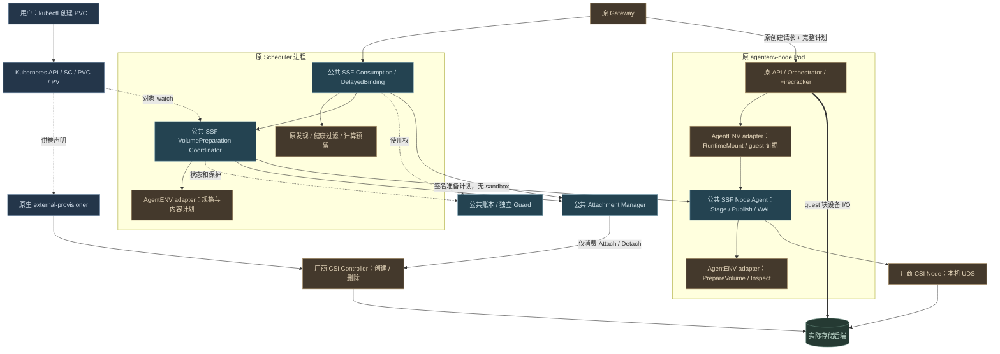

# SSF 卷管理与运行时 Adapter：Kubernetes 建卷、沙箱直接使用

> 2026-10-21 独立化更新：本页保留此前设计/阶段记录。当前 AgentENV 的消费与准备协调、账本事务在 `sandbox-storage` 的独立 `ssf-coordinator` 中执行；Scheduler 为轻量客户端，standalone 同样独立。以 [03](03-framework-design.md)、[23](23-current-implementation-architecture.md)、[26](26-independent-coordinator-implementation.md) 和 [13 部署](13-agentenvadapter-installation-and-deployment.md) 为准。旧内嵌宿主、`go.ssf.mod`、`-tags ssf`、原仓库 SSF overlay 不再适用。本次保留 Block/ext4 和全部原生功能，未新增 OverlayBD CSI Driver。

> 实施增量和当前验证状态见 [22](22-volume-preparation-implementation.md)，用户操作主线见 [20](20-kubernetes-pvc-agentenv-mount-validation.md)。设计要求不等于实现或真机验收已全部完成。

日期：2026-10-21。状态：**设计要求；软件增量与验收状态见 22**。最初设计阶段仅修改文档；后续已有代码和部署材料更新，尚未执行集群及真机验收。

本设计明确 SSF 的定位：在 Kubernetes 原生存储管理体系上，为沙箱提供统一的卷管理与使用框架。每个运行时实现同规格 adapter，主要承担两部分：**供卷过程中的运行时定制准备**、**把卷接入自己的沙箱内部**。AgentENV 的 Gateway、Scheduler、节点服务、Orchestrator、SDK 原有调用和生命周期保持原有职责。

本文是 [03 公共框架](03-framework-design.md)、[05 Kubernetes 集成](05-kubernetes-integration.md)、[16 AgentENV 接入](16-agentenvadapter-native-integration-design.md) 的最新补充；关于供卷定制、PVC 引用、初始化和就绪判据，以本文为准。其他生命周期约束继续有效。现有代码状态仍见 [18](18-native-integration-implementation-status.md)，不得把这里的目标接口当成已可调用接口。

## 1. 固定用户契约

日常使用只需要两步：

1. 通过 Kubernetes 创建使用 AgentENV 存储类的 PVC；Kubernetes 负责供给和绑定 PV，SSF 自动完成该运行时要求的准备。
2. 调用原 AgentENV 创建沙箱接口，指定 PVC 和 guest 路径；SSF 自动等待必要准备、挂载并核验 guest 可用。

用户不需要创建初始化 Pod、不需要手工执行 mkfs、不需要先调用 `/volumes import`，也不需要知道 PV handle、节点设备路径、运行票据或内部 volumeUID。静态 PV 仍通过 PVC 绑定后引用，沙箱不接受裸 PV 名称或 CSI handle 作为租户入口。

“直接能挂载”是用户契约，不表示 `kubectl apply` 返回时所有异步工作都已结束。Immediate 自动提前准备；WFFC 等待首次沙箱选点后自动完成供卷和准备。用户可以立即调用创建沙箱，系统负责等待；成功 `201` 必须意味着 guest 中该卷已经可用。

## 2. 与 K8S CSI 的类比及责任边界

StorageClass 是声明；external-provisioner 观察 PVC，并调用厂商 CSI Controller 创建后端卷，原生控制器完成绑定。Block 能力交付块设备，不保证内部已有 guest 文件系统。这些标准行为保持不变。[StorageClass](https://kubernetes.io/docs/concepts/storage/storage-classes/)、[external-provisioner](https://kubernetes-csi.github.io/docs/external-provisioner.html)、[CSI Raw Block](https://kubernetes-csi.github.io/docs/raw-block.html)

SSF adapter 的两部分是框架内部 SPI，不冒充标准 CSI Controller/Node RPC。**不把 StorageClass.provisioner 改成 agentenvadapter，也不另写一个竞争供卷的 provisioner。**

| 层次 | 负责内容 | 不包含的职责 |
| --- | --- | --- |
| Kubernetes + CSI 管理组件 | StorageClass/PVC/PV、后端供给、绑定、Snapshot/Clone、扩容、回收 | 理解 Firecracker 或 guest 挂载路径 |
| 厂商 CSI Driver | 后端资源及宿主设备、标准 Controller/Node RPC | 管理沙箱生命周期、实现所有运行时的卷内容 |
| SSF 公共框架 | 原生资源观察、准备编排、身份/使用权/拓扑、Attach、Node 发布、WAL、恢复和保护 | 内置 AgentENV 业务规则、接管 VMM |
| Adapter 第一部分：VolumePreparation | 描述运行时卷规格，检查或构建运行时需要的内容，返回可用证明 | 直接创建/删除后端卷、私设 writer 锁 |
| Adapter 第二部分：RuntimeMount | 将受约束 Endpoint 接入 VMM/guest；就绪、停止及冻结等 hook | 再创建另一台 VM、重新供卷 |
| 原沙箱平台 | 鉴权、计算调度、VMM 启停、模板、原 API 和响应 | 重复实现 CSI、存储账本和通用恢复 |

第一部分是可选定制：某运行时可直接使用 CSI 的产物时，实现校验即可。AgentENV Block/ext4 需要补齐文件系统准备。源自 `kubectl`、原 Volume API 或模板克隆的相同卷意图，必须进入同一条准备链，不能按 API 入口区分能力。

## 3. 关键模块与部署归属



青蓝表示公共模块，棕色通过名称区分运行时定制与厂商 Driver，灰蓝为原生 Kubernetes，绿色为后端。实线为控制调用、虚线为对象/状态协调、粗线为数据路径。Controller 不直接调用 Node。框内模块不是额外 Pod。

[独立 Mermaid 图源](figures/ssf-volume-preparation-adapter.mmd) 与上图保持一致。

- 公共准备协调器默认作为现有 Scheduler 内的公共库运行，具备 PVC watch/reconcile；它只准备已有后端卷，不另建资源权威。
- 同一 adapter 包注册 `VolumePreparation` 和 `RuntimeMount` 两部分；节点端可共用现有 `agentenv-storage` sidecar，使用不同的认证方法/消息类型。
- Node Agent 仍唯一执行 CSI Node RPC；既有公共 Attachment Manager 唯一执行 Direct Attach/Detach。
- standalone 使用现有本地插件宿主承载相同公共协调库；不能同时由 Scheduler 和本地宿主竞争同一卷准备权。
- 保留原 Gateway/Scheduler Deployment、节点 DaemonSet、headless Service、心跳/P2P 和退出顺序。不新增默认 `ssf-controller`，不创建逐卷初始化 Pod/Job。

现有本地 StorageProvider loopback 端点不能直接作为远端准备接口。公共 Node API 新增受 mTLS 和签名计划约束的准备方法，Node Agent 通过管理员注册的本机 adapter 端点执行内容定制；此调用不要求先有 VMM。

## 4. 用 StorageClass 选择运行时卷规格

管理员一次性配置“后端存储参数 + 运行时规格”。用户只选存储类和容量。以下是**拟新增的 SSF 约定**：

```yaml
apiVersion: storage.k8s.io/v1
kind: StorageClass
metadata:
  name: agentenv-block
  annotations:
    ssf.dev/volume-profile: agentenv-block-ext4-v1
provisioner: your.vendor.csi.example
parameters:
  # 保留该厂商要求的实际后端参数
  pool: sandbox
reclaimPolicy: Retain
volumeBindingMode: Immediate
allowVolumeExpansion: true
```

上例 provisioner/parameters 由部署管理员替换，不能直接部署占位值。profile 引用放在 **metadata.annotations**，不作为未知参数透传厂商 Driver，不依赖 Driver 识别 SSF。

profile 是管理员维护的版本化配置，随现有 SSF 配置发布，本轮不新增一套 StorageClass CRD：

| profile 内容 | AgentENV 首规格 |
| --- | --- |
| runtime / adapter protocol | agentenv / 协商后的 VolumePreparation、RuntimeMount 版本 |
| 交付介质 | Kubernetes `volumeMode: Block`，设备内 ext4，整盘无分区表 |
| 默认内容 | `empty-ext4`；既有合法 ext4 可复用 |
| 空白初始化策略 | 无恢复数据源且可写；受独占准备权保护；整设备检查全零后初始化 |
| 不兼容内容 | 其他文件系统、分区表、未知非零数据拒绝，不自动清空 |
| 就绪规则 | 内容已验证、UUID 已持久化、源身份匹配、临时资源释放完成 |
| 访问/维护能力 | exclusive writer、受支持 RO、离线扩容、原生 Capture/Clone |

profile 名称一旦发布，其语义不可原地改变；新版本使用新名称。准备记录固定 profile 摘要、StorageClass UID、PVC/PV UID 和 CSI identity。SC 注解被修改不触发已存在卷重新格式化或自动迁移。

Guard 扩展为同一服务中的短时准入默认化与校验：在受管 namespace、指定 profile 的 PVC CREATE 时补 `ssf.dev/managed=true`、`ssf.dev/volume-protection` finalizer、固定 profile revision、缺省 Block 并校验冲突；不在 webhook 内访问设备、格式化或长时间等待。Pod 准入同时识别已接管标签及匹配的受管 SC，消除标签补齐前的竞争窗口。已有 PVC/Retain PV 的接管仍需核验原消费者已排空，不能自动夺取使用权。

## 5. Adapter 第一部分：卷准备 SPI

以下是拟议逻辑接口，最终编码需版本化协议和生成一致性检查；不是现有可调用方法。

| 方法 | 执行位置 | 输入 / 输出 |
| --- | --- | --- |
| `DescribeVolumeProfile` | adapter 控制库 | runtime 规格、支持来源、设备/FS、格式版本和所需能力 |
| `PlanVolumePreparation` | adapter 控制库 | 已校验的 PVC/PV/数据源和 profile → 只读校验/初始化/内容填充计划 |
| `PrepareVolume` | adapter 节点实现 | 公共框架已发布的受约束 Endpoint + 准备票据 → 内容校验/准备结果 |
| `InspectVolumePreparation` | adapter 节点实现 | 未知结果恢复；检查设备身份、格式意图、内容、遗留进程和挂载 |
| `ReleasePreparation` | adapter 节点实现 | 关闭定制阶段持有的设备/进程/临时挂载，返回可信释放证据；不删除卷 |

公共框架负责票据、互斥、超时、重试、WAL、CSI Attach/Publish/逆操作；adapter 只实现内容差异。不得在每个 adapter 重写 PVC watcher、供卷器、CSI 客户端或分布式锁。

### 5.1 AgentENV 的具体准备行为

原 [VolumeManager::create_empty_backing](../AgentENV/src/volume.rs) 会生成 ext4 再打包 OverlayBD；SSF 接入需要保留“得到可直接作为数据盘使用的 ext4”的结果，CSI Block 本身作为 backing，不重复打包 OverlayBD。

| 来源/实际状态 | 准备行为 |
| --- | --- |
| 新动态 PVC，无 dataSource，设备全零 | 获得独占准备权，写持久格式意图后构建 ext4；读取并固定 UUID |
| 已有合法 ext4 的 Block PVC | 校验规格/容量/身份，保留数据；不再 mkfs |
| 静态 PV 绑定的新 PVC | 检查后端交接和既有引用；仅 profile 允许、无恢复来源且设备确实全零时初始化，否则按既有数据校验 |
| Snapshot/PVC clone 恢复 | Kubernetes 原生 dataSource/dataSourceRef 供卷，固定源 UID/pin；只校验恢复内容，缺失 ext4 属于失败，不能改为空盘 |
| 只读源 | 校验已有 ext4；空白时拒绝写入式初始化 |
| 分区盘、其他 FS、未知数据 | 明确不兼容；不得以 blkid 无结果当作空盘 |
| 镜像内容定制 | 通过 profile 能力声明及不可变源摘要走准备 SPI；未提供该实现时在建卷校验阶段拒绝，不能静默得到空卷 |

当前首个完整规格继续是 Block/ext4；本修订不强制把 legacy OverlayBD 变成 CSI Driver，也不暗示所有 `image/fromVolume` 都能无条件转换。原 `image` 路径在 legacy 保留；SSF 的 fromVolume 通过原生稳定快照/克隆来源表达。后续镜像初始化可扩展同一准备 SPI，不另立公开建卷入口。

### 5.2 初始化安全与恢复

是否能初始化由**声明来源、profile、实际设备状态和持久历史**共同决定，不能再使用 `Import != nil` 作为一刀切的禁止条件，也不能简单对所有导入设置 `initialize=true`。

1. 以 PVC UID + PV UID + Driver/handle + profile digest 建立准备记录，统一占用该资源的独占使用权；与 writer、暂停 hold、扩容、迁移及删除互斥。
2. 校验 Endpoint 路径、major/minor、容量、节点 boot、只读状态和无冲突消费者；在完整读取设备前后校验身份。源改变立即中止。
3. 无合法 FS 时完整检查所有字节，读错误、短读/容量不符、超时均不能当作空白。只有允许空卷且检查成功才持久记录 format intent。
4. 格式化后验证 UUID、规格、容量并持久结果。成功的既有 UUID 或恢复源内容不可被后续重试覆盖。
5. 发生部分格式化/结果未知时，通过 WAL 与实际内容核对；不能用新 operation 再格式化来“修复”。无法确认则进入 NeedsRecovery，继续阻止新 writer。
6. 进程或节点失联不能因租约到期就允许别处重做。必须确认旧准备进程停止/设备释放，或完成可信 fencing，才能接续 epoch。

PVC UID 是引用身份，不能替代后端资源去重：同一 Driver 实例/volumeHandle 的别名必须归入同一物理资源锁；多个 PV/PVC 指向同一后端且所有权不明确时拒绝接管。profile 或别名变化不能绕过准备历史。

## 6. 供卷与准备时序

### 6.1 Immediate：创建 PVC 后自动准备

```text
PVC CREATE（Guard 固定 profile/保护）
 → 原生 provisioner/Driver 供卷 → 原生 Bound
 → 公共 Resolver 验证身份/保护/拓扑
 → 公共准备协调器取得独占维护权，选择符合拓扑的准备节点
 → 公共 Attach → Node Stage/Publish
 → adapter PrepareVolume：构建或校验 ext4
 → adapter 释放本次准备资源 → Node Unpublish/Unstage → 最终引用 Detach
 → 持久 VolumeReady，并投影可观测状态
```

准备节点选择复用公共拓扑/节点注册和准备并发配额，不占用一台不存在的 VM 的 CPU/内存预留，也不调用 AgentENV 创建接口。它只是临时执行卷准备，不永久固定沙箱 Worker；未来调度仍服从真实 PV topology。

### 6.2 WFFC：首次创建沙箱自动补齐

```text
PVC CREATE → WaitingConsumer（尚不能承诺卷内容已经准备）
 → 原创建沙箱请求直接引用 PVC
 → 原 Scheduler + 公共 DelayedBinding：联合选点、计算预留
 → 原生供卷/绑定 → 同一准备计划在选定节点执行
 → Ready 内容证明 + 独占使用权原子接续给 sandbox owner/run
 → NodeVolumePlan → 原 Orchestrator 接入 microVM → GuestReady → 201
```

WFFC 不提前随意选点破坏延迟绑定含义。静态与动态、Immediate 与 WFFC 均走同一准备契约；已准备卷跳过内容构建，仅做必要身份校验。创建请求在准备尚未完成时加入既有 operation 等待，不另启动第二个 formatter。

### 6.3 准备与运行资源交接

默认 Immediate 提前准备完成后释放全部临时资源，再报告可自由调度的 VolumeReady。同节点 WFFC/首次创建可复用 attachment/stage，但必须满足：

- 受信节点证明准备进程、可写 FD 和临时挂载已关闭。
- 公共事务将 `purpose=VolumePreparation` 的独占使用权和引用接续为 `purpose=SandboxRun`，绑定 owner/run/epoch；不存在两者同时写入的窗口。
- 共享 stage 可复用，publish target 按新 Binding 明确建立/登记，不能把临时路径直接当作 VM 永久路径。
- 新运行引用持久化前不得回收旧引用；交接失败保留原权威记录并恢复，不执行无依据的 Detach。

准备操作没有 sandboxID，不能伪造 RuntimeReady/Stopped。新增独立 PreparationReceipt/PreparationReleased 证据类型，记录执行进程、节点 boot、设备、UUID 和计划摘要；公共证据验证不因此降低原 VMM 停止证明要求。

## 7. 就绪状态与管理权威

准备状态保存在现有共享账本的独立记录中，是卷内容就绪的派生事实，不能改变 Kubernetes 对供给、容量、绑定和删除的权威。

| 状态 | 含义 |
| --- | --- |
| WaitingBinding / WaitingConsumer | 等待原生绑定或 WFFC 的计算选点 |
| PendingPreparation | 已 Bound、身份及保护已验证，尚未满足运行时内容规格 |
| Preparing | 独占准备中，记录节点/attempt/epoch/WAL |
| ContentReady | 内容验证成功，准备占用尚未释放或接续 |
| VolumeReady | 内容可用且临时占用已释放，或已事务交给当前运行 |
| NeedsRecovery / Failed | 未知结果需要核实 / 已确认不兼容或失败；都不能作为就绪消费 |
| GuestReady | 本次运行中，microVM 内指定路径已挂载核验 |

`PVC.status.phase=Bound` 由 Kubernetes 维护，SSF 不伪造原生 phase。公共协调器可写受保护的观察注解 `ssf.dev/preparation-state`、`ssf.dev/preparation-reason`、`ssf.dev/preparation-revision`，用于 kubectl 观察；**授权和启动不能只信注解**。Guard 只允许协调器身份更新这些字段，内部仍校验账本、对象 UID 和版本。

Ready 固定卷身份、FS UUID、profile/source revision，不是永久跳过设备校验的许可证。正常 guest 写数据不使其失效；后端身份变化、显式迁移或格式版本变化必须重新核验。克隆的新 PVC 使用新准备记录，不继承源卷的 writer 或节点挂载证明。

## 8. Adapter 第二部分：接入 AgentENV microVM

1. 公共消费层取得当前 run 的使用权、Attach 并下发完整 NodeVolumePlan；计划含 PVC/PV UID、准备 revision、FS UUID、设备/RO/目标路径约束。
2. 公共 Node Agent Stage/Publish 后返回 BlockDevice Endpoint；RuntimeMount 校验准备事实与本次设备一致。
3. AgentENV adapter 生成 `PreparedExternalDrives`；原 Orchestrator 校验与 legacy、attachedDrives 的路径、数量、槽位和只读冲突。
4. 原 Firecracker/jailer 接入真实块设备，guest 按已固定 UUID 识别磁盘，挂到指定路径，验证容量、ext4、RO。
5. 原 guest 就绪证据经 Node 和 Coordinator 验证后提交，原 Gateway 返回 `201` 和 native sandboxID。

RuntimeMount 不负责“发现是导入卷所以拒绝准备”，也不允许在恢复或 guest 挂载失败时兜底 mkfs。内容准备属于第一部分，第二部分消费已满足规格的卷。

pause/resume、autoResume、Capture/Clone、模板继承及删除仍按 [16 第 8 节](16-agentenvadapter-native-integration-design.md#8-保持原生生命周期的数据语义)。恢复引用原 PVC UID 和准备证明，不按名称重新绑定；Fork RW 子卷走原生克隆并校验内容，RO 保留共享引用。普通删沙箱保留用户 PVC。

## 9. 对外接口：直接引用 PVC

以下是**目标请求示例，现有二进制尚不支持新增的 `pvc` 字段**。

用户创建 PVC：

```yaml
apiVersion: v1
kind: PersistentVolumeClaim
metadata:
  name: notes
  namespace: agentenv-system
spec:
  storageClassName: agentenv-block
  accessModes: [ReadWriteOnce]
  volumeMode: Block
  resources:
    requests:
      storage: 1Gi
```

随后调用原 `POST /sandboxes-cold`：

```json
{
  "image": "你的已验证可启动镜像",
  "timeout": 3600,
  "volumeMounts": [
    {
      "pvc": {"namespace": "agentenv-system", "name": "notes"},
      "path": "/data"
    }
  ]
}
```

`volumeMounts` 每项的 `name`（已有原生卷名）与 `pvc` 是互斥来源，必须恰好一个；`path` 沿用原规则。原 `{"name":"legacy-or-registered","path":"/data"}` 完全保留，不自动把查不到的原生卷名解释成同名 PVC。无卷请求不增加必填字段。

PVC namespace 必须经可信主体 allowlist 验证；缺省 namespace 从部署/主体配置取得，不能从用户 tenant header 推导。新请求首次解析后固定 PVC UID/PV UID；重试、暂停恢复、模板引用保存 UID，同名重建不能偷换原卷。模板省略、`[]` 和显式替换语义不变。

更新 OpenAPI/SDK 时保留旧请求的线格式和行为，新增来源分支。Rust 原生侧仅增加通用卷引用和 hook 数据；Kubernetes 查询、准备编排、CSI 与账本继续在 SSF/adapter，不能复制进入原生节点。

### 9.1 原 Volume API 的定位

`/volumes` 继续作为可选便捷 facade：

- `create(provider=ssf)` 转换为同样的原生 PVC 声明，自动进入上述准备流程；不再拥有专属初始化权限。
- `import` 可保留为“建立友好名称映射”的兼容操作，直接 PVC 引用不依赖它。多个别名指向同一 PVC UID 时必须共享同一准备记录和使用权。
- 查询可投影 Kubernetes 管理状态及 SSF 准备状态；不能从 `Bound` 推断可用。
- expand/delete 转为原生资源意图并受公共维护/排空/引用保护；不直接调用厂商 DeleteVolume。

## 10. 最小侵入与有限框架扩展

| 位置 | 设计改动 | 保持的边界 |
| --- | --- | --- |
| SSF kubernetes / 配置 | profile 解析、PVC watcher、来源 pin、就绪投影 | 原生 SC/PVC/PV 唯一管理入口 |
| SSF consume / ledger | 公共准备 operation、互斥及原子接续、恢复记录 | 共用 writer/hold/维护/回收权威 |
| SSF Node API / WAL | 准备目的、受约束节点执行、专用证据 | 无第二套 CSI Node 路径 |
| SSF Guard | profile 准入默认化/校验、准备阶段保护与状态字段保护 | 独立现有服务；webhook 不执行长操作 |
| agentenvadapter | 实现卷规格/内容准备、microVM 挂载两部分 | 不新增公开沙箱控制面 |
| 原 Scheduler 薄桥 | 启动公共准备协调器；原生候选节点输入 | 保留发现、健康、策略和计算预留 |
| 原 API 模型/元数据 | 增加可选 PVC 来源及持久 UID 引用 | 原路由、成功码、ID、无卷路径不变 |
| 原 Orchestrator/Firecracker | 复用现有 StorageProvider/PreparedExternalDrives | VMM 管理保持原生 |

Node API 需要显式区分 VolumePreparation 与 SandboxRun，不能为了没有 VM 的准备操作放宽原 RuntimeReady/Stopped 校验。新增 capability 协商；旧插件缺能力时新建卷明确拒绝，不静默走手工 import。

## 11. 生命周期与部署补充

- **多实例协调：** 同一 PVC UID/profile revision 的准备只有一个有效 owner/epoch。watch 重复、多 Scheduler、直接创建与 Volume API 并发进入同一记录。复用共享事务与 leader/CAS fencing。
- **基础设施依赖：** 准备运行在常驻 Node Agent/adapter 上；其镜像、配置、数据库及 WAL 不依赖待准备的业务 PVC，避免引导循环。
- **退出：** 原联合 drain 额外等待准备进程/FD/临时挂载及恢复责任；不能只数运行中的沙箱。升级前保留旧 WAL 与 profile 版本。
- **删除：** 受管 PVC 已有可信保护 finalizer 时，允许 Kubernetes DELETE 写入 DeletionTimestamp，公共 watcher 据此持久记录排空任务并关闭新准入；不靠被 webhook 拒绝的 DELETE 触发后台工作。准备权、运行引用、暂停 hold 和快照 pin 均计入，不能为删卷擅自停止用户沙箱。引用全部释放并获得账本许可后由协调器移除保护 finalizer，原生组件完成删除。缺少可信保护时仍拒绝破坏性删除；普通租户不能移除 finalizer/标签。PV 后端回收保留原 Retain/许可策略。这是待实现的 Guard/排空扩展，当前代码并不具备该自动流程。
- **跨项目：** 公共框架按 PVC/后端身份共用使用权。不同 profile 不自动重格式化同一卷；管理员显式转换且排空后方可更改。
- **性能：** Immediate 默认把首次内容准备前移；WFFC 的必要供卷/准备计入首启耗时。已就绪卷不扫描全盘，不重复格式化，不保留逐卷 HolderPod。

## 12. 实施顺序与验收门槛

后续实现按下列顺序推进；本次不执行这些代码变更：

1. 公共准备模型、profile/来源固定、专用证据、互斥与恢复测试。
2. PVC 准入与公共 watcher，Immediate 自动准备及清理闭环；旧 Volume API 接到同一流程。
3. WFFC 同节点准备与原子引用交接，补四种供给/绑定组合。
4. AgentENV PVC 来源模型、直接创建链路、模板/恢复 UID 固定，复用原 RuntimeMount。
5. 改写专项验证为两步主线，更新部署/RBAC/协议生成及补丁包，执行本机与真机分层验收。

| 编号 | 必测场景 | 通过标准 |
| --- | --- | --- |
| P01 | kubectl 创建 Immediate PVC，不创建沙箱 | 自动准备到 VolumeReady；无初始化 Pod、无手工格式化、无 import |
| P02 | 上述 PVC 直接用于原创建接口 | 201；guest `/data` 可写；删除沙箱并重建后数据仍在 |
| P03 | 原 `/volumes` 创建与 kubectl 创建 | 相同 profile/来源得到相同准备行为，后者不受导入限制 |
| P04 | 动态/静态 × Immediate/WFFC | 原生供卷/绑定，准备正确时机；WFFC 无任意提前固定 Worker |
| P05 | 已有 ext4、其他 FS、未知非零、只读空盘 | 数据保留或明确拒绝；不误格式化 |
| P06 | Snapshot/PVC clone 源损坏或身份改变 | 拒绝并保持源引用；不回退空卷 |
| P07 | 两个创建、多个别名、多协调器抢同一卷 | 单准备 owner，无双 formatter、无双 writer |
| P08 | 格式化中断、Ready 丢回执、节点重启/失联 | 按 WAL/真实内容恢复；未知旧操作不被新 epoch 越过 |
| P09 | 准备与运行交接、跨节点接续、并发删除/扩容 | 设备释放证据与引用事务一致；无提前 Detach/回收 |
| P10 | pause/resume、Fork、模板省略/空数组/替换 | 原语义；固定 UID；克隆不重格式化；原生 ID/API 保留 |
| P11 | 插件关闭、legacy、custom extension、代理、无卷 | 原有功能保持；不依赖新增准备服务 |
| P12 | profile/Ready 注解伪造、PVC 同名重建、协议不兼容 | 不越权、不启动错误卷、不退化为空卷 |

完成判定以真实 guest 数据与故障恢复证据为准，不能仅以 PVC Bound、HTTP 201、mock 或类型检查替代。

## 13. 与当前代码的差距

当前代码的 `native_volumes.go` 将初始化授权限制为非 import、非 snapshot；`volumeMounts` 依赖已登记卷名，没有 PVC 直接来源；尚无自主 PVC 准备协调器和本设计的准备阶段状态/证据。已有 CSI、WAL、全零校验、UUID 核验、原生生命周期 hook 可复用，但不足以声明本设计完成。

本次交付是设计修订：供卷定制是一等能力，RuntimeMount 是第二部分，原 Volume API 是可选 facade。后续实现及测试必须围绕“两步用户契约”，不能再把临时 Pod 初始化的绕行流程作为目标验收。

## 14. 本次文档检查范围

检查本地文档链接/章节锚点、示例 YAML/JSON、独立图源与正文一致性，以及受保护 CSI 参考文件哈希。Mermaid 保留可编辑源；本次未新增 SVG/PNG 渲染结果。此段为设计阶段记录。后续软件及部署增量、实际本机验证和未完成边界见 [22](22-volume-preparation-implementation.md)；集群/CSI/KVM/guest 验收仍未执行。
