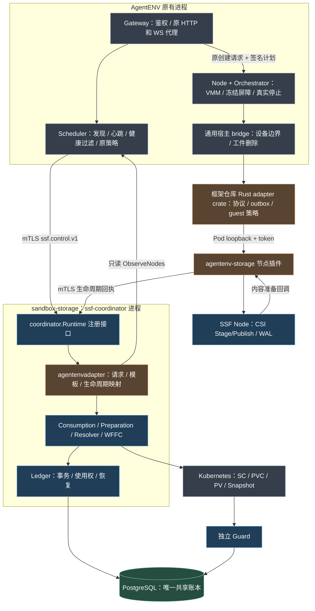
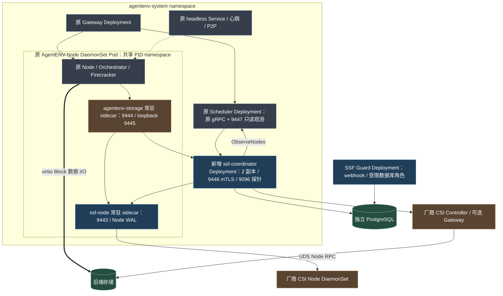
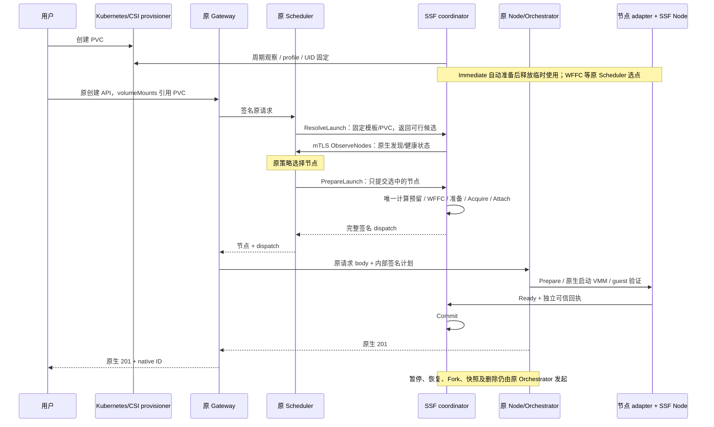

# 当前实现架构：独立 SSF 协调服务与 AgentENV 薄接入

更新：2026-10-21。本页描述当前源码和部署材料；真实 Linux/KVM/Kubernetes/厂商 CSI 验证不在本机通过记录内。

## 1. 职责归属

Kubernetes 管理卷资源和供卷，SSF 管理准备、消费、引用和恢复，AgentENV 原 Scheduler 选择计算节点、Orchestrator 管理 VMM。原 API、SDK、Gateway 代理、VolumeManager、SnapshotManager、OverlayBD、P2P、custom extension、builder 和 recorder 保留。

| 模块 | 源码 | 运行位置 |
| --- | --- | --- |
| Consumption / Preparation / Resolver / Ledger | `sandbox-storage/{consume,preparation,kubernetes,ledger}` | 独立 `ssf-coordinator` |
| 运行时注册与 mTLS 服务 | `sandbox-storage/coordinator`、`cmd/ssf-coordinator` | 同上 |
| AgentENV 控制映射与原生计算预留 | `sandbox-storage/adapter/agentenvadapter/control_service.go`、`native_*.go` | 同上，专用表保留在 adapter |
| 原计算策略 / 发现 / 心跳 | `AgentENV/services/scheduler` | 原 Scheduler |
| 轻量 Go 客户端 | `sandbox-storage/sdk/go/control` | 原 Scheduler 内；仅标准库，无 PG/CSI/SSF 核心依赖 |
| 运行时协议、outbox、回收扫描、guest 策略 | `sandbox-storage/adapter/agentenvadapter/runtime` | 链入原 Node 的 Rust crate |
| 设备/工件边界及生命周期调用点 | `AgentENV/src/sandbox/storage/mod.rs` 和原生生命周期 | 原 Node/Orchestrator |
| NodePlugin / SSF Node / WAL | `sandbox-storage/adapter/agentenvadapter`、`node` | 原 Node Pod 的两个常驻 sidecar |
| Guard / 数据库 | `sandbox-storage/guard`、PostgreSQL | 独立 Guard Pod / 独立数据库 |

本轮继续采用 CSI Block/ext4 外部数据盘。`agentenv-block` 是 StorageClass 名，`provisioner` 决定后端 Driver，profile 决定准备规格。legacy OverlayBD 保留；实现原生 OverlayBD CSI Driver 属于另一个范围。

## 2. 逻辑架构

## 3. 部署架构

协调服务是唯一消费执行方。NodePlugin 不再回调 Scheduler 的 StorageControl，也不在 standalone 内嵌数据库和协调器。standalone 增加本机 `ssf-coordinator.service`，保留原 AgentENV 服务和固定本机 placement。

## 4. 创建与生命周期

`ResolveLaunch` 持久固定请求、模板和卷引用；`PrepareLaunch` 只处理原策略选中的节点。已取得预留但结果未知时，`InspectOperation` 返回原节点或原 dispatch；只有明确尚无预留的容量拒绝才能由原策略重选。后台恢复不重放公开创建 API。

暂停仍在原冻结屏障中保留逻辑使用权，停止后释放当前 run；恢复、Fork、builder、recorder 使用相同计算预留。外部卷通过公共准备及 Endpoint 接入，native memory/rootfs、legacy 和 CSI 卷联合捕获。recorder 使用独立 owner/run 和 checkpoint 克隆，不复用源 writer。

Rust crate 外移的是代码归属，outbox 仍在原进程的副作用边界同步落盘。宿主负责原生设备路径/major/minor、受限 guest 执行、真实进程停止、最后工件删除。服务端不接收任意宿主删除路径。

## 5. 运维与验收

部署 overlay、联合 Dockerfile、配置和凭据工具在 `sandbox-storage/adapter/agentenvadapter/deploy`；引用原 AgentENV base。Scheduler 无 SSF 数据库 Secret、无消费 RBAC、无 SSF modfile/tag。可关闭的 StorageProvider 和无卷路径保留。

[实施和协议](26-independent-coordinator-implementation.md) · [部署](13-agentenvadapter-installation-and-deployment.md) · [测试矩阵](14-agentenvadapter-real-environment-test-plan.md) · [PVC 手动主场景](20-kubernetes-pvc-agentenv-mount-validation.md)。验证结果以本轮报告为准，旧 18/22 中的测试不能替代本轮测试。
