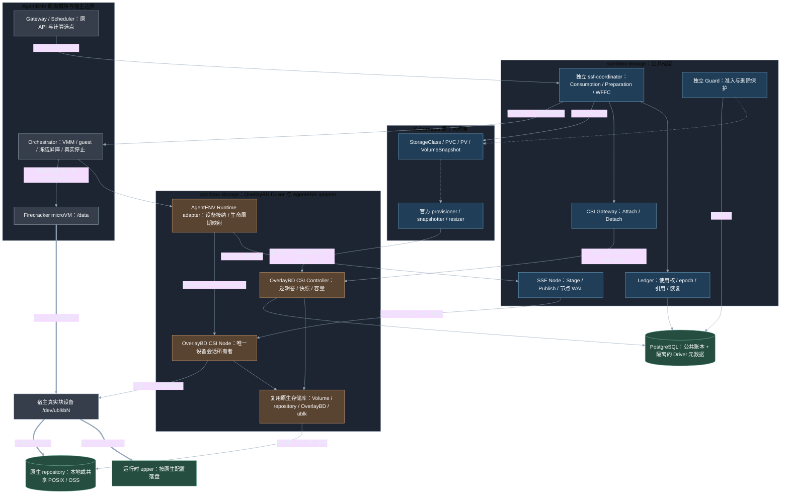
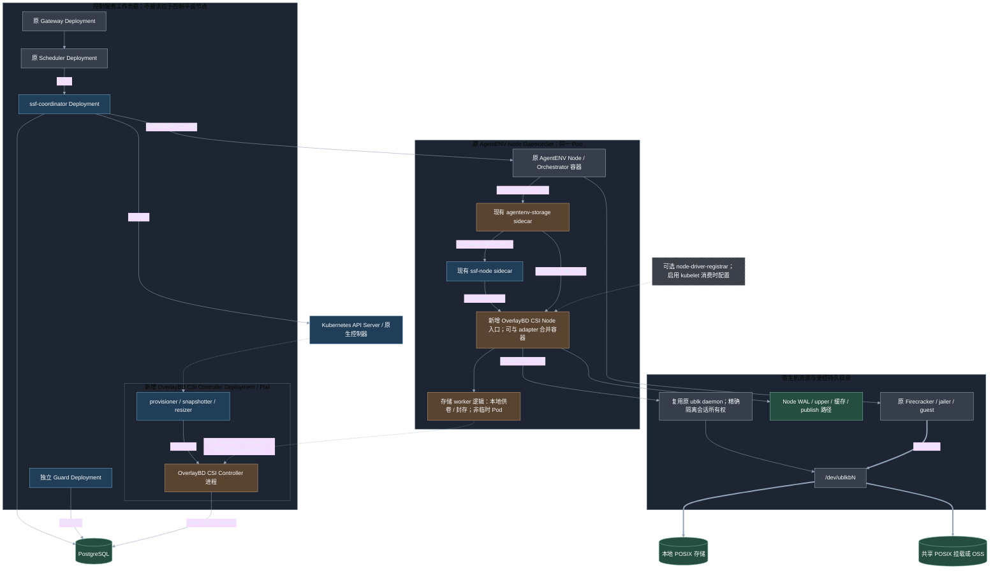
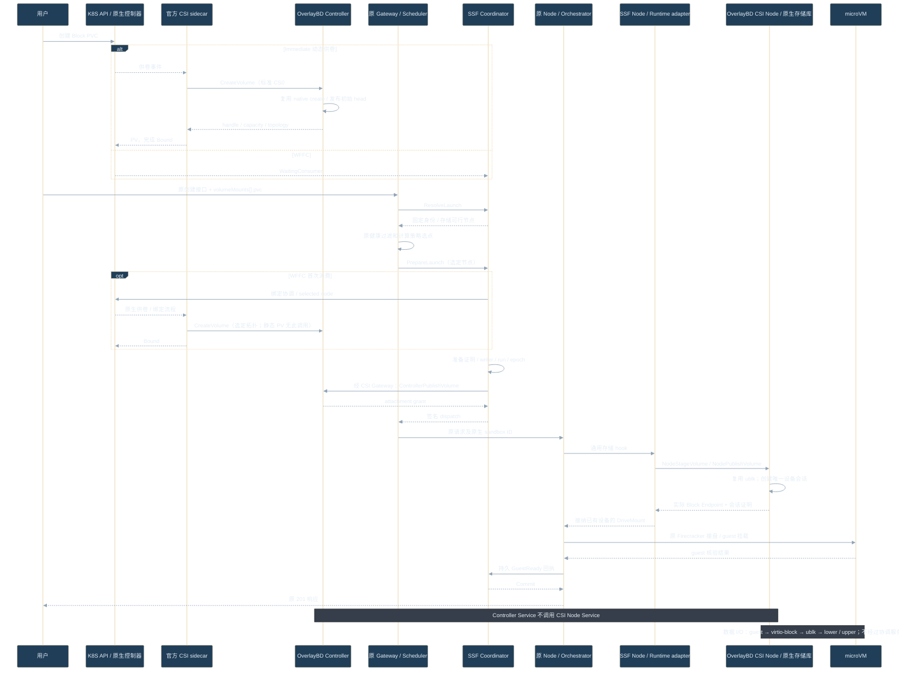

# AgentENV 原生 OverlayBD CSI 接入与最小侵入复用设计

更新：2026-10-22。状态：**详细设计，尚未实施**。本次交付为本文、三份 Mermaid 图源和目录索引，不代表新增 Driver、协议或测试已经交付。

本文细化用户已确认的方向：Kubernetes 管理 OverlayBD 卷，SSF 负责公共消费协调，AgentENV 保留原生计算和沙箱生命周期；卷创建、OverlayBD/ublk 和 VM 接盘均复用 AgentENV 现有实现。总体架构遵循 [03](03-framework-design.md)，当前软件事实以 [23](23-current-implementation-architecture.md)、[26](26-independent-coordinator-implementation.md) 为准，需求来源见 [25](25-requirements-and-open-questions-summary.md)。

## 1. 结论与范围

### 1.1 三个角色及其关系

| 逻辑角色 | 对外职责 | 复用的原生能力 | 不应承担的职责 |
| --- | --- | --- | --- |
| OverlayBD CSI Controller | 创建、删除、查询、快照、克隆、容量及拓扑；发放节点 attachment | VolumeManager、repository、空卷 ext4 封装、层发布与引用管理 | 调度沙箱、控制 VMM、直接调用 CSI Node RPC |
| OverlayBD CSI Node | 将逻辑卷物化为宿主真实块设备，Stage/Publish、恢复及最终释放设备会话 | 原 OverlayBD/ublk 库、daemon 客户端、层配置物化及设备校验 | 创建沙箱、把文件系统挂入 guest、重复实现存储引擎 |
| AgentENV OverlayBD Runtime adapter | 接纳已准备设备，协调 guest 挂载与生命周期屏障 | 原 ExtraDrive/DriveMount、Firecracker/jailer、guest 校验、快照与 Fork 宿主操作 | 再创建一份 ublk 设备、绕过 CSI 删除卷、代替原 Orchestrator |

**CSI Node 角色需要保留。** 当前原生 OverlayBD 已经需要在宿主生成 `/dev/ublkbN` 等块设备，再交给 Firecracker。这里的“挂载到宿主”主要是设备创建和 Block Publish，不是先把 guest ext4 挂成宿主目录。

**逻辑角色不等于独立 Pod。** Node 入口可以与节点 adapter 同 Pod，满足构建和权限边界时也可合并进程或容器。是否合并不改变设备所有权：对于 CSI 管理卷，只有 CSI Node 会话管理器创建、恢复和最终销毁设备。

### 1.2 用户体验及保留能力

主线固定为：**Kubernetes 创建 PVC → 原 AgentENV 创建接口引用 PVC → guest 使用 `/data`**。不要求初始化 Pod、手工格式化、预先 import，也不新增公开沙箱 API。

- 保留 Gateway、Scheduler、Node、Orchestrator、VolumeManager、SnapshotManager 及原部署主体。
- 保留命名卷、PVC 引用、legacy 混合、模板、v2、暂停/恢复、自动策略、快照、Fork、builder、startup recorder、P2P、custom extension、HTTP/WS/流式代理。
- 普通删除沙箱保留 PVC；删除 PVC 由 Kubernetes 驱动回收，并受 SSF 引用保护。
- 支持动态/静态供给与 Immediate/WFFC。静态卷必须是已存在且可验证的 OverlayBD 逻辑卷，不能仅把任意目录填进 PV。
- 使用原生支持的 `posix_fs` 和 `oss` repository；NFS 等共享文件系统作为已挂载的 POSIX 目录使用，是否可用以其原生文件与锁语义兼容性为准。
- 当前通用 CSI Block/ext4 路径和 legacy OverlayBD 路径继续存在，不自动迁移或接管既有资源。

本设计新增 OverlayBD CSI Driver，取代此前“不新增 OverlayBD CSI Driver”的范围限制；不扩展 FileTree，不承诺跨节点内存迁移，不把节点本地 upper 描述为远端同步写入，不重新实现 OverlayBD 或 ublk 引擎。

### 1.3 当前事实与新增工作分开

| 内容 | 当前事实 | 本设计增量 |
| --- | --- | --- |
| 公共服务 | 独立 `ssf-coordinator` 和 PostgreSQL，原 Scheduler 使用薄客户端 | 延续，增加分层卷能力与发布屏障衔接 |
| PVC 数据卷 | 通用 CSI Block/ext4，经外部设备路径接入 | 新增真正的 OverlayBD CSI 后端和 profile |
| 原生 OverlayBD | 已有卷、repository、ublk、ExtraDrive 和原生生命周期实现 | 抽出可复用边界，CSI 入口调用同一实现 |
| 设备控制 | legacy 原生路径创建/释放自己的设备 | CSI 管理卷改由 Node 会话唯一持有；宿主接纳已有设备 |
| 快照/扩容 | 已有原生快照及底层容量操作，不能等同完整 CSI 能力 | 补齐标准资源、发布事务、离线扩容及故障恢复契约 |

后文新接口、目录、Driver 名称和配置均为**拟议契约**。只有“当前源码依据”中列出的原有入口可作为已存在实现引用。

## 2. 源码依据与复用方式

| 当前源码 | 已存在能力 | 设计中的使用方式 |
| --- | --- | --- |
| [volume.rs](../AgentENV/src/volume.rs)：`create_with_source_owner`、`create_empty_backing` | 原生空卷/来源卷创建；创建 ext4 文件并封装为 OverlayBD 层 | Controller 的创建引擎；增加稳定操作身份，不复制创建算法 |
| 同文件：`materialize_backing`、`publish_records` | 层引用物化；`Uploading → Ready/Failed` 与发布 | Node 物化、封存后的 head 发布；保留失败阻断和真实发布证据 |
| [repository 接口](../AgentENV/src/snapshot/repository/interfaces.rs)及[后端构造](../AgentENV/src/snapshot/repository/backends/mod.rs) | POSIX/OSS、卷记录、层和原生快照存取 | 提取卷范围接口，继续调用相同后端实现；不把整个 SnapshotManager 搬进 Driver |
| [extra_drive.rs](../AgentENV/src/sandbox/extra_drive.rs)：`prepare_extra_drives` | 创建 OverlayBD 运行设备、构造 DriveMount、管理清理路径 | 拆分“创建设备”和“接纳设备”；CSI 分支只执行后半部分 |
| [ublk/device.rs](../AgentENV/src/sandbox/ublk/device.rs) | `create_overlaybd_runtime_device`、`restack_snapshot_device`、`release_device` | 抽出受限库接口，由 CSI Node 唯一调用 CSI 会话的创建/释放 |
| [daemon 协议](../AgentENV/storage/ublk-daemon/src/protocol.rs) | CreateOverlaybdRuntimeDevice、RestackSnapshot、Delete、UpdateSize、recording 等 | 继续复用，补操作查询/恢复关联，不另做一套 daemon |
| [Firecracker 宿主](../AgentENV/src/sandbox/firecracker/sandbox.rs) | `configure_extra_drives`、槽位绑定、原生快照、设备接入 | 保留原宿主行为，新增接纳会话与存储参与者回调 |
| [原生配置](../AgentENV/config/default.toml) | `repository_backend = posix_fs/oss`，共享目录、OSS、缓存配置 | Driver 的 repository 配置复用其结构与实现，按受管空间隔离 |

有三个不能直接“包一层就完成”的点：

1. 当前 `prepare_extra_drives` 会创建设备。Node 已完成 Stage 后再完整调用一次，会得到两个设备/upper；必须拆开创建和接纳。
2. 当前 VolumeRecord 与 repository 接口混有原生类型、所有者和节点本地路径。CSI 需要稳定 handle、跨重试操作身份和可传输描述，不能传递整个私有对象。
3. 当前卷容量校验限制变更；daemon 的 `UpdateSize` 也不能单独完成文件系统与层元数据扩容。必须补齐维护事务后才能宣告 CSI 扩容能力。

### 2.1 代码归属与联合构建

| 代码/状态 | 归属 |
| --- | --- |
| 通用 Consumption、Preparation、WFFC、账本事务、Node WAL | `sandbox-storage` 公共模块 |
| OverlayBD CSI 协议入口、Driver 目录/操作/会话管理 | `sandbox-storage` 新 Driver 模块 |
| AgentENV 请求、模板、guest 和生命周期映射 | `sandbox-storage/adapter/agentenvadapter` |
| 原生 OverlayBD/ublk 引擎、repository 的共享实现 | 保持单一源码；优先复用 AgentENV 现有 crate，必要时抽出中立库后两侧共同依赖 |
| 原 API、计算调度、VMM、guest 执行、原生工件边界 | AgentENV |
| 公共引用状态 | PostgreSQL 的 SSF 账本 |
| 卷内容、层和 native volume catalog | 原 repository；Driver 元数据记录其受管映射与事务进度 |

建议新增 `sandbox-storage/drivers/overlaybd/` 维护 Driver，Rust 共享实现通过双仓固定路径/版本构建。该目录是规划位置，当前不存在不代表缺失本轮交付。

先提取卷操作、repository 和设备会话所需的最小接口，再让原 VolumeManager/设备宿主成为转发或组合层。**不复制源文件维护两套逻辑，不让 SSF 公共核心导入 AgentENV 私有类型，也不让 Driver 启动整个 AgentENV 服务后调用公开 `/volumes` API。**

## 3. 架构与部署

### 3.1 关键模块

图源：[ssf-overlaybd-modules.mmd](figures/ssf-overlaybd-modules.mmd)。蓝色是 Kubernetes 或 SSF 公共模块，分别由分组标识；棕色是 Driver/adapter，灰色是原生运行时，绿色是存储。实线为控制调用，虚线为对象/状态协调，粗线为业务 I/O。



图中的共享存储库是代码复用关系，并非所有调用都跨进程。Controller 的标准接口只面向官方 sidecar 和受信 CSI Gateway；不会通过 NodeStage/NodePublish 完成供卷。

### 3.2 完整部署

图源：[ssf-overlaybd-deployment.mmd](figures/ssf-overlaybd-deployment.mmd)。以下是目标部署，不是当前已安装资源清单。



- 保留 Gateway/Scheduler Deployment、原节点 DaemonSet、发现/心跳、headless Service、P2P、探针与优雅终止。
- 保留独立协调服务、Guard、数据库以及现有 `agentenv-storage`、`ssf-node` sidecar。
- 新增 OverlayBD CSI Controller Deployment，组合官方 provisioner、snapshotter、resizer；其进程通过 UDS 调用 Driver。
- OverlayBD CSI Node 默认与原节点同 Pod 部署，可采用单独容器便于隔离权限；并不要求额外 Node Pod。后续可与 adapter 合并容器，不能因此混合设备所有权。
- 原 daemon 可继续共用进程，但 CSI 会话和 legacy 会话有明确命名空间、调用身份和清理权限；不能只凭可复用的设备编号删除会话。
- 本地主机目录、upper、WAL、设备、UDS 和 publish 路径通过受控挂载共享。需要 mount propagation 的路径单独配置，不把所有容器默认设为同等特权。

`CSIDriver`、节点 ID/拓扑注册和 CSI 端点发现必须交付。SSF 使用路径不依赖 kubelet 代挂卷或消费者 Pod。`node-driver-registrar` 仅在需要 kubelet 注册/消费时部署；若不使用它，Driver/SSF 的受信节点注册组件负责标准拓扑信息与 SSF registry 的一致性。不能省略节点身份维护。

受管卷禁止普通 Pod 挂载，初期不支持 kubelet 与 SSF 同时消费同一个卷。SSF attachment 由现有 Gateway 路径负责；不再为同一消费创建一份由 external-attacher 管理的 VolumeAttachment。后续支持普通 Pod 必须另行设计统一授权，不能仅打开 registrar。

### 3.3 创建调用关系

图源：[ssf-overlaybd-calls.mmd](figures/ssf-overlaybd-calls.mmd)。为突出前后关系，图中合并了若干查询、重试和准备回执步骤。



对 Immediate 卷，后台准备和首次创建请求进入同一准备记录。已验证的 Controller 内容证明可以避免再初始化；需要设备级 Inspect 时，临时设备也由 Node 创建并释放。不能先创建一份临时设备、再让 Runtime adapter 自行创建另一份。

## 4. 唯一权威与设备所有权

### 4.1 权威矩阵

| 对象/行为 | 唯一权威 | 其他模块如何参与 |
| --- | --- | --- |
| PVC/PV/Snapshot、卷生命周期请求 | Kubernetes 与官方 CSI 配套组件 | SSF 创建/观察原生对象，Guard 保护 |
| 逻辑卷、head、层引用及内容发布 | Driver 调用共享原生存储实现 | SSF 保存准备/使用/快照引用，不能改写 backing layers |
| owner/run、writer、hold、维护锁、消费 epoch | SSF 公共账本 | Driver 验证授权并保存 fencing 投影，不自行签发第二份使用权 |
| 计算节点与策略 | 原 AgentENV Scheduler | SSF 只返回存储候选集，校验所选节点并保存计算预留 |
| CSI 卷的 ublk 会话、Stage/Publish、最终销毁 | OverlayBD CSI Node | native 宿主借用设备，提供冻结/停止证据 |
| VMM、guest、rootfs/内存工件与原生生命周期 | 原 AgentENV | adapter 编排存储参与步骤，不代管 VMM |
| legacy 卷及其设备 | 原生既有路径 | 继续使用共享库，不能接管 CSI 资源 |

复用代码不意味着存在两个对象所有者。原生 reserve 字段不能成为 SSF writer 之外的另一套独立授权：受管卷使用中立授权上下文，原有 legacy reserve 语义只用于 legacy 卷。

### 4.2 受管空间与原生 API

Driver 默认使用独立 repository 子目录/OSS prefix 和受管 catalog 空间，复用同一种后端，不自动登记或改写既有 legacy 卷。这样既避免重名，也避免原生 `/volumes` 的删除路径绕过 Kubernetes。

命名卷 facade 通过 alias 解析到 PVC UID，与直接 PVC 共用授权；不得为受管卷再创建一个可独立删除的 native public volume。原 `/volumes` 的 legacy 分支保留。共享原生库对受管记录的所有变更都要求 Driver 授权上下文，原生回收扫描也必须识别受管标识并拒绝擅自删除。

### 4.3 会话接纳而非二次准备

建议将原生设备准备拆为两种内部入口：

```text
legacy: PrepareNativeDrive(spec) → 原有设备创建 → OwnedNativeDrive
CSI:    AdoptPreparedDrive(session, endpoint) → BorrowedPreparedDrive
```

两种结果统一进入原 DriveMount/Firecracker 槽位、jailer 路径和 guest 校验。borrowed 分支的析构、错误回滚、snapshot 清理和 shutdown 都不能直接调用 daemon Delete；必须持久交还引用，由 Node 判定最终释放。

原生边界检查继续保留：真实块设备、允许的 publish 根、设备 major/minor、只读属性、盘位/数量、重复路径、挂载路径、源模板盘位与旧 FD。Node 重启后同一个 `/dev/ublkbN` 可能指向其他设备，不能凭路径或编号恢复会话。

## 5. 身份、元数据与事务模型

### 5.1 身份链

```text
PVC UID → PV UID → (CSI driver, volume_handle)
                    → (repository_id, native_volume_id)
                    → head_revision / capacity_generation / FS UUID
消费：owner_id → run_id → epoch → node_id → device_session_id
快照：CheckpointSet → VolumeSnapshot UID / Content UID → driver snapshot_handle
```

- 名称只用于首次查找；后续重试、恢复、模板继承使用持久 UID/handle，防同名重建。
- handle 是稳定不透明 ID，不包含用户可控宿主路径，也不等于节点本地 `image.json`。
- `repository_id` 是配置身份，不能因 endpoint 的字符串别名产生另一份卷身份。
- 同一后端的别名通过规范身份去重；引用不同 PVC 不会绕过 writer 排他。
- head revision 表示已发布内容版本。FS UUID 证明文件系统身份，不是全局卷主键；克隆可能继承相同 UUID，挂载仍按受信设备/盘位区分。
- 本地 `image.json` 和缓存路径由节点物化，不写入可跨节点复用的 PV 权威字段。

### 5.2 建议记录

以下为模型契约，不要求直接使用这些表名。

| 记录 | 核心字段 | 持久位置与用途 |
| --- | --- | --- |
| DriverVolume | handle、native ID、repository、管理模式、source、head、容量 generation、topology | Driver 隔离 schema；关联 native catalog，不复制层内容权威 |
| DriverOperation | operation ID、CSI request name、输入摘要、已分配 ID、步骤、结果/未知状态 | 创建、删除、快照、扩容幂等与恢复 |
| PublishedHead | native revision、层引用/校验、FS UUID、发布回执、可访问范围 | 原生 repository；Driver 索引和条件更新引用 |
| AttachmentGrant | handle、node ID、use epoch、访问模式、授权摘要、撤销状态 | Driver 的 SSF 授权投影；ControllerPublish 返回不透明凭据 |
| DeviceSession | session ID、node/boot/daemon identity、设备身份、head、upper、epoch、状态 | Node 持久 WAL；共享服务保存归属与恢复索引 |
| PublishReference | session、target、run、盘位、只读、宿主借用状态 | Node WAL；防重复 Publish/提前释放 |
| CaptureOperation | capture ID、checkpoint、屏障、源 session、sealed layers、发布状态 | Node WAL + Driver 操作记录；不能仅存在内存 |

公共账本保留通用 use/hold/attachment/checkpoint/preparation 模型，AgentENV 专用层字段放在 Driver 或 adapter。Driver 可与 SSF 使用同一 PostgreSQL 实例，但采用分离 schema/角色；Guard 只获必要的受限查询权限。

### 5.3 跨系统事务

Kubernetes、SSF 数据库、repository 和节点 WAL 之间采用可恢复步骤，不宣称具备跨系统原子提交：

1. 先持久化意图和确定性操作身份，再做外部副作用。
2. 成功回执记录具体 revision/设备身份，不能只存布尔成功。
3. 超时进入 Inspect/恢复，继续同一 operation；不能新建卷、重做 mkfs 或另开 writer。
4. head 通过 native repository 的条件更新发布；保留 POSIX 锁/原子替换和 OSS 条件写语义。
5. 发布后账本回执丢失，按操作标识和 revision 补齐；只上传了部分层则保留待恢复引用。
6. 删除同样先记 tombstone，完成可验证的引用解除后再做最终回收。

CSI CreateVolume 的 request name 必须映射到已持久分配的 native ID。当前 native create 会生成 ID，实施时要增加受控的“按已分配身份确保创建”入口，不能每次超时都调用一次随机 ID 创建。

## 6. 标准 CSI、Kubernetes 与 SSF 扩展的边界

当前框架依赖 CSI **v1.11.0**，本设计以该版本为协议基线。Block NodePublish 的目标必须是可消费的块设备；不能把 `image.json`、目录或逻辑描述文件伪装成 Block Endpoint。Stage/Unstage 根据 Driver 声明的能力启用。[CSI v1.11.0 规范](https://raw.githubusercontent.com/container-storage-interface/spec/v1.11.0/spec.md)

### 6.1 Controller RPC

| RPC | 设计行为 | 原生复用/约束 |
| --- | --- | --- |
| CreateVolume | 持久操作 → 空卷/快照/clone 来源解析 → native create → 初始 head 发布 → 返回 handle、capacity、topology | 复用 ext4 封装、层引用和 catalog；返回前内容应可重建/校验 |
| DeleteVolume | 校验 handle 与 tombstone → 拒绝活动/hold/维护/快照依赖 → 删除逻辑卷引用 → 安全 GC | 不停止沙箱；不存在时幂等成功；不直接删他人共享层 |
| ValidateVolumeCapabilities | 校验 Block、访问模式、FS/profile 与来源能力 | 不对实际不支持的 multi-writer 返回支持 |
| ControllerPublish/Unpublish | 确认 SSF 使用授权，建立/撤销节点 attachment grant | 对 OverlayBD 不必模拟硬件插拔；撤销须晚于设备安全释放 |
| CreateSnapshot/DeleteSnapshot | 消费受信 capture 操作或空闲 published head，发布独立 snapshot 引用；依赖解除后删除 | 不把旧 head 冒充正在运行卷的最新内容 |
| ControllerExpandVolume | 离线维护事务、原生卷内容与元数据扩展、发布新容量 generation | 不是只修改 PVC 或 daemon sectors；见第 11 节 |
| List/Get/Capacity 等 | 从持久 Driver 状态和可验证后端信息查询 | 仅宣告已实现并验证的能力 |

只读共享必须固定不可变 head；可写卷默认排他，初期不支持多 writer。CSI access mode 描述驱动能力，SSF 额外保证同一 owner/run 及别名下不启动两个 writer。

### 6.2 Node RPC

| RPC | 设计行为 |
| --- | --- |
| NodeGetInfo/GetCapabilities | 返回稳定 node ID、真实存储拓扑与协议能力；不把 Pod 名当节点身份 |
| NodeStageVolume | 验证 attachment、epoch/head → 物化配置 → 复用原 daemon 创建会话 → 验证设备与容量 → 持久 Stage 结果 |
| NodePublishVolume | 在标准 target path 发布真实块设备；记录 target/run 引用与只读约束；不能独立创建第二个 upper |
| NodeUnpublishVolume | 依据宿主停止/脱离证据解除对应 publish 引用；重复调用幂等 |
| NodeUnstageVolume | 引用、发布/维护操作和未知借用均清零后，持久 Release 意图并调用原 daemon 释放设备 |
| NodeExpandVolume | 根据已提交容量 generation 更新节点呈现；不能在活动 VMM 下偷偷扩容 |
| NodeGetVolumeStats | 如宣告则提供可可靠观测的信息；不为取统计而随意将活动 guest 文件系统挂到宿主 |

NodeStage 采用一个受管会话与多个受控 publish 引用的模型。多个只读消费者可共享不可变 head 对应会话；可写会话只有一个授权 writer。target path 不是 session identity。

### 6.3 SSF/Driver 的私有扩展

标准 CSI 不描述 microVM 的冻结屏障、层封存和 VMM 停止事实，需要保留受认证的扩展协议。扩展只编排存储消费/捕获，不增加绕过 Kubernetes 的公开供卷或回收通道。

| 拟议接口/DTO | 作用 |
| --- | --- |
| Describe/Plan/InspectPreparation | 识别 layered-block 能力、验证 published head、返回准备证明 |
| PreparedDeviceSession | 返回 session、Endpoint、head/FS UUID、epoch、设备身份、只读和盘位约束；不泄露凭据 |
| AdoptPreparedDrive / ReleaseBorrowedDrive | 原生宿主接纳设备及记录借用释放；不拥有 daemon Delete 权限 |
| PrepareCapture / InspectCapture / AbortCapture | 在真实冻结屏障内调用原 seal/restack，实现可恢复捕获 |
| PublishHead | 将已验证 sealed layers 发布到原 repository，并条件更新卷 head；属于消费后的数据持久化 |
| ReportGuestReady / ReportStopped | 原生副作用边界持久回执；保留 outbox 和重放 |
| RegisterSnapshotIntent | 将 K8S snapshot 身份、CSI 操作和 capture ticket 绑定；禁止客户端伪造关联 |

这些名称表示契约，不预设全部都是新 RPC。宿主与共享库之间优先使用 trait；跨容器采用受限 UDS 或现有认证 Node 通道，跨节点继续使用 mTLS。

能力协商增加“接纳已有 layered 设备”“capture/发布回执”“会话恢复”等语义。签名覆盖 handle、head、run、epoch、node、Endpoint 与 capability revision；旧组件缺少能力时明确拒绝，不静默降级为 generic mkfs。

### 6.4 协议兼容与公共边界

保留 `ssf.control.v1` 的 ResolveLaunch/PrepareLaunch 等入口。新后端的拓扑和存储需求通过公共 DTO 返回，不在 Scheduler 增加 OverlayBD 专用数据库或 CSI 客户端。

公共 Node API 继续交付 Block Endpoint；分层会话/capture 数据放在显式协商的版本化扩展内。不得把 `image.json` 等 AgentENV 私有结构塞入公共必填字段。现有 runtime/原生签名协议可增加兼容字段，但新的所有权与释放语义必须通过必需能力位启用；不能仅因 JSON 可反序列化就认定旧节点兼容。

OverlayBD Driver 的 Controller/Node 层依赖中立共享存储库，AgentENV 的内存快照、模板和 guest 类型留在 Runtime adapter。其他运行时若支持真实 Block Endpoint，可复用该 Driver；其自己的 freeze/stop/capture 参与能力仍由各自 adapter 实现。

实施交付必须包含版本矩阵、协议生成一致性检查、签名测试向量及新旧组件组合的拒绝测试。Driver 元数据/Node WAL schema 升级需要幂等与恢复验证，不能用升级过程中丢弃未知会话的方式清空状态。

## 7. 供卷与内容准备

### 7.1 空卷

Controller 复用 `create_empty_backing` 的 ext4 → OverlayBD 层封装过程，发布初始不可变 head。ContentReady 证明至少包含 handle、head revision、实际容量、FS UUID、profile revision、source 和发布范围。

这样 PVC 绑定的就是一个可接入的原生 OverlayBD 逻辑卷，不是等待用户初始化的裸盘。公共 Preparation 仍保留身份锁定、互斥和状态恢复，但对该 profile 使用 **验证已发布内容** 策略；不能再执行通用 CSI 空盘初始化。

如果初始封装中断，复用同一创建 operation，并按新增 Driver WAL 与原生临时工件恢复。当前 `create_empty_backing` 还不是完整的跨崩溃事务，需要在共享边界补齐持久意图和完成证据。不能对已存在但来源不明的设备执行 mkfs，也不能凭 PV Bound 推断 FS 已准备。

### 7.2 快照与克隆来源

- 来自 VolumeSnapshot/PVC clone 的内容必须引用确定的 source handle、UID 与不可变 revision。
- 克隆复用原生层引用和独立可写 upper；源被删除不影响已建立的引用。
- 缺层、校验失败或 FS 不符时创建失败/等待修复，不能创建空卷代替恢复内容。
- source 为活动 writer 时，通过第 10 节 capture 协议取得一致版本，不能直接复制一个旧 catalog head。
- 容量大于来源时走受控离线扩容；不允许缩容或截断。

### 7.3 静态 PV

静态 PV 指向管理员已经登记的 Driver handle。登记必须核验 repository、层内容、FS、容量、归属和已有引用；普通用户不能从宿主路径自行造 handle。

保留标准 reclaimPolicy：Retain 不删除后端；Delete 仍须由 Driver 检查引用。未登记的旧 legacy 卷不会因填入同名 handle 被自动接管。未来若增加导入工具，需要独立的离线接管设计；不是两步新卷主线的前提。

### 7.4 准备占用与运行接续

后台检查、重试和创建请求复用同一 Preparation 记录。设备级核验如需临时 upper/会话，也使用专用 preparation 身份，不伪造 sandbox run。

同节点准备到运行的接续条件：准备操作已完成、临时进程/FD/挂载已确认释放，账本原子转移占用并生成新 epoch，Node 将同一已知会话接续给运行，或安全释放后重新物化。旧准备者不能继续写入。

初始 head 在 Controller 已完成充分验证时，允许无需节点写入的内容认证路径；是否需要额外 Node Inspect 由能力/profile 决定。公共状态区分沿用 WaitingBinding、WaitingConsumer、Preparing、ContentReady、VolumeReady、NeedsRecovery 等，不把任一中间态等同 GuestReady。

## 8. 后端与节点放置

### 8.1 后端语义

| 原生配置 | 层/元数据所在位置 | 放置与持久化条件 |
| --- | --- | --- |
| `posix_fs` 本地目录 | 指定节点本地磁盘 | PV/topology 固定可访问节点；该节点故障可能不可用，不能随意跨节点重启 |
| `posix_fs` 共享目录 | 管理员在各节点挂好的 NFS 等文件系统 | 挂载路径、文件一致性/锁兼容须验证；lower 可共享不代表当前 upper 已在共享目录 |
| `oss` | 原生 S3-compatible repository，节点缓存/按需读取 | 完成层上传和 head 发布后其他兼容节点才能重建该版本；当前本地 upper 不自动远端持久化 |

不新增 `repository_backend = nfs` 类型，不自行实现 NFS 协议客户端。保留原生 P2P/缓存优化，缓存存在不能作为唯一持久性或可迁移性证据。

### 8.2 四种供给/绑定组合

| 组合 | 初始阶段 | 首次消费 |
| --- | --- | --- |
| 动态 + Immediate | provisioner 创建逻辑卷并绑定；后台验证内容 | Scheduler 在已知可访问拓扑内选点，Node 物化设备 |
| 动态 + WFFC | PVC 等待消费者 | 原 Scheduler 选点，SSF 绑定协调促成原生供卷；完成后同一流程接入 |
| 静态 + Immediate | 匹配已登记 PV，验证现有内容 | 在 PV/topology 范围内选点 |
| 静态 + WFFC | 已有 PV 候选，等待消费节点约束 | Scheduler/SSF 联合过滤后，由原生绑定流程完成绑定 |

Kubernetes 原生 WFFC 以消费 Pod 的调度约束为通常入口；本方案复用 SSF 的延迟绑定桥接，将原 Scheduler 的选择和预留送入绑定流程，不能假定“没有 Pod 也会自行完成 WFFC”。不创建初始化 Pod/Holder Pod，不伪造普通 Pod 执行记录。[Kubernetes StorageClass 绑定模式](https://kubernetes.io/docs/concepts/storage/storage-classes/)

Immediate 不因临时检查就永久绑定沙箱节点；但**本地存储本身的节点拓扑必须保留**。本地 Immediate 的存储节点可由 provisioner/Driver 根据存储池选择，这不是替代原 Scheduler 选择计算节点；后者必须尊重已经形成的 PV 拓扑。

### 8.3 本地供卷如何复用原 native create

控制器 Pod 不一定能访问目标节点的本地 repository。为此设置 Driver 内部持久 backend operation，由目标节点常驻存储 worker 执行原 native create/publish，并返回可校验回执。

- worker 可作为 CSI Node 同进程内部逻辑，使用相同共享库；不为每个 PVC 建临时 Pod。
- Controller 发起的是 Driver 后端操作，不调用 CSI NodeStage/NodePublish，也不让 CSI Node Service 承担标准 Controller RPC。
- operation 在派发前固定 native ID、repository 和 storage node；未知结果先查询，不能换节点再创建另一个卷。
- 共享 POSIX/OSS 可在具备后端访问能力的 Controller worker 执行初始封装，不要求 KVM；实际 ublk 接入仍在消费节点。
- backend worker 只处理存储，不调用沙箱创建接口，不占用一份虚构的计算预留。

## 9. 创建与普通删除

### 9.1 创建

1. Gateway 保留原鉴权、body、native ID 和请求关联，清除客户伪造的私有存储 header。
2. `ResolveLaunch` 固定 PVC/PV/模板身份和来源，返回存储候选；省略 namespace 时只用可信配置默认值。
3. Scheduler 继续原健康过滤、资源检查和选点；`PrepareLaunch` 保存唯一持久计算预留。
4. 完成 WFFC/内容证明、writer 与 attachment；签名 dispatch 固定 run/epoch/head。异常结果先恢复同一 launch。
5. SSF Node 调用 OverlayBD Node Stage/Publish，Node 创建唯一设备会话并持久回执。
6. Runtime adapter 接纳该设备；原宿主合并 legacy/外部设备盘位，复用 jailer/Firecracker 驱动配置及受限 guest 校验。
7. guest 挂载成功、FS/只读/容量/路径核验通过后，原生 outbox 交付 GuestReady；公共 Commit 验证可信节点回执，原 API 才返回 `201`。

`name` 与 `pvc` 继续恰好选一个，直接 PVC 不创建额外用户可见卷登记。失败不能退回创建一个空 legacy 卷。

### 9.2 删除沙箱

删除先落持久清理任务。原 Orchestrator 执行 flush/冻结/停止，adapter 在原生屏障内捕获最终可写状态；停机后仍须保留 Node 的 upper/会话，直到最后一次内容封存与发布有可靠回执。

```text
持久删除意图 → 原生停止/最终内容捕获 → 发布最终 head
→ 核验真实停止及 FD/借用解除 → NodeUnpublish
→ NodeUnstage / 设备释放 → ControllerUnpublish
→ 释放运行引用与计算预留
```

若先 seal 后 stop，两者之间必须保持写入冻结，或在停机后再次封存最终增量；不能丢掉 seal 之后的写入。顺序由原生生命周期实现保证，Driver 不能自行推断 VMM 已停。

发布失败时可以记录“计算已停止、存储清理未完成”，保留 upper/WAL/恢复引用并阻止新 writer；不以删除 API 返回或进程退出推断最新数据已持久化。不自动删除 PVC。

### 9.3 删除 PVC

Guard 允许受可信 finalizer 保护的 PVC 接收 DELETE，协调器观察 DeletionTimestamp 后持久排空。活动运行、暂停 hold、准备、未知操作或 snapshot/clone 依赖尚在时保留 finalizer；不为完成 PVC 删除而停止沙箱。

可删除后由 Kubernetes 回收策略和 provisioner 调用 DeleteVolume；Driver 再核验引用。对共享层只减引用，最后一个安全引用解除后才做 GC。Guard 的保护不取代 Driver 最后的条件检查。

## 10. 完整生命周期与层发布

### 10.1 暂停、恢复、自动策略

暂停仍由原 Orchestrator 统一处理内存/rootfs、legacy 卷和 CSI 卷。CSI 参与者在同一冻结屏障下 seal/restack 并发布可恢复 head，保存磁盘盘位、revision 和原生内存工件之间的关联。

暂停成功后保留 owner 的 UseHold；释放本次运行的设备和 attachment 前必须确认原 VMM 停止及借用已解除。某些原生暂停阶段仍有活 VMM/FD 时，会话继续持有，不能为“释放资源”强行删设备。

恢复生成新 run/epoch，原 Scheduler 验证固定节点或存储可行节点及容量，原子接续 hold，Node 重建/接续指定 head 后由原生恢复内存。旧 run 的迟到 Ready/Release 不得影响新运行。自动暂停、autoResume、驱逐走同一入口，不能另写弱化的自动路径。

跨节点恢复仅在原生内存/rootfs能力及存储访问条件都允许时成立；本设计不新增跨节点内存迁移。节点失联不是旧运行已停的证据。

### 10.2 联合快照

完整沙箱快照包括内存/rootfs、legacy 和 CSI 数据卷，使用单一 CheckpointSet：

1. 持久记录参与者、源 run/epoch、卷 revision、引用和操作 ID。
2. 原生建立统一 flush/freeze/pause 屏障；任一参与者未就绪，不能提交部分“成功快照”。
3. 对 CSI OverlayBD 卷，Node 在有效屏障下调用原 restack/seal，持久 capture receipt；此时是捕获准备，不等于 K8S 快照已经发布。
4. SSF 创建原生 VolumeSnapshot 资源；官方 snapshotter 调用 Driver CreateSnapshot，将捕获结果转为持久 snapshot handle 和层引用。
5. 原生内存/rootfs/legacy 工件及所有 CSI Snapshot/Content 都持久可引用后，提交 CheckpointSet。
6. 清理临时引用；恢复运行按原生语义 thaw/resume。失败也必须执行可恢复 thaw，且保留可能已发布的工件引用以便补偿。

屏障不必覆盖全部远端上传时间：所有参与者在同一屏障内取得稳定、持久且已 pin 的捕获结果后，可以按原生协议先 thaw，再异步发布；联合快照仍必须等所有发布完成才对外成功。不能在仅部分参与者完成捕获时提前恢复写入。

CSI 单卷快照不代替整个 VM 快照。`readyToUse` 只证明对应存储快照的结果，不能独立证明多卷和内存一致。[Kubernetes VolumeSnapshot](https://kubernetes.io/docs/concepts/storage/volume-snapshots/)

### 10.3 Snapshot 与 capture 的可信关联

不能假定任意 VolumeSnapshot annotation 会自动传入 CSI。external-snapshotter 提供 `--extra-create-metadata` 选项，默认关闭；实施需固定并验证所选版本的参数内容，并建立下述受信桥接，而不是依靠任意 annotation 透传。[官方 snapshotter 参数实现](https://raw.githubusercontent.com/kubernetes-csi/external-snapshotter/master/cmd/csi-snapshotter/main.go)

- 创建前保存内部 snapshot intent 和 capture ID；创建资源后固定 VolumeSnapshot UID。
- Driver 根据 snapshotter 提供的资源定位信息读取并验证真实 Snapshot/Content UID、source handle 与受管 namespace，再从受认证的 intent registry 取得 capture ticket。
- 首次收到 CSI request name 时持久绑定；同名重试必须匹配相同 UID/source。资源尚未完成关联则返回可重试状态，不开始第二次捕获。
- 关闭额外 metadata、资源身份不匹配或未知客户端伪造 annotation 时拒绝；不能凭 `parameters` 中一个用户字符串认定屏障有效。

普通用户直接创建 VolumeSnapshot 也受支持：空闲卷使用已发布 head；活动 writer 由 Driver 的持久操作请求 SSF 协调原生短暂屏障，完成后再发布快照。Driver 不能自己暂停 VM，也不能直接返回旧 head。恢复中的未知运行或无法取得屏障时保持 Pending/明确失败。后台操作负责推进，避免同步 RPC 相互等待形成死锁。

原生联合快照已准备的 capture 可直接被关联操作消费，不能再触发第二次冻结。适用的 sidecar 参数、身份关联及故障行为是实施验收项，本文不宣称现有协议已经支持。

### 10.4 Fork

- 复用原生父实例一致性捕获；可写卷从共同快照恢复为独立 PVC/native volume/upper。
- 只读卷按原语义共享同一不可变版本，并保存独立引用。
- 子实例继续使用原生 ID、父节点放置约束、原调度容量准入和部分成功结果；Driver 不替 Scheduler 选点。
- 子实例失败只回滚该子实例私有资源，不能删除父快照、其他子实例或用户共享 PVC。
- 源层借用完成前先建立 clone 引用；不能先返回 child Ready 后异步补 pin。

### 10.5 模板继承、替换与旧 FD

模板 pin 保存不可变 checkpoint、磁盘盘位和每个卷的来源：省略 `volumeMounts` 继承；`[]` 显式清空；显式数组按原生规则替换。继承可写数据必须按原语义生成独立可写引用，不把模板所有子实例放到同一个 writer 上。

保留替换所需的独立保留克隆与原盘位；内存恢复可能仍引用原磁盘槽位/FD。新用户卷就绪不意味着旧设备可释放，只有原生明确报告旧 FD 和保留克隆不再被使用，Node 才能释放。不能用“最终挂载列表里没有它”代替真实解绑。

### 10.6 builder、recorder、P2P 与混合卷

builder/recorder 保留原生服务入口与固定放置，统一验证节点健康和计算预留；需要私有数据卷时通过同一 clone/授权流程，不占用业务卷的第二 writer。recording 的 daemon 扩展继续复用，调用须限定设备会话，不能因抽离而关闭 startup recorder。

P2P 保留原 native repository/缓存能力，不能把缓存回执当 published head。mixed sandbox 的 legacy 与 CSI 设备使用同一盘位检查、冻结屏障、停止证据和快照提交，但各自按明确所有者释放。

## 11. 离线扩容

保持 Block/ext4、禁止缩容。以下完整路径通过前不宣告扩容可用：

1. 用户更新 PVC 容量，resizer 驱动 ControllerExpandVolume。
2. SSF/Driver 获取维护授权，确认无运行 writer、借用设备、未知操作及冲突准备。
3. 默认阻止暂停 hold 对应卷扩容：其内存 checkpoint 仍关联旧磁盘几何。只能先通过显式生命周期操作解除该 hold 或构造新的兼容 checkpoint，不能暗改恢复依据。
4. worker 复用原生设备/OverlayBD 容量操作，在维护设备上完成 ext4 扩展，核验实际容量和 FS，封存新 head。
5. 条件更新容量 generation 与 native catalog，保留旧快照的旧几何；发布成功后更新 CSI 返回容量。
6. 必要时 NodeExpandVolume 更新节点呈现，新运行只能消费新 generation；释放维护引用。

当前 native catalog 的容量不可变约束需要增加受控维护接口，daemon UpdateSize、底层扩容命令和 ext4 resize 都只是步骤。既有通用 CSI 离线扩容路径保留；不能把增加这个新后端解释为关闭旧功能。

## 12. 状态、恢复和失败处理

### 12.1 不混淆就绪状态

| 状态 | 含义 | 不能推导的结论 |
| --- | --- | --- |
| PVC Bound | PVC 与 PV 绑定 | 节点已创建设备、guest 可用 |
| ContentReady | 指定 head/FS/来源已验证且发布 | 当前运行的最新 upper 已发布 |
| Attached | 节点授权及 attachment 确认 | NodeStage/Publish 已完成 |
| HostPublished | 真实设备已发布到目标路径 | VMM 已接盘或 guest 已挂载 |
| GuestReady/Committed | 本次 run 完成 guest 核验并获提交 | 后续写入已远端持久化 |
| CaptureSealed | 稳定层已捕获并有 WAL 证据 | 远端上传/head 发布已完成 |
| HeadPublished | 指定 revision 已完成 repository 发布 | 内存/其他卷的联合 checkpoint 已提交 |
| ReleaseComplete | 借用、设备、attachment 等已按序释放 | PVC 已删除或后端可立即 GC |

### 12.2 会话状态

```text
Planned → Creating → Staged → Published → BorrowedByRuntime
                                ↘ Capturing / Publishing ↗
BorrowReleased → Unpublished → Releasing → Released
任何外部结果未知 → NeedsRecovery → Inspect 后续接原步骤
```

会话、publish 引用和运行状态分开存储，不能用一个线性枚举覆盖全部并发关系。capturing 不意味着 publish 引用消失；VMM 退出不意味着设备或 upper 可删。

### 12.3 故障矩阵

| 故障点 | 必须保留的证据 | 恢复规则 |
| --- | --- | --- |
| native create 已执行但 CSI 响应丢失 | CSI name、预分配 ID、native catalog 操作身份 | 查原操作并返回同一 handle，不新建 |
| 设备创建超时/Node 重启 | session、daemon/boot identity、设备元数据、WAL | 先 Inspect 原设备；不能只按 `/dev/ublkbN` 接管 |
| 两协调服务同时启动同卷 | canonical handle、账本条件更新、epoch | 仅一个获 writer；另一方等待/失败 |
| 准备释放未知 | preparation epoch、FD/挂载/设备证据 | 阻止 VMM 接续，恢复后再转移 |
| spawn 已成功、Ready 丢失 | 原生 outbox、run、真实 VM 状态 | 恢复原 launch，不重复 spawn |
| 冻结后捕获失败 | 屏障、capture WAL、各参与者状态 | 按原生流程 thaw；保留未知层/工件引用 |
| restack 终态失败 | 原 daemon 的终态错误及设备状态 | 不盲目重试；进入受控停止/恢复，禁止旧设备继续写 |
| 层上传失败/head 更新未知 | sealed layer、旧 revision、发布 operation | 原 revision 上条件重试或确认已提交，不丢弃 upper |
| 停机成功、Release 回执丢失 | 停止事实、借用清零、release tombstone | 幂等补齐，不释放新 epoch 的会话 |
| 节点失联/本地盘丢失 | 旧 writer/hold、最后 durable head、节点归属 | 不凭超时自动授予新 writer；先 fencing/证明旧运行停止 |
| PVC 删除与 snapshot/clone 竞态 | finalizer、持久引用、删除 tombstone | 引用事务拒绝新关联或推迟删除，不能释放仍被引用层 |
| OSS/POSIX catalog 冲突 | 原生条件写版本、head ancestry | 重读并按同一操作恢复，禁止 last-write-wins 覆盖 |

lease 过期只能触发检查，不能证明活 VMM 已停。新 epoch 拒绝旧命令也不能隔离一个仍能写本地 upper 的旧设备；故障换节点前需要可验证 fencing 或停止事实。

## 13. 配置、安全与部署材料

### 13.1 管理员配置

管理员配置不可变 profile、repository identity、访问凭据、Driver 节点注册、拓扑、资源限额及 Guard。profile 和 StorageClass 参数只引用允许的配置 ID，用户不能提交任意 `image.json`、宿主路径、命令或 OSS 凭据。

以下是**目标配置示意，当前软件不能仅应用此 YAML 就获得 OverlayBD CSI 能力**；Driver 名称需在实施中统一注册并固定。

```yaml
apiVersion: storage.k8s.io/v1
kind: StorageClass
metadata:
  name: agentenv-overlaybd
  annotations:
    ssf.dev/volume-profile: agentenv-overlaybd-ext4-v1
provisioner: overlaybd.csi.ssf.dev
parameters:
  repository: agentenv-managed
reclaimPolicy: Delete
volumeBindingMode: WaitForFirstConsumer
allowVolumeExpansion: true # 仅在第 11 节完整实现并验收后启用
---
apiVersion: v1
kind: PersistentVolumeClaim
metadata:
  name: workspace-data
  namespace: agentenv
spec:
  storageClassName: agentenv-overlaybd
  volumeMode: Block
  accessModes: [ReadWriteOnce]
  resources:
    requests:
      storage: 2Gi
```

Block 表示宿主向 VM 交付块设备，不代表 guest 内没有 ext4。挂载输入片段保持现有形状，其他沙箱创建字段沿用原接口：

```json
{
  "volumeMounts": [
    {"pvc": {"namespace": "agentenv", "name": "workspace-data"}, "path": "/data"}
  ]
}
```

示例只说明 API 关系，不是完整创建请求或部署脚本。工作负载镜像仍是原生沙箱启动镜像，与 Driver/Node 镜像不同。

### 13.2 必须交付的部署增量

| 材料 | 要求 |
| --- | --- |
| Controller 镜像及清单 | 共享原生库联合构建、固定依赖；官方 sidecar 版本/参数；leader election 与操作级幂等 |
| Node overlay | 保留原 DaemonSet；增加 Driver 入口、UDS、设备访问、upper/WAL 持久卷和必要 mount propagation |
| CSIDriver/节点注册 | node ID、topology、capacity 能力与实际支持一致 |
| profile/SC 样例 | OverlayBD 与 generic-block 明确区分；不批量改旧 SC |
| 认证与 RBAC | mTLS、loopback 凭据、受限 UDS；Snapshot 关联查询和 backend worker 权限最小化 |
| 数据库 | 幂等迁移、Driver schema 隔离、协议/版本门禁；不是旧状态在线迁移 |
| 探针与 drain | 依赖能力可见、优雅退出、冻结窗口/未知发布不被提前终止 |
| standalone | 独立本地协调服务与 Node 存储入口，固定本机 placement；保留原服务入口 |

standalone 的“本地”指 AgentENV 控制部署方式；若使用本设计 PVC 路径仍需 Kubernetes 管理入口。无 Kubernetes 的既有 legacy standalone 用法保持原样，不另造 Direct CSI 供卷服务。

### 13.3 安全边界

- Gateway 私有 header 清理、可信主体 namespace 授权及签名完整性继续生效。
- PV volumeAttributes 是定位信息，不是授权。Node 需校验不可伪造的 attachment/session 证明及实时撤销/epoch。
- Node 受控开放 daemon 能力；runtime 不能通过任意 dev ID 删除或捕获其他会话。
- Guard 防止修改受管 profile、源 UID、绑定身份、管理标签/finalizer，禁止普通 Pod 抢占受管卷。
- 主机路径限制在受控目录，校验 symlink/设备替换与路径越界；guest 命令使用现有受限宿主接口。
- 关闭插件、无 SSF 卷与 legacy 模式不依赖新 Driver；启用 OverlayBD profile 而能力不匹配时明确失败。

## 14. 最小侵入点与必要性

以下是逻辑边界清单，不预先承诺最终修改文件数；具体数量须由实施后的 diff 分别统计核心、独立模块、生成代码和测试。

| 原生区域 | 预计必要变化 | 为什么不能完全外置 | 外置后不应残留的内容 |
| --- | --- | --- | --- |
| VolumeManager/repository | 提取中立卷接口、受控身份/授权和维护更新；原入口委托复用 | 现有私有类型/随机身份和 owner 校验阻碍直接安全重用 | CSI RPC、K8S 客户端、公共账本事务 |
| ExtraDrive/PreparedDrives | 区分 Owned 与 Borrowed，接纳已有设备、统一边界校验 | 原生控制 Firecracker FD、槽位与析构 | CSI Stage/Publish、设备重建策略 |
| VMM 生命周期宿主 | 原生冻结/恢复/停止事实、持久 outbox 与参与者回调 | 只有原生知道真实进程和副作用时序 | Driver catalog、层 GC、远端协议实现 |
| SnapshotManager | 统一 capture/发布/删除参与契约，保留原生工件边界 | 内存/rootfs/模板与磁盘需要同一屏障 | 直接拼接 CSI 参数、K8S Snapshot 控制器 |
| ublk 库与 daemon 接口 | 暴露受限复用接口、可靠 Inspect/操作关联 | 需要识别既有设备和终态错误 | 独立复制的设备创建/封存算法 |
| 构建与配置 | 双仓共享库依赖及可关闭通用 hook | 要加载 adapter 并提供原生边界 | Scheduler 内嵌 SSF/数据库/CSI 实现 |

Gateway/Scheduler 继续现有薄客户端职责，不因新增 OverlayBD 后端再引入专用调度分支。若需要新的放置约束，由通用 storage candidates/capability 返回。

减少侵入的衡量是把协议、策略和存储算法留在唯一适当位置，并缩小原生 hook；不能以禁用 recorder、Fork、快照或移除 VolumeManager 来减少行数。

## 15. 实施顺序与开放门禁

| 阶段 | 交付 | 开放条件 |
| --- | --- | --- |
| 0 基线 | 保存当前 diff/哈希、原生能力清单与构建基线 | 不覆盖用户部署修复，不清理旧资源 |
| 1 共享边界 | 中立卷/repository/设备接口，原调用路径仍工作 | legacy 与插件关闭回归通过；无算法复制 |
| 2 Driver 管理面 | 幂等 create/delete、来源固定、后端 operation、层引用保护 | 重试不重复卷，失败不丢引用；暂不开放业务消费 |
| 3 Node 会话 | 实际 Block Publish、唯一所有者、WAL/Inspect/fencing | 故障恢复、旧 epoch、设备编号复用和释放测试通过 |
| 4 Runtime 接纳 | 原 DriveMount/guest 路径复用，原生 stop/borrow 证据 | 冷启动及删除主线；此阶段不能宣告全量完成 |
| 5 全生命周期 | pause/resume、联合快照、Fork、模板、混合卷、recorder、离线扩容 | 完整屏障/发布/引用故障矩阵通过 |
| 6 部署与验收 | SC/profile、清单、手动步骤、故障工具、补丁与侵入量对照 | 本地/共享/OSS 和四绑定组合按实测矩阵记录 |

新 Driver 与旧路径按 profile 并存；不在线迁移旧运行、不替换原有 SC、不自动格式化或接管旧卷。只有替代链路通过安全测试后，才移除被替代的重复实现。

## 16. 验收设计

### 16.1 简单主场景

在管理员已完成部署后，业务操作者只需：

1. 创建 OverlayBD StorageClass 对应的 PVC；Immediate 应能独立达到内容就绪，WFFC 允许等待消费。
2. 用原 API 创建 A，PVC 挂到 `/data`；确认 `201` 后在 `/data/note.txt` 写入一段文本并 sync。
3. 用原 API 删除 A，观察计算停止及存储发布/清理完成；PVC 应保留。
4. 用同一 PVC 创建 B，读取原文件，验证数据一致。

`sync` 验证 guest 刷写，不单独作为远端 head 发布证明。验收证据需同时确认原生 OverlayBD handle/head、ublk 会话及 GuestReady，不能只看到文件存在就把 generic CSI 路径误认为 OverlayBD 路径。

### 16.2 覆盖矩阵

| 编号 | 范围 | 核心断言 |
| --- | --- | --- |
| O01 | 四种供给/绑定组合 | 无初始化/holder Pod；原 Scheduler 选点；local topology 不被越过 |
| O02 | POSIX 本地、共享 POSIX、OSS | 使用原 repository；发布/缓存/upper 语义可区分 |
| O03 | 创建幂等与多副本竞争 | 一次逻辑创建、同一 handle、无孤儿 catalog/层引用 |
| O04 | Stage/Publish 与会话恢复 | 单一 ublk/upper；重试不会第二次创建设备 |
| O05 | 别名、双 writer、只读共享 | 规范身份排他；只读固定版本；RO 写入失败 |
| O06 | guest 接入/混合卷 | 原盘位、jailer、path、FS/容量校验；legacy 不受影响 |
| O07 | 暂停/恢复/autoResume | hold 保留，新 epoch 接续，旧回执不能释放新设备 |
| O08 | 原生联合快照与直接 K8S Snapshot | 屏障一致、最新内容、Snapshot/Content/capture 可信关联 |
| O09 | Fork/模板继承/清空/替换 | 可写独立、只读共享、旧 FD/保留克隆安全、部分成功 |
| O10 | builder/recorder/P2P | 原功能运行；统一计算准入；缓存不被当成持久发布 |
| O11 | 普通删除/PVC 删除/GC | 删除 A 保留数据；有引用不能删 PVC/层；Retain 生效 |
| O12 | 离线扩容 | 文件数据/FS UUID 保留、容量真实增加、活动/暂停冲突拒绝 |
| O13 | 节点/daemon/协调服务重启 | WAL 可恢复；设备编号复用不会误接盘；无未知 writer 接管 |
| O14 | 上传中断、head 竞态、响应丢失 | 同操作恢复；最新 upper 不丢；不返回假就绪 |
| O15 | 插件关闭/无卷/旧 profile | 原 API、proxy、custom extension、原有启动与生命周期不退化 |
| O16 | 权限和版本不匹配 | namespace 越权、伪造路径/回执、旧协议和 ordinary Pod 争用被拒绝 |

工程验收包括 Go/Rust 构建与测试、CSI 一致性、PostgreSQL 事务集成、协议与 OpenAPI 兼容、清单渲染、依赖边界、双仓补丁重放。设备与 guest 验收必须在 Linux/KVM/ublk 环境执行，后端测试分别记录本地、真实共享文件系统和真实对象存储结果。

fixture、mock、交叉编译和 YAML 渲染只证明各自范围，不替代真实设备、VM 或后端验证。每项标记通过、失败、未执行并附证据，不能以冷启动主场景成功宣告完整交付。

## 17. 设计决策与实施前配置项

已固定的设计决策：采用真实 Block CSI；Node 角色保留且不强制独立 Pod；创建/设备/guest 复用原生实现；CSI 设备唯一归 Node；卷管理经 Kubernetes；公共协调和账本留在框架仓库；原功能不裁剪。

实施前仍需按环境填写，而不改变上述架构：

- repository 实例、共享目录/OSS endpoint、凭据和本地节点存储池。
- 原生 ublk/kernel、Firecracker、Kubernetes、CSI sidecar 的兼容版本及 snapshot metadata 参数。
- shared POSIX 的锁/一致性测试结果，upper 的实际位置、磁盘预算与失联节点恢复流程。
- Driver/协议最终注册名称、镜像版本、证书和调度资源配置。
- 协议能力和完整生命周期通过前的功能门禁；不得把“待验证”配置成默认成功。

本轮只形成设计。现有实现文档与测试记录继续描述当前通用 CSI/legacy 软件状态；OverlayBD CSI 的实施完成结论必须由后续代码、部署材料与实测证据给出。
