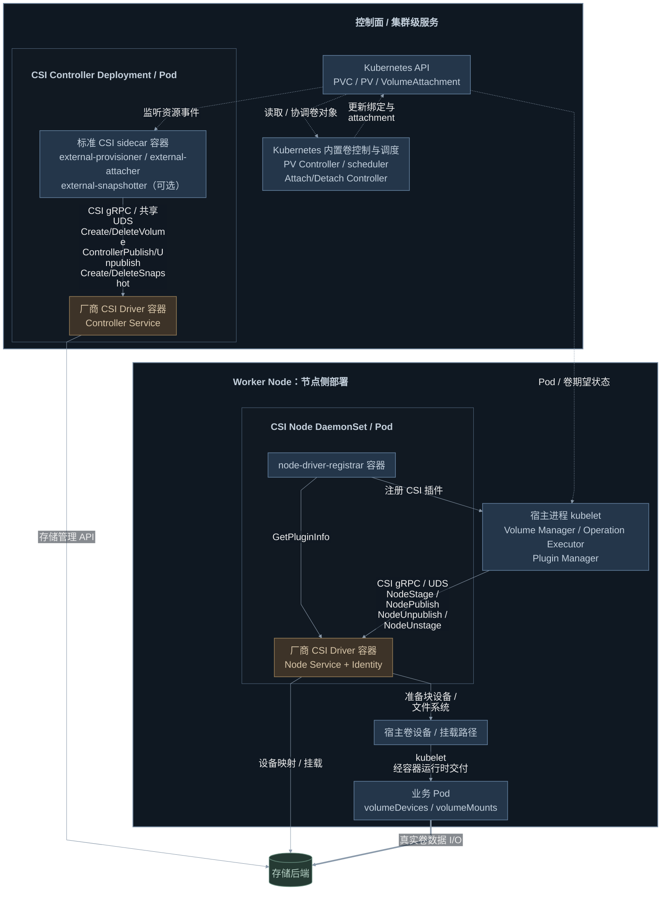

# K8S CSI 架构分析

> 整理日期：2026-10-15。基于当前[精简版设计文档](Kubernetes_CSI与AgentENV_OverlayBD存储方案_精简版.md)中的标准 Kubernetes CSI 架构分析整理；原文档与现有图源保持不变。

## 1. 分析范围与架构边界

本文分析标准 Kubernetes 中 **Pod 通过 PVC 消费 CSI 卷** 的体系，包括实际部署形态、关键组件职责、CSI 调用链及业务数据路径。图示为典型部署模型，不表示已对某个真实集群完成部署验证。

CSI 是容器编排系统与存储驱动之间的标准接口。Kubernetes 管理卷对象、绑定、Pod 调度和节点卷生命周期；官方 sidecar 将对象事件转换为 CSI Controller 调用；存储厂商实现 Identity、Controller 和 Node 服务，并连接实际存储后端。

| 接口 | 核心职责 | 典型调用方 |
|---|---|---|
| Identity | 驱动身份、能力和健康状态 | sidecar、registrar、健康探针等 |
| Controller | 创建/删除卷、节点 attachment、快照等管理操作 | external-provisioner、external-attacher、external-snapshotter 等 |
| Node | 节点身份与拓扑、stage/publish、节点清理等 | kubelet 的 CSI 卷插件，通过节点 CSI socket 调用 |

**CSI 是管理接口，不是业务数据转发通道。** Controller Service 不直接调用 Node Service；两者由 Kubernetes 的控制器与 kubelet 分别驱动。各 RPC 是否适用由 Driver 能力声明决定，例如没有 staging 能力时不会执行 NodeStage/NodeUnstage。

## 2. 关键模块与主调用链

下图突出标准 CSI 的核心链路：**Kubernetes 卷对象 → CSI Controller 供卷与 attachment；kubelet → CSI Node 准备与发布卷 → 业务 Pod**。虚线表示 API 对象协调，实线表示控制调用，粗线表示业务 I/O。

[关键模块简图 Mermaid 源文件](figures/kubernetes-csi-key-modules.mmd)。蓝色为 Kubernetes 内置模块及标准 CSI sidecar，棕色为厂商实现的 CSI Driver，绿色为存储后端。Controller Service 与 Node Service 通过各自的 CSI 调用链协作，二者不直接互调；业务数据也不经 sidecar 或 CSI RPC 转发。

外层大框区分 **控制面 / 集群级服务** 与 **Worker Node 节点侧部署**。kubelet 是宿主进程，CSI Node DaemonSet 的 Pod、卷路径和业务 Pod 均在节点侧；CSI Controller 是集群级 Deployment，可按部署策略运行在具备相应调度条件的节点上，图中归入控制面职责区域不表示必须部署到 Kubernetes 控制平面节点。

为突出主链路，图中合并卷控制与调度模块，省略探针、独立 snapshot-controller 和扩容等辅助模块；这些组件和细节见第 3、4 节。本图描述标准 Pod 消费卷路径。

## 3. 完整部署架构

下面按 **工作负载资源 → Pod → 容器/进程 → 内部模块** 展开，采用 kubeadm 控制面和 Deployment 形式的 CSI Controller 作为示例；这不是对某个已运行集群的部署盘点。蓝色为 Kubernetes/官方 CSI 组件，橙色为厂商 Driver，灰色为应用、宿主路径与存储。

使用一张固定布局部署图，保持 **16px 字体**；控制器模块和 sidecar 分组并排，标题与嵌套框之间预留独立空间。实线为控制关系，虚线为 API 对象读写，粗线为业务 I/O。

[查看矢量图 / 可编辑 SVG 源文件](figures/kubernetes-csi-standard-deployment.svg)。

四个 sidecar 是同 Pod 的独立容器，经共享 CSI socket 调用厂商 Driver，不相互串行调用。snapshot-controller 为独立 Deployment；控制器和 scheduler 经 API Server 读写对象，重复连线合并。Deployment 经 ReplicaSet 管理 Pod；PV/PVC、VolumeAttachment 等是 API 对象，不是 Pod。

节点上，registrar 向 kubelet Plugin Manager 注册服务；Volume Manager 调用标准 CSI Node RPC，卷就绪后 kubelet 通过 CRI 将 mount/device 交给容器运行时。业务 I/O 经过真实文件系统或设备到后端，不经过 CSI gRPC。

图中各层的含义：

| 图中对象 | 实际部署/运行形态 |
|---|---|
| kube-apiserver、kube-controller-manager、kube-scheduler、etcd | 本示例为各自独立的静态 Pod；控制面不是一个包含所有组件的大 Pod |
| PV/PVC 绑定控制器、Attach/Detach Controller | 同一个 kube-controller-manager 容器/进程内部的模块，不单独部署 Pod |
| CSI Controller | 一个 Deployment，经 ReplicaSet 管理 Pod；driver 与多个官方 sidecar 是同 Pod 的不同容器，共享 CSI socket |
| snapshot-controller | 独立 Deployment/Pod；不是 kube-controller-manager 模块，也不是 CSI Controller Pod 中的 snapshotter 容器 |
| CSI Node | 一个 DaemonSet；每个目标节点一个 Pod，包含 driver 和 registrar 等容器 |
| kubelet Volume Manager | 宿主 kubelet 进程内部模块，不是 CSI Node Pod 的容器 |
| 业务应用 | 示例为 Deployment → ReplicaSet → Pod → 容器；也可由 StatefulSet、Job 等管理 |

控制面也可能由发行版以宿主进程或托管服务运行；CSI Controller 有些驱动采用 StatefulSet，图中 Deployment 是本方案选用的典型形式。快照为可选组件，attach/stage 是否执行以驱动能力为准；上方固定布局图未展开扩容/健康监控 sidecar。**CSI 服务提供管理接口，业务 I/O 走实际挂载或设备，不经过 sidecar 或 CSI gRPC 转发。** 依据：[kubeadm 静态 Pod 部署](https://kubernetes.io/docs/reference/setup-tools/kubeadm/implementation-details/)、[CSI 插件部署](https://kubernetes-csi.github.io/docs/deploying.html)、[快照组件划分](https://kubernetes-csi.github.io/docs/external-snapshotter.html)。

**补充：按参考图片重绘的 Mermaid 部署关系图**

以下按新增的[参考图片](mermaid-diagram.png)保留“四个区域”的结构：Kubernetes 内置组件、CSI Controller Deployment、Worker Node、存储后端。内部分出 sidecar 容器、厂商 Driver 服务和 kubelet 模块。低饱和蓝色为标准组件，棕色为厂商服务，绿色为存储后端，灰色虚线框为可选组件。Mermaid 采用柔和的深色填充与灰蓝边线；采用固定三列布局：四层纵向排列，同类模块按行并排，每层标题独占一行，避免被子框覆盖。原 SVG 保持不变。

```mermaid
%%{init: {"theme": "base", "themeVariables": {"fontSize": "14px", "darkMode": true, "background": "transparent", "textColor": "#c4d0dc", "titleColor": "#c4d0dc", "clusterBkg": "#172330", "clusterBorder": "#60758a", "lineColor": "#8999aa", "defaultLinkColor": "#8999aa", "edgeLabelBackground": "#111922"}, "themeCSS": ".cluster-label text{fill:#c4d0dc!important}.edgeLabel text{fill:#b9c6d4!important}.edgeLabel rect{fill:#111922!important;opacity:1!important}marker path{fill:#8999aa!important;stroke:#8999aa!important}", "markdownAutoWrap": false, "block": {"padding": 14}}}%%
block-beta
    columns 3
    BuiltinTitle["① Kubernetes 内置组件"]:3
    Scheduler["kube-scheduler<br/>静态 Pod / 进程<br/>VolumeBinding Plugin"]
    KCM["kube-controller-manager<br/>静态 Pod / 同一进程<br/>包含下列两类控制器"]
    APIServer["kube-apiserver<br/>静态 Pod / 进程<br/>API 对象读写"]
    PVController["PersistentVolume Controller<br/>PV/PVC 绑定与回收"]
    ADController["Attach/Detach Controller<br/>卷与节点的 attachment 协调"]
    KCMNote["上述两个 Controller<br/>均在 kube-controller-manager 内<br/>不是独立 Pod"]
    StorageAPI["存储 API 对象（非 Pod）：SC / PVC / PV / Pod<br/>CSIDriver / CSINode / VolumeAttachment<br/>VolumeSnapshot / Content / Class"]:3
    ControlTierTitle["② CSI 控制服务（集群级）"]:3
    ControllerPodTitle["Deployment：csi-controller → ReplicaSet → Pod<br/>下列 sidecar 与厂商 Driver<br/>是同一 Pod 内的独立容器"]:3
    Provisioner["external-provisioner<br/>Create / DeleteVolume"]
    Attacher["external-attacher<br/>ControllerPublish / Unpublish"]
    Snapshotter["external-snapshotter（可选）<br/>Create / DeleteSnapshot"]
    Resizer["external-resizer（可选）<br/>ControllerExpandVolume"]
    Liveness["livenessprobe 容器<br/>Identity Probe"]
    ControllerDriver["厂商 Driver 容器 / 进程<br/>Identity Service<br/>Controller Service"]
    CSISocket["上述容器通过 Pod 内共享 CSI Unix socket 通信"]:3
    SnapshotController["独立 Deployment：snapshot-controller（可选）<br/>独立 Pod / 容器；协调 VolumeSnapshot 与 Content<br/>经 API 对象与 snapshotter 协作"]:3
    WorkerTitle["③ Worker Node（每个适用节点）"]:3
    KubeletTitle["宿主进程：kubelet（不是 Pod）<br/>下列均为 kubelet 内置模块<br/>卷操作在 Volume Manager 内协调执行"]:3
    PluginManager["Plugin Manager<br/>CSI endpoint 注册 / 发现"]
    VolumeState["Volume Manager<br/>卷期望 / 实际状态协调"]
    Executor["Operation Executor<br/>NodeStage / Publish<br/>及逆向清理"]
    NodePodTitle["DaemonSet：csi-node → 本节点 Pod<br/>下列 registrar 与厂商 Driver<br/>是该 Pod 中的独立容器"]:3
    Registrar["node-driver-registrar 容器<br/>插件注册<br/>GetPluginInfo"]
    NodeDriver["厂商 Driver 容器 / 同一进程<br/>Identity Service + Node Service<br/>CSI UDS：NodeStage / Publish 等 RPC"]:2
    Target["宿主 staging / publish 目标<br/>真实文件系统或块设备"]
    App["业务 Pod / 容器<br/>kubelet 经容器运行时交付<br/>volumeMounts / volumeDevices"]:2
    StorageTitle["④ 存储后端"]:3
    Backend["Ceph / 云盘 / NAS / LVM / 自研存储<br/>Controller 管理卷；Node 映射设备<br/>业务 I/O 经真实卷访问后端"]:3
    
    style Scheduler fill:#24364a,stroke:#617d9b,stroke-width:1.4px,color:#c3d0dd
    style KCM fill:#24364a,stroke:#617d9b,stroke-width:1.4px,color:#c3d0dd
    style APIServer fill:#24364a,stroke:#617d9b,stroke-width:1.4px,color:#c3d0dd
    style PVController fill:#24364a,stroke:#617d9b,stroke-width:1.4px,color:#c3d0dd
    style ADController fill:#24364a,stroke:#617d9b,stroke-width:1.4px,color:#c3d0dd
    style StorageAPI fill:#24364a,stroke:#617d9b,stroke-width:1.4px,color:#c3d0dd
    style Provisioner fill:#24364a,stroke:#617d9b,stroke-width:1.4px,color:#c3d0dd
    style Attacher fill:#24364a,stroke:#617d9b,stroke-width:1.4px,color:#c3d0dd
    style Snapshotter fill:#24364a,stroke:#617d9b,stroke-width:1.4px,color:#c3d0dd
    style Liveness fill:#24364a,stroke:#617d9b,stroke-width:1.4px,color:#c3d0dd
    style PluginManager fill:#24364a,stroke:#617d9b,stroke-width:1.4px,color:#c3d0dd
    style VolumeState fill:#24364a,stroke:#617d9b,stroke-width:1.4px,color:#c3d0dd
    style Executor fill:#24364a,stroke:#617d9b,stroke-width:1.4px,color:#c3d0dd
    style Registrar fill:#24364a,stroke:#617d9b,stroke-width:1.4px,color:#c3d0dd
    style Target fill:#24364a,stroke:#617d9b,stroke-width:1.4px,color:#c3d0dd
    style App fill:#24364a,stroke:#617d9b,stroke-width:1.4px,color:#c3d0dd
    style ControllerDriver fill:#3d3328,stroke:#937b56,stroke-width:1.4px,color:#d8c6a9
    style NodeDriver fill:#3d3328,stroke:#937b56,stroke-width:1.4px,color:#d8c6a9
    style Resizer fill:#2a3039,stroke:#707c8d,stroke-width:1.3px,stroke-dasharray:5 3,color:#b4bdc9
    style SnapshotController fill:#2a3039,stroke:#707c8d,stroke-width:1.3px,stroke-dasharray:5 3,color:#b4bdc9
    style Backend fill:#253a33,stroke:#668b7d,stroke-width:1.4px,color:#b4cfc3
    style BuiltinTitle fill:#172330,stroke:#50657b,stroke-width:1.2px,color:#c4d0dc,font-size:12px,font-weight:600
    style ControlTierTitle fill:#172330,stroke:#50657b,stroke-width:1.2px,color:#c4d0dc,font-size:12px,font-weight:600
    style WorkerTitle fill:#172330,stroke:#50657b,stroke-width:1.2px,color:#c4d0dc,font-size:12px,font-weight:600
    style StorageTitle fill:#172330,stroke:#50657b,stroke-width:1.2px,color:#c4d0dc,font-size:12px,font-weight:600
    style ControllerPodTitle fill:#172330,stroke:#50657b,stroke-width:1px,color:#b9c6d4
    style CSISocket fill:#172330,stroke:#50657b,stroke-width:1px,color:#b9c6d4
    style KubeletTitle fill:#172330,stroke:#50657b,stroke-width:1px,color:#b9c6d4
    style NodePodTitle fill:#172330,stroke:#50657b,stroke-width:1px,color:#b9c6d4
    style KCMNote fill:#172330,stroke:#50657b,stroke-width:1px,color:#b9c6d4
```

图中按部署归属分行排列，跨层长连线合并为以下调用关系，图内以说明行标明通信与交付职责，避免连线穿框：

| 调用方 | 目标与职责 |
|---|---|
| Kubernetes 控制器 / scheduler | 经 API Server 维护绑定、VolumeAttachment、Pod 节点等对象 |
| Controller sidecar | watch 对应 API 对象，经共享 UDS 调用 CSI Controller；具体 RPC 标在容器框内 |
| registrar | GetPluginInfo → Node Identity；注册 endpoint → kubelet Plugin Manager |
| kubelet Operation Executor | 经 CSI Node UDS 调用 NodeStage/Publish 及逆向清理，准备真实 target |
| CSI Controller / Node | 分别执行后端卷管理、设备映射或文件系统操作；业务 I/O 经真实卷访问后端 |

[Mermaid 源文件](figures/kubernetes-csi-reference-deployment.mmd)。此图展示标准 Pod CSI 体系，用于分析标准 Pod 消费卷的部署边界。参考图片中的 external-resizer 保留并标为可选，扩容是否可用取决于 Driver 的能力声明和部署配置；另补充独立部署的 snapshot-controller，避免将其与 sidecar snapshotter 混同。sidecar 与 Driver 共用 Pod 内 CSI Unix socket；registrar 的插件注册 socket 与 CSI 服务 socket 分别承担注册和 RPC 职责。

## 4. 完整模块调用关系

下图参考[mermaid-diagram.png](mermaid-diagram.png)展示模块之间的调用和协调关系：**虚线表示 API 对象/事件协调，实线表示控制调用，粗线表示业务数据 I/O**。CSI gRPC 线标明具体 RPC；同 Pod sidecar 经共享 UDS 调用 Driver，不互相串行调用。

```mermaid
%%{init: {"theme": "base", "themeVariables": {"fontSize": "34px", "darkMode": true, "background": "transparent", "textColor": "#c4d0dc", "titleColor": "#c4d0dc", "clusterBkg": "#172330", "clusterBorder": "#60758a", "lineColor": "#8999aa", "defaultLinkColor": "#8999aa", "edgeLabelBackground": "#111922"}, "themeCSS": ".cluster-label text{fill:#c4d0dc!important}.edgeLabel text{fill:#b9c6d4!important}.edgeLabel rect{fill:#111922!important;opacity:1!important}marker path{fill:#8999aa!important;stroke:#8999aa!important}", "markdownAutoWrap": false, "flowchart": {"htmlLabels": false, "wrappingWidth": 520, "padding": 8, "nodeSpacing": 10, "rankSpacing": 22, "subGraphTitleMargin": {"top": 0, "bottom": 0}, "useMaxWidth": true, "diagramPadding": 6, "curve": "linear"}}}%%
flowchart TB
    subgraph Builtin[" "]
        BuiltinTitle["① Kubernetes 内置组件"]
        Scheduler["kube-scheduler 进程<br/>VolumeBinding Plugin"]
        subgraph KCM[" "]
            KCMTitle["kube-controller-manager<br/>进程 / 容器"]
            PVController["PersistentVolume Controller<br/>PV/PVC 绑定与回收协调"]
            ADController["Attach/Detach Controller<br/>卷与节点的 attach/detach 协调"]
            KCMTitle ~~~ PVController
            KCMTitle ~~~ ADController
        end
        APIServer["kube-apiserver"]
        StorageAPI["存储 API 对象（不是 Pod）<br/>StorageClass / PVC / PV / Pod<br/>CSIDriver / CSINode<br/>VolumeAttachment<br/>VolumeSnapshot / Content / Class"]
        Scheduler -.->|"卷绑定 / 拓扑选点<br/>读写 API"| APIServer
        PVController -.-> StorageAPI
        ADController -.->|"维护 VolumeAttachment"| StorageAPI
        APIServer --- StorageAPI
        BuiltinTitle ~~~ Scheduler
        KCMTitle ~~~ APIServer
    end

    subgraph ControllerDeploy[" "]
        ControllerDeployTitle["② CSI Controller<br/>Deployment"]
        subgraph ControllerPod[" "]
            ControllerPodTitle["Pod：csi-controller-xxx"]
            subgraph Sidecars[" "]
                SidecarsTitle["独立 Sidecar 容器"]
                Snapshotter["external-snapshotter<br/>快照，可选"]
                Provisioner["external-provisioner<br/>供卷 / 删除卷"]
                Attacher["external-attacher<br/>Controller attach/detach"]
                Resizer["external-resizer<br/>扩容，可选"]
                Liveness["livenessprobe<br/>健康检查"]
                SidecarsTitle ~~~ Snapshotter
                SidecarsTitle ~~~ Provisioner
                SidecarsTitle ~~~ Attacher
                SidecarsTitle ~~~ Resizer
                SidecarsTitle ~~~ Liveness
            end
            subgraph ControllerDriver[" "]
                ControllerDriverTitle["厂商 Driver 容器"]
                CIdentity["Identity Service"]
                Controller["Controller Service"]
                ControllerDriverTitle ~~~ CIdentity
                ControllerDriverTitle ~~~ Controller
            end
        end
    end
    StorageAPI -.->|"PVC / PV 事件"| Provisioner
    StorageAPI -.->|"VolumeAttachment 事件"| Attacher
    StorageAPI -.->|"扩容事件"| Resizer
    StorageAPI -.->|"VolumeSnapshotContent<br/>事件"| Snapshotter
    Liveness -->|"CSI gRPC: Probe"| CIdentity
    Snapshotter -->|"Create / Delete<br/>Snapshot"| Controller
    Provisioner -->|"Create / Delete<br/>Volume"| Controller
    Attacher -->|"ControllerPublish<br/>ControllerUnpublish"| Controller
    Resizer -->|"ControllerExpand<br/>Volume"| Controller

    subgraph SnapshotDeploy[" "]
        SnapshotDeployTitle["可选快照 Deployment"]
        SnapshotController["独立 Pod / 容器<br/>协调 VolumeSnapshot 与 Content"]
        SnapshotDeployTitle ~~~ SnapshotController
    end
    SnapshotController -.->|"读写快照 API 对象"| StorageAPI

    subgraph Worker[" "]
        WorkerTitle["③ Worker Node"]
        subgraph Kubelet[" "]
            KubeletTitle["宿主进程：kubelet"]
            PluginManager["Plugin Manager<br/>CSI 插件注册"]
            subgraph VolumeManager[" "]
                VolumeManagerTitle["内置 Volume Manager<br/>模块"]
                VolumeState["卷期望 / 实际状态协调"]
                Executor["Operation Executor<br/>执行节点卷操作"]
                VolumeState --> Executor
                VolumeManagerTitle ~~~ VolumeState
                VolumeManagerTitle ~~~ Executor
            end
            KubeletTitle ~~~ PluginManager
        end
        subgraph NodeDS[" "]
            NodeDSTitle["DaemonSet：CSI Node"]
            subgraph NodePod[" "]
                NodePodTitle["本节点 Pod：csi-node-xxx"]
                Registrar["node-driver-registrar 容器<br/>通用 sidecar"]
                subgraph NodeDriver[" "]
                    NodeDriverTitle["厂商 Driver 容器"]
                    NodeService["Node Service<br/>Stage / Publish / 逆向清理"]
                    NIdentity["Identity Service"]
                    NodeDriverTitle ~~~ NodeService
                    NodeDriverTitle ~~~ NIdentity
                end
                NodePodTitle ~~~ Registrar
            end
        end
        Target["宿主 staging / publish 目标<br/>真实文件系统或块设备"]
        App["业务 Pod / 容器<br/>volumeMounts 或 volumeDevices"]
        Executor -->|"CSI gRPC / 服务 UDS"| NodeService
        Registrar -->|"注册 socket / endpoint"| PluginManager
        Registrar -->|"CSI gRPC: GetPluginInfo"| NIdentity
        NodeService -->|"准备并发布真实卷"| Target
        Target -->|"kubelet 经容器运行时交付"| App
        WorkerTitle ~~~ Target
        WorkerTitle ~~~ App
    end
    StorageAPI -.->|"Pod / 卷期望状态"| VolumeState
    NodeService -->|"设备映射 / 文件系统操作"| Backend
    Controller -->|"存储管理 API"| Backend
    App ==>|"经真实卷访问；不经过 CSI gRPC 转发"| Backend
    subgraph Storage[" "]
        StorageTitle["④ 存储后端"]
        Backend[("Ceph / 云盘 / NAS / LVM<br/>或自研存储")]
        StorageTitle ~~~ Backend
    end

    classDef standard fill:#24364a,stroke:#617d9b,stroke-width:1.4px,color:#c3d0dd;
    classDef driver fill:#3d3328,stroke:#937b56,stroke-width:1.4px,color:#d8c6a9;
    classDef optional fill:#2a3039,stroke:#707c8d,stroke-width:1.3px,stroke-dasharray:5 3,color:#b4bdc9;
    classDef backend fill:#253a33,stroke:#668b7d,stroke-width:1.4px,color:#b4cfc3;
    class Scheduler,PVController,ADController,APIServer,StorageAPI,Snapshotter,Provisioner,Attacher,Liveness,PluginManager,VolumeState,Executor,Registrar,Target,App standard;
    class CIdentity,Controller,NodeService,NIdentity driver;
    class Resizer,SnapshotController optional;
    class Backend backend;

    %% 显式设置各层边框与底色，避免继承阅读器的黑色细线。
    style Builtin fill:#111922,stroke:#52677e,stroke-width:1.5px,color:#c4d0dc
    style ControllerDeploy fill:#111922,stroke:#52677e,stroke-width:1.5px,color:#c4d0dc
    style Worker fill:#111922,stroke:#52677e,stroke-width:1.5px,color:#c4d0dc
    style Storage fill:#111922,stroke:#52677e,stroke-width:1.5px,color:#c4d0dc
    style SnapshotDeploy fill:#111922,stroke:#52677e,stroke-width:1.5px,color:#c4d0dc
    style KCM fill:#172330,stroke:#50657b,stroke-width:1.3px,color:#c4d0dc
    style ControllerPod fill:#172330,stroke:#50657b,stroke-width:1.3px,color:#c4d0dc
    style Kubelet fill:#172330,stroke:#50657b,stroke-width:1.3px,color:#c4d0dc
    style NodeDS fill:#172330,stroke:#50657b,stroke-width:1.3px,color:#c4d0dc
    style NodePod fill:#172330,stroke:#50657b,stroke-width:1.3px,color:#c4d0dc
    style Sidecars fill:#1d2b3a,stroke:#60758a,stroke-width:1.2px,color:#c4d0dc
    style ControllerDriver fill:#1d2b3a,stroke:#60758a,stroke-width:1.2px,color:#c4d0dc
    style VolumeManager fill:#1d2b3a,stroke:#60758a,stroke-width:1.2px,color:#c4d0dc
    style NodeDriver fill:#1d2b3a,stroke:#60758a,stroke-width:1.2px,color:#c4d0dc

    %% 标题作为组内独立布局节点，避免嵌套 cluster 标题被子框覆盖。
    classDef groupTitle fill:transparent,stroke-width:0px,color:#c4d0dc,font-size:32px,font-weight:600;
    class BuiltinTitle,KCMTitle,ControllerDeployTitle,ControllerPodTitle,SidecarsTitle,ControllerDriverTitle,SnapshotDeployTitle,WorkerTitle,KubeletTitle,VolumeManagerTitle,NodeDSTitle,NodePodTitle,NodeDriverTitle,StorageTitle groupTitle;

    %% 仅约束布局的不可见边，不改变模块调用关系。
    Snapshotter ~~~ Provisioner
    Attacher ~~~ Resizer
    CIdentity ~~~ Controller
    NIdentity ~~~ NodeService

    %% 每个标题仅连接首个子模块，避免多条占位边撑宽分组。
    BuiltinTitle ~~~ Scheduler
    KCMTitle ~~~ PVController
    ControllerDeployTitle ~~~ ControllerPodTitle
    ControllerPodTitle ~~~ SidecarsTitle
    SidecarsTitle ~~~ Snapshotter
    ControllerDriverTitle ~~~ CIdentity
    SnapshotDeployTitle ~~~ SnapshotController
    WorkerTitle ~~~ KubeletTitle
    KubeletTitle ~~~ VolumeManagerTitle
    VolumeManagerTitle ~~~ VolumeState
    NodeDSTitle ~~~ NodePodTitle
    NodePodTitle ~~~ Registrar
    NodeDriverTitle ~~~ NIdentity
    StorageTitle ~~~ Backend
    Scheduler ~~~ APIServer
    APIServer ~~~ KCMTitle
    Controller ~~~ WorkerTitle
    StorageAPI ~~~ ControllerDeployTitle
    StorageAPI ~~~ WorkerTitle
    Controller ~~~ StorageTitle
    App ~~~ StorageTitle
```

[调用关系图 Mermaid 源文件](figures/kubernetes-csi-module-calls.mmd)。ControllerPublish 的节点 attachment 与 NodeStage/Publish 的节点卷准备是两条协调链路，CSI Controller 不直接调用 CSI Node。registrar 通过注册 socket 对接 kubelet Plugin Manager，并通过 CSI 服务 socket 查询 Node Identity；Volume Manager 的 Operation Executor 调用 Node Service。业务卷由 kubelet/容器运行时交付 Pod，业务 I/O 不经 CSI gRPC 转发。

snapshot-controller、snapshotter、resizer 展示标准 CSI 的可选能力；是否启用取决于 Driver 能力与部署配置。本图描述标准 **Pod 消费卷** 路径。

## 5. 核心组件职责

| 组件 | 所属进程或部署资源 | 在卷生命周期中的职责 |
|---|---|---|
| kube-apiserver | 控制面进程；kubeadm 场景为静态 Pod | 提供 PV/PVC、Pod、VolumeAttachment 等 API 的读写和 watch |
| PersistentVolume Controller | kube-controller-manager 内部控制器 | 协调 PV/PVC 绑定、回收等；不是独立 Pod |
| Kubernetes scheduler / VolumeBinding 插件 | kube-scheduler 内部插件 | 综合 Pod 与卷拓扑进行节点选择，协同延迟绑定 |
| Attach/Detach Controller | kube-controller-manager 内部控制器 | 根据 Pod 卷需求协调 attachment；CSI 路径使用 VolumeAttachment 对象 |
| external-provisioner | CSI Controller Pod 的 sidecar 容器 | 将动态供卷及删除请求转换为 CreateVolume / DeleteVolume |
| external-attacher | CSI Controller Pod 的 sidecar 容器 | watch VolumeAttachment，调用 ControllerPublish / ControllerUnpublish |
| snapshot-controller | 独立 Deployment / Pod | 协调 VolumeSnapshot 与 VolumeSnapshotContent |
| external-snapshotter | CSI Controller Pod 的 sidecar 容器 | 根据快照内容对象调用 CSI 快照 RPC，并回写结果 |
| external-resizer | 可选 sidecar | 协调支持扩容的 Driver；文件系统扩容还可能需要节点操作 |
| livenessprobe | 辅助容器 | 调用 CSI Probe，为部署提供健康检查 |
| kubelet Volume Manager | kubelet 进程内部模块 | 协调卷期望与实际状态，经 Operation Executor 执行卷操作；不是独立 Pod |
| kubelet Plugin Manager | kubelet 进程内部模块 | 处理节点插件注册 |
| node-driver-registrar | CSI Node Pod 的 sidecar 容器 | 查询驱动身份，向 kubelet 注册节点 CSI endpoint |
| 厂商 CSI Driver | Controller / Node Pod 中的驱动容器 | 实现 CSI 服务并管理实际后端卷、设备与挂载 |

## 6. 从 PVC 到 Pod 的生命周期

1. **声明卷**：用户创建 PVC，指定容量、访问模式和 StorageClass。已有 PV 可静态绑定；动态供卷由 external-provisioner 调用 CreateVolume 创建后端卷并生成 PV。
2. **绑定与选点**：PV Controller 协调 PV/PVC 绑定。Immediate 通常在 Pod 调度前供卷；WaitForFirstConsumer 将供卷/绑定与首个 Pod 的节点选择协调，避免卷拓扑与节点不匹配。
3. **节点 attachment**：对于需要 attach 的 Driver，Attach/Detach Controller 协调 VolumeAttachment，external-attacher 调用 ControllerPublishVolume。无需 attach 的 Driver 可跳过此链路。
4. **节点准备与发布**：kubelet 调用 NodeStageVolume（若支持）准备节点级卷，再调用 NodePublishVolume 为目标 Pod 发布。文件系统卷交付挂载路径，Block 卷交付设备。
5. **容器使用**：kubelet 经容器运行时将卷交付容器，应用通过 volumeMounts 或 volumeDevices 使用。数据经实际文件系统/设备访问存储后端。
6. **卸载与回收**：Pod 退出后执行 NodeUnpublish；节点不再使用该卷时执行 NodeUnstage（若支持），再按控制器协调解除 attachment。PVC/PV 的删除、保留和后端回收由回收策略及保护机制决定。

## 7. 关键边界与常见混淆

- **控制面职责不等于控制平面节点部署**：CSI Controller 是集群级工作负载，可按调度策略运行在普通 Worker 节点上。
- **PV/PVC、VolumeAttachment 是 API 对象**，不是 Pod；StorageClass 描述供卷策略，也不是存储服务进程。
- **sidecar 与 Driver 是并列容器**：同 Pod 通过共享 CSI Unix socket 通信；sidecar 彼此不组成串行调用链。
- **snapshot-controller 与 external-snapshotter 不同**：前者协调 Kubernetes 快照资源，后者调用 Driver 的 CSI 快照接口。
- **注册 socket 与服务 socket 不同**：registrar 与 kubelet 的注册通道负责发现插件，CSI 服务 socket 承载实际 RPC。
- **Bound、attached、published 不同**：PVC Bound 只说明绑定完成，不表示节点已准备好卷，更不表示应用已成功访问。
- **Controller attach 与 Node publish 不同**：前者建立后端卷与节点的可访问关系，后者在节点上为消费者准备交付目标。
- **标准路径依赖 Pod 消费者**：scheduler、Attach/Detach Controller 和 kubelet 的协调围绕 Pod 展开。VM 直接消费卷时，需由额外框架承担相应消费者侧职责，具体方案见[精简版 §2.2](Kubernetes_CSI与AgentENV_OverlayBD存储方案_精简版.md#22-当前目标设计vm-直接消费卷)。
